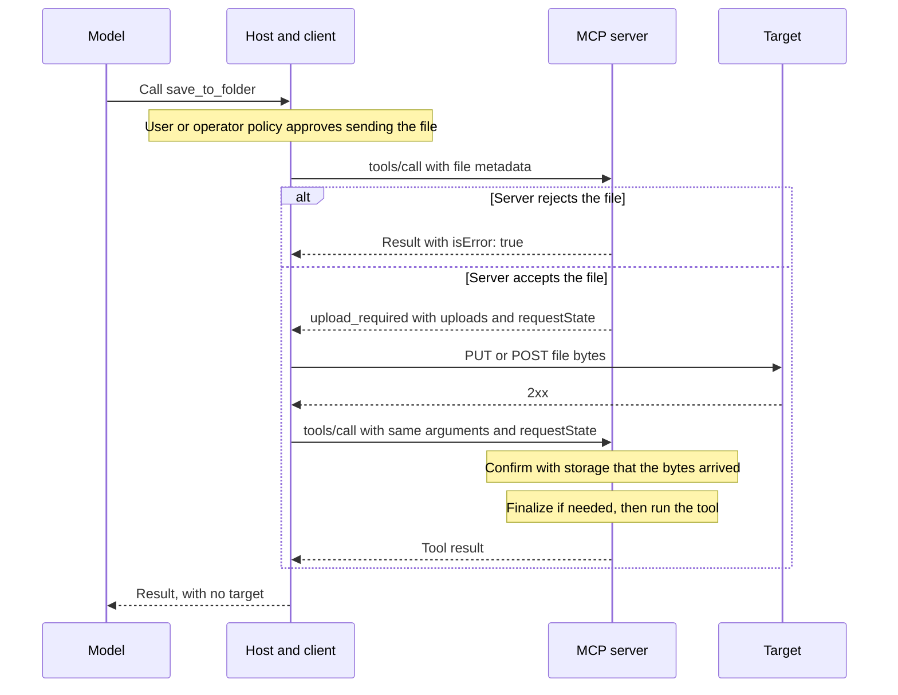
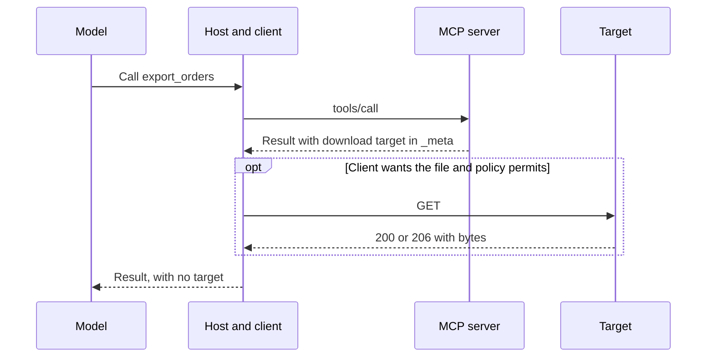

Model Context Protocol（MCP）最初是一种连接模型与工具的简单方式，这一理念至今仍是它的核心。过去两年里，人们用该协议构建的项目变得越来越复杂，复杂得多。许多 MCP 服务器项目现在都需要处理文件，这通常是由代理能力和自主性的不断提升所推动的。


将对话中的 PDF 保存到云存储，或把 CSV 文件导入沙箱，已经成为 MCP 开发者经常提出的需求。如今要实现这些场景，需要设计一套套专用的工具约定和传输机制；我们不希望每个人都反复从头解决同样的问题。

由于客户讨论中不断出现这类需求，我们成立了 [File Uploads 工作组](https://modelcontextprotocol.io/community/working-groups/file-uploads)。过去一个月里，我们一直在研究解决方案可能是什么样子。

在社区和开发者的共同努力下，我们现在有了一份初步的扩展定义。随着我们开始制作原型并在实际环境中试用，欢迎你来探索和检验它。



<a id="where-the-work-stands" />
## 当前进展

这项扩展仍处于实验阶段。虽然我们已经勾勒出大致方案，但还不能确定最终成果是否会与当前设想一致。要弄清楚这一点，最好的办法就是让它接受实际应用的检验。

你可能也注意到目前还没有参考实现。这是因为我们预计，等开始将这项实验与第三方文件服务集成时，许多内部实现方式可能会发生很大变化。这些服务包括云存储、数据库导入/导出，以及其他需要文件输入和输出的服务。

与其他扩展一样，这项扩展仍为可选功能。如果客户端或服务器不打算支持它，就无需做任何改动（不过考虑到大家对此项工作的广泛兴趣，我们确实希望你们能支持它）。

我们预计在今年年底前完成扩展，并使其达到稳定状态。

<a id="how-it-works" />
## 工作方式

最初讨论这项扩展时，以下几个关键场景为我们指明了方向：

- 你在对话中有一个大文件，想将它保存到云存储。
- 你想把一个较大的 CSV 文件导入代码沙箱，让代理分析数据或围绕数据编写 Python 代码。
- 你想把大型演示文稿，或包含所有资源文件的 ZIP 格式 HTML 演示文稿上传到第三方远程服务器。

在这些场景中，代理需要了解文件的许多信息，但模型不必读取文件的每个字节，甚至不必直接处理文件。文件应直接传到目标位置。由此便形成了下面介绍的设计。

该扩展使用标识符 `io.modelcontextprotocol/files`，适用于 `2026-07-28` 及之后的协议版本。服务器可以在 `server/discover` 响应中声明支持该扩展：支持带外文件传输时设置 `upload`，支持内联传输时设置 `maxInlineBytes`。客户端则在每个可能需要此扩展的请求（包括 `tools/list`）的 `io.modelcontextprotocol/clientCapabilities` 元数据中声明支持情况：能够带外上传时设置 `upload`，接受下载目标时设置 `download`。

下面以一个简单的上传流程为例。假设服务器提供了 `save_to_folder` 工具，用户想用它保存 PDF 文件。

<a id="marking-a-file-argument" />
### 标记文件参数

服务器在工具的输入架构中使用 `x-mcp-file` 标记参数。这与 [`x-mcp-header`](https://modelcontextprotocol.io/specification/2026-07-28/server/tools#x-mcp-header)采用相同模式，用于告知客户端此参数是文件，由客户端填写，这样模型就不必处理文件本身：

```json
{
  "type": "object",
  "properties": {
    "folderId": { "type": "string" },
    "file": {
      "type": "object",
      "x-mcp-file": { "accept": ["application/pdf"], "maxSize": 157286400 },
      "properties": {
        "id": { "type": "string", "minLength": 1, "maxLength": 128 },
        "name": { "type": "string" },
        "mimeType": { "type": "string" },
        "size": { "type": "integer", "minimum": 0 },
        "data": { "type": "string" }
      },
      "required": ["id", "mimeType", "size"]
    }
  },
  "required": ["folderId", "file"]
}
```

只要请求中所有内联文件的总大小不超过服务器公布的 `maxInlineBytes`，较小的文件就可以通过 `data` 以内联 Base64 形式传输。对于更大的文件，如果服务器公布了 `upload`，客户端就会省略 `data`，并按下面的步骤执行上传。`maxSize` 限制单个文件的大小，不受传输方式影响。完整的 `FileInput` 结构还包含可选的 SHA-256 `digest` 字段，工具可以在其架构中要求提供此字段。

不支持此扩展的客户端会忽略 `x-mcp-file`，并将参数视为普通对象。如果客户端没有在 `tools/list` 请求中声明支持此扩展，服务器就应隐藏该工具或提供替代方案。例如，替代方案可以接受指向已上传文件的 URL。

<a id="asking-before-sending" />
### 发送前征求许可

发送文件前，主机需要征得用户同意。如果当前没有用户参与，则由代理策略决定是否允许传输。随后，客户端调用工具时只提供**文件元数据**，而不发送文件内容。


为了让请求示例更易阅读，我们省略了 `_meta`。实际请求中，客户端会在此字段声明对扩展的支持。


```json
{
  "jsonrpc": "2.0",
  "id": 1,
  "method": "tools/call",
  "params": {
    "name": "save_to_folder",
    "arguments": {
      "folderId": "fld_8c1a",
      "file": {
        "id": "file-1",
        "name": "Q3 report.pdf",
        "mimeType": "application/pdf",
        "size": 41204133
      }
    }
  }
}
```

先发送元数据，服务器便可在开始上传前检查权限和存储配额。如果其中任一检查失败，服务器会返回常规工具错误。这样就不必先上传 40 MB 数据，之后才发现目标文件夹为只读。

如果检查通过，服务器会要求客户端先上传文件，再运行工具。服务器通过此扩展新增的 `upload_required` 结果类型提出要求。响应会告知客户端文件的上传位置和方式，并附带一个 `requestState` 值，供客户端稍后重试工具调用时原样发回：

```json
{
  "jsonrpc": "2.0",
  "id": 1,
  "result": {
    "resultType": "upload_required",
    "uploads": [
      {
        "fileId": "file-1",
        "url": "https://upload.example.com/u/01JD3V7K2M?sig=...",
        "headers": { "Content-Type": "application/pdf" },
        "credentials": "omit",
        "expiresAt": "2026-11-04T18:30:00Z"
      }
    ],
    "requestState": "..."
  }
}
```

在此示例中，`requestState` 表示尚未完成的任务：将 PDF 保存到特定文件夹。服务器会把继续执行所需的详细信息打包成一个值，保护其免遭篡改，并与上传说明一并发送。文件上传后，客户端会将该值原样发回，无需理解其内容。

下一次工具调用会携带自身上下文，而不依赖与服务器之间的会话。这项设计有意遵循 MCP [无状态核心](https://modelcontextprotocol.io/specification/2026-07-28/basic#statelessness)。只要其他服务器实例能够验证此值并访问已上传的文件，它也可以继续处理该任务。

在某些场景下，工具需要防止重复运行，例如再次运行会创建不需要的重复文件。对于这类工具，服务器会在执行任务前将 `requestState` 标记为已使用。所有服务器实例共享此记录，因此再次使用相同值的请求会被拒绝。

<a id="completing-the-job" />
### 完成任务

客户端使用 HTTPS `PUT` 请求将 PDF 上传到指定 URL。对于有此需求的存储服务，上传目标也可以指定 `POST`，并使用 `multipart/form-data` 请求体。此时，文件内容会绕过 JSON-RPC，直接传送到上传目标。

上传成功并收到 HTTP `2xx` 响应后，客户端会再次调用 `save_to_folder` 工具。它会发送相同的参数，并按照新推出的[多轮往返请求](https://modelcontextprotocol.io/specification/2026-07-28/basic/patterns/mrtr)模式原样返回 `requestState`：

```json
{
  "jsonrpc": "2.0",
  "id": 2,
  "method": "tools/call",
  "params": {
    "name": "save_to_folder",
    "arguments": {
      "folderId": "fld_8c1a",
      "file": {
        "id": "file-1",
        "name": "Q3 report.pdf",
        "mimeType": "application/pdf",
        "size": 41204133
      }
    },
    "requestState": "..."
  }
}
```

不过，服务器仍需检查上传结果。它会验证 `requestState` 并确认重试请求与原始调用一致，然后向存储服务确认文件已送达，并验证文件大小和类型。

只有这些检查全部通过后，服务器才会运行 `save_to_folder` 并返回结果。如果上传失败，客户端不会发送重试请求，工具也不会运行。

客户端会协调整个流程，不再让模型参与。模型发起工具调用并收到结果，而文件字节和上传 URL 都不会进入模型上下文。

如果您对端到端流程感到好奇，它看起来像这样：



<a id="downloading-a-file" />
### 下载文件

我们也在探索相反的流程：工具生成文件，客户端负责下载。与上传一样，文件内容会绕过 JSON-RPC 传输。

主要区别在于，工具可以在完成结果中返回下载详情，因此传输完成后客户端无需重试工具调用。


细心的读者可能会注意到，上传目标通过 `upload_required` 结果返回，而下载目标则出现在 `_meta` 中。

MCP 的 [`_meta` 字段](https://modelcontextprotocol.io/specification/2026-07-28/basic#_meta)允许客户端和服务器在交互中附加其他元数据，包括特定扩展的详细信息。

在这里，下载说明随已完成的工具结果一同返回，而不是放在常规的 `content` 中。上传则需要不同的信号：`upload_required` 告知客户端先上传并重试，然后工具才能运行。此扩展会让这两类目标都不进入模型上下文。


草案使用结果中的 `_meta` 定义了下载响应格式。在下面的 CSV 示例中，工具会返回下载 URL 和文件详情，客户端便可通过 HTTPS `GET` 请求获取文件：

```json
{
  "jsonrpc": "2.0",
  "id": 3,
  "result": {
    "resultType": "complete",
    "content": [{ "type": "text", "text": "Exported q3-orders.csv." }],
    "_meta": {
      "io.modelcontextprotocol/files": {
        "downloads": [
          {
            "name": "q3-orders.csv",
            "mimeType": "text/csv",
            "size": 209715200,
            "url": "https://download.example.com/d/01JD3V9P4Q?sig=...",
            "credentials": "omit",
            "expiresAt": "2026-11-04T18:30:00Z"
          }
        ]
      }
    }
  }
}
```

如何在工具结果中表示下载详情仍是一个[尚待解决的设计问题](https://github.com/modelcontextprotocol/experimental-ext-file-uploads/blob/main/specification/draft/file-uploads.md#open-questions)。目前我们采用 `_meta`，非常期待你反馈这种方式在实际使用中的效果。

客户端会在工具调用中声明支持 `download`，以告知服务器它能够处理下载目标。只有此时，服务器才能在响应中包含下载目标。结果中的 `content` 仍会告知模型生成了什么，例如“已导出 q3-orders.csv.”，而客户端会处理下载目标，不让模型看到它。

下载后，客户端会将文件的字节数与 `size` 比较。如果服务器提供了 `digest`，客户端还会计算文件哈希并与该值比较。如果不匹配，就必须丢弃文件。


请注意，`digest` 匹配只能确认文件字节与所提供的哈希一致，并不能证明文件安全。服务器仍可能提供有害文件及其匹配的摘要，因此客户端必须继续将下载的文件视为不可信内容。


拟议的文件下载流程如下：



<a id="what-about-credentials" />
## 凭据如何处理

文件可能会传输到存储服务，而不是 MCP 服务器本身。因此，客户端不能自动将 MCP 凭据发送到服务器提供的每个 URL，否则可能会把令牌泄露给毫不相关的服务。

因此，每个上传和下载目标都包含 `credentials` 字段，用于告知客户端是否附加其访问 MCP 服务器时使用的凭据。该字段有两种模式：`omit` 和 `include`。

示例中使用的 `"credentials": "omit"` 模式下，客户端不会附加 MCP 令牌、Cookie 或环境中的其他凭据。目标会提供自己的授权信息，例如预签名 URL 中的签名。这样，存储服务就能接受传输，而无需接收客户端的 MCP 凭据。

使用 `"credentials": "include"` 时，客户端会附加 MCP 凭据，但**仅限于** MCP 地址下的 `path` 或服务器自身源站上的 URL。当无法使用预签名 URL，或文件传输需要经过网关时，此模式会很有用。

在下面的示例中，服务器上传文件时提供的是 `path`，而不是单独的 URL：

```json
{
  "fileId": "file-1",
  "path": "/uploads",
  "credentials": "include"
}
```

对于使用 `https://gateway.example.com/mcp/abc` 的客户端，该 `path` 会解析为 `https://gateway.example.com/mcp/abc/uploads`。上传将通过与 MCP 调用相同的网关，并使用相同的 MCP 凭据。这也有助于那些可以访问网关、但无法直接访问存储服务的沙箱客户端。

客户端还必须拒绝重定向，并拒绝提供 `Authorization` 请求头的目标。这有助于防止目标将传输重定向到其他源站，或覆盖 `credentials` 定义的凭据处理方式。

这些保护措施控制了客户端 MCP 凭据的发送位置，但它们本身并不能控制**文件会被发送到哪里**。在 `omit` 模式下，恶意服务器仍可将上传引导至其控制的公共端点。主机征求许可时尚不知道目标位置，因此该许可并未涵盖具体目的地。

为降低风险，我们的草案建议主机将 `omit` 模式的目标限制在允许的源站列表中。是否应强制要求此限制，是另一个[尚待解决的问题](https://github.com/modelcontextprotocol/experimental-ext-file-uploads/blob/main/specification/draft/file-uploads.md#open-questions)，期待听到你的看法。

草案的[安全影响](https://github.com/modelcontextprotocol/experimental-ext-file-uploads/blob/main/specification/draft/file-uploads.md#security-implications)一节更详细地讨论了这些风险以及我们对缓解方法的考虑。

<a id="wed-love-your-help" />
## 欢迎参与

欢迎对[草案](https://github.com/modelcontextprotocol/experimental-ext-file-uploads/blob/main/specification/draft/file-uploads.md)提出反馈。你可以查看[扩展仓库](https://github.com/modelcontextprotocol/experimental-ext-file-uploads)、[提交议题](https://github.com/modelcontextprotocol/experimental-ext-file-uploads/issues)，或到[工作组的 Discord 讨论区](https://discord.com/channels/1358869848138059966/1497669234564661438)与我们交流。加入社区的详情请参阅[沟通指南](https://modelcontextprotocol.io/community/communication)。

<a id="acknowledgments" />
## 致谢

感谢 Ethan Heimlich、Gaurav Soni、[Jay Zuccarelli](https://github.com/jayzuccarelli)、[Kevin Lam](https://github.com/kevklam)、[Kryspin Ziemski](https://github.com/kziemski)、[Kurtis Van Gent](https://github.com/kurtisvg)、Madhavi Pasumarthi、Mike Coopersmith、[Mike Eastes](https://github.com/meastes)、[Patrick Rodgers](https://github.com/patrick-rodgers)、Prem Ramanathan、[Thomas Sarlandie](https://github.com/tsarlandie-oai)，以及所有在[工作组讨论](https://github.com/modelcontextprotocol/modelcontextprotocol/discussions?discussions_q=Files+Working+Group+Meeting+in%3Atitle)中分享用例、问题和反馈的人。
