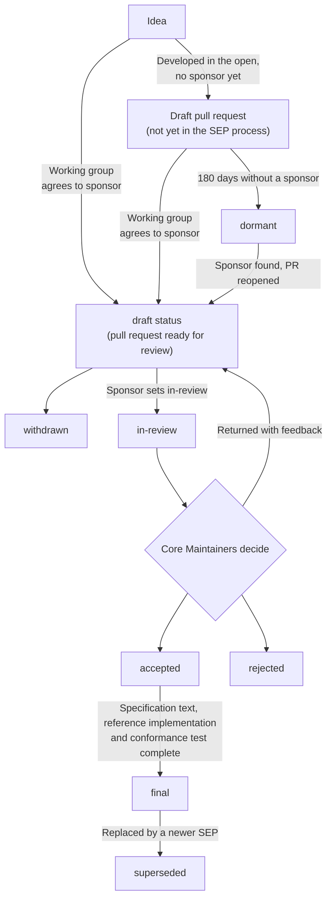

本页说明何时需要规范增强提案（SEP），以及提案从拉取请求到 Final 的处理流程。SEP 是一份设计文档，用简明的技术规范描述一项功能或流程，并说明设计理由。作者负责推动社区达成共识，并记录不同意见。[SEP-1850](/seps/1850) 确立了此流程，[SEP-2484](/seps/2484) 确立了一致性测试门槛。修改这两项流程都需要提交流程类 SEP。本页的赞助规则遵循 [SEP-3398](/seps/3398)。

<a id="when-you-need-a-sep" />
## 当您需要 SEP 时

以下变更需要编写 SEP：
- 新的、更改的或删除的协议功能或方法（新的 RPC 方法，例如 `tools/execute`、新的功能协商字段、传输的更改）
- 任何不向后兼容的更改
- 消息格式或模式结构的更改
- 核心规范之外支持的互操作性约定
- 治理或流程变更
- 任何有争议的或有几个看似合理的设计，例如授权工作方式的改变
错误修复、澄清、编辑性修改、现有功能的新示例、不改变行为的架构修正和测试，都通过普通拉取请求提交。治理文件本身的修订遵循 [SEP-2085](/seps/2085) 中的流程，而不是本流程。如有疑问，请先在 [Discord](/community/communication#discord) 中询问。

<a id="sep-types" />
## SEP 类型

- 标准轨道：描述新的协议功能或实现，或核心规范之外支持的互操作标准。
- 信息类：描述设计问题，或为社区提供指南，不引入新功能。
- 流程类：描述 MCP 相关流程，或提议修改现有流程。
- 扩展轨道：描述协议扩展，审查和接受流程与标准轨道相同。扩展轨道 SEP 获得接受后，扩展进入 Beta；第二份扩展轨道 SEP 可将其提升至 Stable（阶段说明见[扩展生命周期](/extensions/overview#extension-lifecycle)）。

<a id="before-you-write" />
## 在你写之前

正式审查前，SEP 需要由工作组或核心维护者团队赞助（参见[赞助人](#sponsors)）。

要获得工作组赞助：

1. 检查想法是否符合[路线图](/development/roadmap)当前的重点。路线图优先领域之外的 SEP 可能需要等待更久，审查门槛也更高（参阅 [SEP 优先级](/development/roadmap#sep-prioritization)）。
2. 在相关工作组的 Discord 频道或会议上提出想法（参阅[加入小组](/community/working-interest-groups#joining-a-group)）。兴趣组可以先帮助明确问题，再由工作组赞助 SEP。
3. 在工作组中达成[共识](/community/working-interest-groups#making-decisions)，然后起草该工作组愿意[赞助](#sponsors)的 SEP。阅读[设计原则](/community/design-principles)；如果适合，先将想法作为[扩展](/extensions/overview)试行，并构建符合[原型要求](#prototype-requirements)的原型。
4. 工作组通过[工作流程](#workflow)将 SEP 提交核心维护者审查。

如果兴趣组负责该领域、但尚无工作组，兴趣组可以通过[组建小组](/community/working-interest-groups#forming-a-group)流程成立工作组，由该工作组赞助 SEP。这是兴趣组负责领域的常规路径。如果该领域目前没有工作组或兴趣组覆盖，可以通过[组建小组](/community/working-interest-groups#forming-a-group)流程提议创建工作组。也可以在 Discord 的 `#general` 频道发起讨论，寻找新工作组的参与者。

<a id="workflow" />
## 工作流程

1. 将 [`seps/TEMPLATE.md`](https://github.com/modelcontextprotocol/modelcontextprotocol/blob/main/seps/TEMPLATE.md) 复制为 `seps/0000-<slug>.md` 并填写。
2. 按照[拉取请求标题指南](https://github.com/modelcontextprotocol/modelcontextprotocol/blob/main/CONTRIBUTING.md#pull-request-titles)，在[规范仓库](https://github.com/modelcontextprotocol/modelcontextprotocol)中创建拉取请求，标题采用 `sep: <description>` 格式，例如 `sep: propose task cancellation`。尚未加入 `modelcontextprotocol` GitHub 组织的作者，请工作组负责人或[赞助人](#sponsors)代为创建拉取请求，并在其中注明作者。
3. SEP 编号就是 PR 编号。创建 PR 后，按编号重命名文件（例如 PR #1850 对应 `seps/1850-<slug>.md`），更新文件头部，然后运行 `npm run generate:seps`，否则 `check:seps` CI 作业会失败。将 PR 标题改为 `sep(SEP-1850): <description>`。后续提交即可，无需 amend 或强制推送。之后有关该 SEP 的拉取请求都应以 `SEP-1850` 为范围，并在描述中链接到它。
4. 工作组同意赞助 SEP 前，提案保留为草稿拉取请求。草稿 PR 用于公开完善提案，此时提案尚未进入 SEP 流程，SEP 文件中的 `Status` 字段保持空白，并添加 `wg-support-needed` 标签。
5. 工作组同意[赞助](#sponsors) SEP 后，将拉取请求标记为可供审查。`Sponsor` 字段填写代表赞助小组行事的人员；该人员将状态设为 `draft`。非正式审查在 PR 评论中进行。
6. SEP 准备就绪后，赞助人确认此前的讨论已经进行，且讨论链接已包含在 PR 描述中，然后将状态设为 `in-review`，并把 SEP 列入核心维护者会议议程。作者和赞助人可以进行介绍。
7. 核心维护者按照[审查与接受](#review-and-acceptance)作出决定。赞助人在 PR 和 SEP 文件头部记录结果：`accepted` 或 `rejected`。
8. SEP 被接受后，作者在同一个 PR 中添加规范正文、`schema.ts` 变更及重新生成的输出（参阅 [CONTRIBUTING.md](https://github.com/modelcontextprotocol/modelcontextprotocol/blob/main/CONTRIBUTING.md#schema-changes)）、变更日志条目和所需的文档修改（弃用功能时，需完成[弃用功能](/community/feature-lifecycle#deprecating-a-feature)中列出的四项修改）。参考实现在其所在位置完成，可以是 SDK 分支、fork 或独立仓库（参阅[原型要求](#prototype-requirements)）。对于具有可观察协议行为的标准轨道 SEP，还须合并一致性测试场景和 `sep-NNNN.yaml` 文件（参阅[一致性测试要求](#conformance-test-requirement)）。达到 Final 不要求 SDK 实现。
9. 赞助人验证这些产物并将状态设为 `final`，随后合并 PR。

八种 `Status` 状态也定义在 [SEP 索引](/seps)中：

| 状态 | 含义 | 设置者 |
| ------------ | ---------------------------------------------------------------------------------- | ------------------------------------------- |
| `draft` | 已有赞助人，PR 可供审查，正在评论中进行非正式审查 | 赞助人 |
| `in-review` | 已列入核心维护者正式审查议程 | 赞助人 |
| `accepted` | 已接受，等待规范正文、参考实现和一致性测试完成 | 核心维护者决定后由赞助人设置 |
| `rejected` | 已被核心维护者拒绝 | 核心维护者决定后由赞助人设置 |
| `withdrawn` | 作者已撤回提案 | 作者或赞助人 |
| `final` | 所有产物均已完成且 PR 已合并 | 赞助人 |
| `superseded` | 已被更新的 SEP 取代 | 赞助人 |
| `dormant` | 180 天内未找到赞助人，PR 已关闭；可恢复 | 核心维护者 |

180 天内未找到赞助人的 SEP 会标记为 `dormant`，并关闭其 PR。休眠不等于拒绝：找到赞助人并重新打开 PR，即可恢复该 SEP 并将其状态改回 `draft`。

<a id="sponsors" />
## 赞助商

SEP 可以由工作组或核心维护者团队赞助。两种方式遵循相同的审查流程和接受要求。

- **工作组赞助：**SEP 所属范围的工作组通过[决策流程](/community/working-interest-groups#making-decisions)批准提案。[在起草前](#before-you-write)介绍了工作组如何决定赞助 SEP。
- **核心维护者团队赞助：**核心维护者同意赞助 SEP，并指定一名核心维护者代表团队。不需要工作组另行批准，但指定的核心维护者会征询相关工作组意见。这是例外途径；通常核心维护者不会赞助 SEP，除非提案由核心维护者直接提出。

`Sponsor` 字段填写代表赞助团队行事的维护者或核心维护者，例如 `Name (@handle), on behalf of the Transports Working Group` 或 `Name (@handle), on behalf of the Core Maintainers`。工作组可由符合资格的工作组负责人担任此角色；核心维护者团队则由指定的核心维护者担任。本页其余部分将此人称为赞助人。

赞助人负责维护 SEP 的状态和标签，并跟踪实现进度。赞助人审查提案、要求修改、与作者共同介绍提案、提交核心维护者审查、核验 Final 所需产物，并按照[工作流程](#workflow)更新每个状态。这包括 SEP 文件中的规范字段 `Status`，以及用于筛选的对应 PR 标签。没有分支写入权限时，赞助人请作者代为修改状态字段。作者不应自行修改 `Status` 或标签，而应联系赞助人。

赞助团队、赞助人和作者共同负责推进 SEP。如果作者无权在规范仓库中创建拉取请求，由工作组负责人或赞助人代为创建，并注明作者。SEP 仍按 PR 编号。

工作组负责人也可以按照[领导职责](/community/working-interest-groups#leadership)分流并关闭工作组范围内的 SEP；相关决定可向核心维护者申诉。

<a id="prototype-requirements" />
## 原型要求

SEP 在获接受前必须提供可运行的原型，可以是官方 SDK 中的分支或 fork、展示关键机制的独立概念验证、覆盖拟议行为的集成测试，或参考服务器/客户端。原型应证明核心功能按描述运行、API 设计实用易用、已发现边界情况和实现问题，并且审查者能按照随附的设置说明运行它。仅有伪代码或没有代码的设计文档不符合要求。原型无需达到生产质量。

<a id="review-and-acceptance" />
## 审核与验收

核心维护者每两周召开一次会议，并依据[决策流程](/community/governance#decision-process)审查状态为 `in-review` 的 SEP。审查标准包括：是否有可运行的原型、是否能明显惠及 MCP 生态、是否获得社区支持并形成共识，以及是否符合路线图和设计原则。结果为 `accepted`、`rejected`，或退回 `draft` 并在 PR 中记录具体反馈。

<a id="conformance-test-requirement" />
## 一致性测试要求

引入或修改可观察协议行为的标准轨道 SEP，只有在[一致性测试仓库](https://github.com/modelcontextprotocol/conformance)具备以下内容后，才能达到 `final`：
- 一个以 SEP 编号标记、针对该仓库草案规范版本标签的测试场景。
- 一个 `sep-NNNN.yaml` 可追溯性文件，将 SEP「规范」章节中的每条 MUST、MUST NOT、SHOULD 和 SHOULD NOT 映射到检查 ID 或有记录的豁免项。如果豁免源于测试框架缺口，须提供跟踪议题。
- 针对 SEP 参考实现通过的测试场景。

流程类 SEP、信息类 SEP，以及不改变可观察协议行为的标准轨道 SEP（例如文档澄清、不改变校验行为的架构注释、实现加固建议）可豁免此要求。

任何人都可以编写测试场景，包括 SEP 作者、SDK 维护者或其他贡献者。赞助人负责确认场景已提交，且 `sep-NNNN.yaml` 覆盖所有规范性要求；一致性测试仓库的维护者负责审查测试场景 PR 的技术正确性。鼓励在核心维护者审查前编写测试场景，但不作强制要求。[SEP-2484](/seps/2484)定义了可追溯性格式和争议处理流程。

<a id="after-the-decision" />
## 决定后

被拒绝的 SEP 可以根据记录的反馈进行修改并重新提交，或者使用竞争的 SEP 进行答复。

SEP 达到 Final 前，请在其 PR 中提出问题。Final SEP 是已接受设计的冻结记录。如果它与当前规范不一致，以规范为准：请针对规范提交议题，而不要修改 SEP。

作者可以申请撤回 SEP，由作者或赞助人将状态设为 `withdrawn`。取代早期 SEP 的提案须在文件头部添加 `Supersedes:` 行，并将早期 SEP 的状态设为 `superseded`。

如果原作者无暇继续或无法联系，可以将 SEP 转交给新作者；原作者愿意时仍可列为共同作者。仅仅不同意原作者的方向并不足以转交提案，此时应另行撰写竞争性 SEP。

<a id="template-and-tooling" />
## 模板和工具

SEP 文件存放在 [`seps/`](https://github.com/modelcontextprotocol/modelcontextprotocol/tree/main/seps) 中，每个文件的 Git 历史就是该提案的记录。[`seps/TEMPLATE.md`](https://github.com/modelcontextprotocol/modelcontextprotocol/blob/main/seps/TEMPLATE.md)规定了文档结构：序言、摘要、动机、规范、理由、向后兼容性、安全影响和参考实现。摘要约 200 字。动机不足本身就足以成为拒绝理由。规范必须详细到足以支持独立且可互操作的实现。理由章节记录考虑过的替代方案、提出的异议和达成共识的证据。只要 SEP 引入不兼容变更，就必须说明其严重程度和迁移路径。安全影响必须明确说明，包括没有安全影响的情况。

`npm run generate:seps` 将文件渲染为 `docs/seps/`，`npm run check:seps` 验证渲染的页面是否是最新的。有关有效示例，请参阅 [SEP-2567](/seps/2567)，这是最近的最终标准轨道 SEP。
