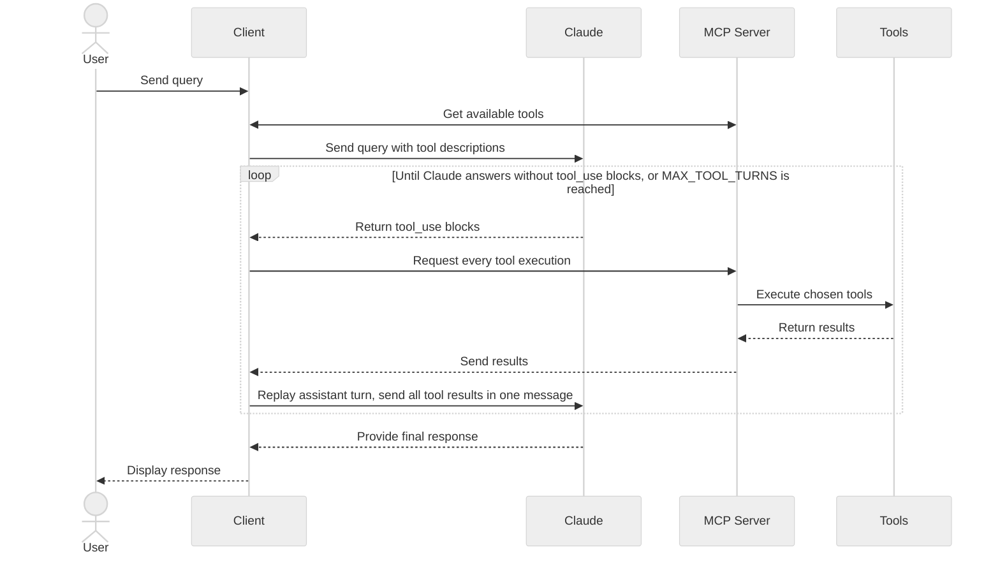

在本教程中，您将学习如何构建连接到 MCP 服务器的 LLM 支持的聊天机器人客户端。

在开始之前，阅读我们的[构建 MCP 服务器](/docs/2026-07-28/develop/build-server) 教程会有所帮助，以便您了解客户端和服务器如何通信。
<Tabs>
<Tab title="蟒蛇">

[您可以在此处找到本教程的完整代码。](https://github.com/modelcontextprotocol/quickstart-resources/tree/main/mcp-client-python)

## 系统要求

开始之前，请确保您的系统满足以下要求：
- Mac 或 Windows 计算机
- 安装了最新的Python版本
- 安装最新版本的`uv`
- 您必须使用Python MCP SDK 2.0.0或更高版本

## 设置您的环境

首先，使用 `uv` 创建一个新的 Python 项目：
<CodeGroup>

```bash macOS/Linux
# Create project directory
uv init mcp-client
cd mcp-client

# Create virtual environment
uv venv

# Activate virtual environment
source .venv/bin/activate

# Install required packages
uv add mcp anthropic python-dotenv

# Remove boilerplate files
rm main.py

# Create our main file
touch client.py
```

```powershell Windows
# Create project directory
uv init mcp-client
cd mcp-client

# Create virtual environment
uv venv

# Activate virtual environment
.venv\Scripts\activate

# Install required packages
uv add mcp anthropic python-dotenv

# Remove boilerplate files
del main.py

# Create our main file
new-item client.py
```

</CodeGroup>

## 设置您的 API 密钥

您需要从 [Anthropic 控制台](https://console.anthropic.com/settings/keys) 获取 Anthropic API 密钥。

创建一个`.env`文件来存储它：

```bash
echo "ANTHROPIC_API_KEY=your-api-key-goes-here" > .env
```

将 `.env` 添加到您的 `.gitignore` 中：

```bash
echo ".env" >> .gitignore
```

<Warning>

确保您的 `ANTHROPIC_API_KEY` 安全！
</Warning>

## 创建客户端

### 导入和设置

首先，让我们设置导入以及文件其余部分共享的部分：

```python
import asyncio
import sys

from mcp import Client, StdioServerParameters
from mcp.client.stdio import stdio_client
from mcp_types import TextContent

from anthropic import Anthropic
from dotenv import load_dotenv

load_dotenv()  # load environment variables from .env

MODEL = "claude-opus-5"
# The model thinks adaptively unless told otherwise, and max_tokens caps thinking
# plus the reply, so leave room for both.
MAX_TOKENS = 10000
MAX_TOOL_TURNS = 10
anthropic = Anthropic()
```

`Client` 是您的程序与服务器通信的单个对象。列出工具、调用工具、读取资源：其中每一项都是其上的一个方法。

### 服务器连接管理

接下来，我们将计算出为给定服务器脚本启动哪个进程：

```python
def server_params(server_script_path: str) -> StdioServerParameters:
    """Describe the subprocess that runs an MCP server

    Args:
        server_script_path: Path to the server script (.py or .js)
    """
    if server_script_path.endswith(".py"):
        command = "python"
    elif server_script_path.endswith(".js"):
        command = "node"
    else:
        raise ValueError("Server script must be a .py or .js file")

    return StdioServerParameters(command=command, args=[server_script_path])
```

`StdioServerParameters` 是配置，而不是连接。 `stdio_client()` 将其转换为 stdio 传输，而当您进入其 `async with` 块时，`Client` 将打开该传输。我们将在 `main()` 中完成这两项操作。

### 查询处理逻辑

现在让我们添加处理查询和处理工具调用的核心功能：

```python
async def process_query(client: Client, query: str) -> str:
    """Process a query using Claude and available tools"""
    messages = [
        {
            "role": "user",
            "content": query
        }
    ]

    tool_list = await client.list_tools()
    available_tools = [{
        "name": tool.name,
        "description": tool.description,
        "input_schema": tool.input_schema
    } for tool in tool_list.tools]

    final_text = []

    # Initial Claude API call
    response = anthropic.messages.create(
        model=MODEL,
        max_tokens=MAX_TOKENS,
        messages=messages,
        tools=available_tools
    )

    for _ in range(MAX_TOOL_TURNS):
        # Process response and collect tool calls
        tool_uses = []
        for content in response.content:
            if content.type == 'text':
                final_text.append(content.text)
            elif content.type == 'tool_use':
                tool_uses.append(content)

        if not tool_uses:
            return "\n".join(final_text)

        tool_results = []
        for tool_use in tool_uses:
            # Execute tool call
            result = await client.call_tool(tool_use.name, tool_use.input)
            final_text.append(f"[Calling tool {tool_use.name} with args {tool_use.input}]")

            tool_results.append({
                "type": "tool_result",
                "tool_use_id": tool_use.id,
                "content": "\n".join(
                    block.text
                    for block in result.content
                    if isinstance(block, TextContent)
                ),
                "is_error": result.is_error
            })

        # Replay the assistant turn as returned, then answer all of its
        # tool calls in a single user message
        messages.append({"role": "assistant", "content": response.content})
        messages.append({"role": "user", "content": tool_results})

        # Get next response from Claude
        response = anthropic.messages.create(
            model=MODEL,
            max_tokens=MAX_TOKENS,
            messages=messages,
            tools=available_tools
        )

    # The turn cap was hit. Keep the last response's text. If it asked for
    # more tools, say they were not run.
    final_text.extend(content.text for content in response.content if content.type == 'text')
    if any(content.type == 'tool_use' for content in response.content):
        final_text.append(f"[Stopped after {MAX_TOOL_TURNS} tool-use turns]")
    return "\n".join(final_text)
```

`call_tool` 返回 `CallToolResult`。它的 `content` 是一个块列表，这就是为什么我们在读取 `.text` 之前缩小到 `TextContent` 的原因。引发的工具不会在这里引发：它以 `is_error` 设置进行响应，并传递该标志让 Claude 读取消息并尝试其他操作。

每个回合都会完全按照克劳德返回的方式重播辅助消息，包括思考块，并在一条用户消息中回答该回合的每个 `tool_use` 块。消息 API 会拒绝两者不相符的对话。 `tools` 会进行每次调用，以便 Claude 可以继续调用工具，并且循环会一直运行，直到 Claude 没有回答或达到 `MAX_TOOL_TURNS` 为止，此时客户端报告它已停止。

### 互动聊天界面

现在我们将添加聊天循环：

```python
async def chat_loop(client: Client) -> None:
    """Run an interactive chat loop"""
    print("\nMCP Client Started!")
    print("Type your queries or 'quit' to exit.")

    while True:
        try:
            query = (await asyncio.to_thread(input, "\nQuery: ")).strip()
        except EOFError:
            break

        if query.lower() == 'quit':
            break

        try:
            response = await process_query(client, query)
            print("\n" + response)
        except Exception as e:
            print(f"\nError: {e}")
```

`input()` 会阻塞，因此它在工作线程上运行。这使得事件循环可以在您键入时自由地为连接提供服务。

### 主入口点

最后，我们添加主要的执行逻辑：

```python
async def main() -> None:
    if len(sys.argv) < 2:
        print("Usage: python client.py <path_to_server_script>")
        sys.exit(1)

    async with Client(stdio_client(server_params(sys.argv[1]))) as client:
        tool_list = await client.list_tools()
        tool_names = [tool.name for tool in tool_list.tools]
        print("\nConnected to server with tools:", tool_names)

        await chat_loop(client)


if __name__ == "__main__":
    asyncio.run(main())
```

`async with` 就是整个连接生命周期。输入它启动服务器并与其同意协议版本；让它断开连接并关闭子进程。没有什么可以用手关闭的。

您可以在[此处](https://github.com/modelcontextprotocol/quickstart-resources/blob/main/mcp-client-python/client.py)找到完整的`client.py`文件。

## 关键组件解释

### 1.客户端初始化

- 单个`Client`承载连接，`async with`是其整个生命周期
- 没有连接/关闭对可以调用，之后也没有什么需要清理的
- 配置 Anthropic 客户端以进行 Claude 交互

### 2.服务器连接

- 支持 Python 和 Node.js 服务器
- 验证服务器脚本类型
- 将服务器作为子进程启动并与其进行 stdio 对话
- 连接打开后列出可用工具

### 3. 查询处理

- 维护对话上下文
- 处理克劳德的响应和工具调用
- 运行一轮中的每个工具调用，然后在一条消息中回答它们
- 克劳德要求工具时不断循环，最多为 `MAX_TOOL_TURNS`
- 将结果组合成一致的响应

### 4.交互界面

- 提供简单的命令行界面
- 处理用户输入并显示响应
- 包括基本的错误处理
- 允许优雅退出

### 5.资源管理

- 离开 `async with` 块会断开连接并关闭服务器子进程
- 在不结束会话的情况下报告失败的查询
- 输入 `quit`，或关闭标准输入，干净退出

## 常用定制点

1. **工具处理**
   - 修改`process_query()`以处理特定的工具类型
   - 调整 `MAX_TOOL_TURNS` 以允许每个查询更多或更少轮次的工具调用
   - 为工具调用添加自定义错误处理
   - 实施特定于工具的响应格式
2. **响应处理**
   - 自定义工具结果的格式
   - 添加响应过滤或转换
   - 实施自定义日志记录
3. **用户界面**
   - 添加 GUI 或 Web 界面
   - 实现丰富的控制台输出
   - 添加命令历史记录或自动完成

## 运行客户端

要使用任何 MCP 服务器运行客户端：

```bash
uv run client.py path/to/server.py # python server
uv run client.py path/to/build/index.js # node server
```

<Note>

如果您继续[服务器快速入门中的天气教程](https://github.com/modelcontextprotocol/quickstart-resources/tree/main/weather-server-python)，您的命令可能如下所示：`python client.py .../quickstart-resources/weather-server-python/weather.py`
</Note>

客户将：

1.连接指定服务器
2. 列出可用工具
3. 启动交互式聊天会话，您可以：
   - 输入查询
   - 查看工具执行情况
   - 得到克劳德的回复
以下是从服务器快速入门连接到天气服务器时的示例：
<Frame>
  
</Frame>

## 它是如何工作的

当您提交查询时：

1.客户端从服务器获取可用工具列表
2. 您的查询以及工具说明将发送给 Claude
3. Claude 决定使用哪些工具（如果有）
4. 客户端通过服务器执行任何请求的工具调用
5. 结果发送回 Claude，重复步骤 3 到 5，同时 Claude 不断索要工具，最多为 `MAX_TOOL_TURNS`
6. 克劳德提供自然语言回应
7. 回复会显示给您

## 最佳实践

1. **错误处理**
   - 检查 `result.is_error` 而不是期望一个失败的工具来提高
   - 保持工具循环上限，以便永远不会解决的查询仍然返回
   - 提供有意义的错误消息
   - 优雅地处理连接问题
2. **资源管理**
   - 让 `async with` 块拥有连接
   - 只要您需要服务器，就保持打开状态
   - 处理服务器断开连接
3. **安全**
   - 将API密钥安全地存储在`.env`中
   - 验证服务器响应
   - 谨慎使用工具权限
4. **工具名称**
   - 工具名称可以根据[此处]指定的格式进行验证(/specification/2026-07-28/server/tools#tool-names)
   - 如果工具名称符合指定的格式，则 MCP 客户端的验证不应失败

## 故障排除

### 服务器路径问题

- 仔细检查服务器脚本的路径是否正确
- 如果相对路径不起作用，则使用绝对路径
- 对于 Windows 用户，请确保在路径中使用正斜杠 (/) 或转义反斜杠 (\\)
- 验证服务器文件具有正确的扩展名（Python 为 .py，Node.js 为 .js）
正确路径使用示例：

```bash
# Relative path
uv run client.py ./server/weather.py

# Absolute path
uv run client.py /Users/username/projects/mcp-server/weather.py

# Windows path (either format works)
uv run client.py C:/projects/mcp-server/weather.py
uv run client.py C:\\projects\\mcp-server\\weather.py
```

### 响应时间

- 第一个响应可能需要长达 30 秒的时间才能返回
- 这是正常现象，发生时：
  - 服务器初始化
  - 克劳德处理查询
  - 工具正在执行
- 随后的响应通常会更快
- 在最初的等待期间不要中断该过程

### 常见错误消息

如果您看到：
- `FileNotFoundError`：检查您的服务器路径
- `Connection refused`：确保服务器正在运行并且路径正确
- `Tool execution failed`：验证工具所需的环境变量是否已设置
- `Timeout error`：考虑在 `Client` 上加注 `read_timeout_seconds`
</Tab>

<Tab title="打字稿">

[您可以在此处找到本教程的完整代码。](https://github.com/modelcontextprotocol/quickstart-resources/tree/main/mcp-client-typescript)

## 系统要求

开始之前，请确保您的系统满足以下要求：
- Mac 或 Windows 计算机
- 安装 Node.js 20 或更高版本
- 安装最新版本的`npm`
- Anthropic API 密钥（克劳德）

## 设置您的环境

首先，让我们创建并设置我们的项目：
<CodeGroup>

```bash macOS/Linux
# Create project directory
mkdir mcp-client-typescript
cd mcp-client-typescript

# Initialize npm project
npm init -y

# Install dependencies
npm install @anthropic-ai/sdk @modelcontextprotocol/client dotenv

# Install dev dependencies
npm install -D @types/node typescript

# Create source file
touch index.ts
```

```powershell Windows
# Create project directory
md mcp-client-typescript
cd mcp-client-typescript

# Initialize npm project
npm init -y

# Install dependencies
npm install @anthropic-ai/sdk @modelcontextprotocol/client dotenv

# Install dev dependencies
npm install -D @types/node typescript

# Create source file
new-item index.ts
```

</CodeGroup>

更新您的 `package.json` 以设置 `type: "module"` 和构建脚本：

```json package.json
{
  "type": "module",
  "scripts": {
    "build": "tsc && chmod 755 build/index.js"
  }
}
```

在项目的根目录中创建一个 `tsconfig.json`：

```json tsconfig.json
{
  "compilerOptions": {
    "target": "ES2022",
    "module": "Node16",
    "moduleResolution": "Node16",
    "types": ["node"],
    "outDir": "./build",
    "rootDir": "./",
    "strict": true,
    "esModuleInterop": true,
    "skipLibCheck": true,
    "forceConsistentCasingInFileNames": true
  },
  "include": ["index.ts"],
  "exclude": ["node_modules"]
}
```

## 设置您的 API 密钥

您需要从 [Anthropic 控制台](https://console.anthropic.com/settings/keys) 获取 Anthropic API 密钥。

创建一个`.env`文件来存储它：

```bash
echo "ANTHROPIC_API_KEY=<your key here>" > .env
```

将 `.env` 添加到您的 `.gitignore` 中：

```bash
echo ".env" >> .gitignore
```

<Warning>

确保您的 `ANTHROPIC_API_KEY` 安全！
</Warning>

## 创建客户端

### 基本客户端结构

首先，让我们设置导入并在 `index.ts` 中创建基本客户端类：

```typescript
import { Anthropic } from "@anthropic-ai/sdk";
import {
  ContentBlockParam,
  MessageParam,
  Tool,
  ToolResultBlockParam,
  ToolUseBlock,
} from "@anthropic-ai/sdk/resources/messages/messages.mjs";
import { Client } from "@modelcontextprotocol/client";
import { StdioClientTransport } from "@modelcontextprotocol/client/stdio";
import readline from "readline/promises";
import dotenv from "dotenv";

dotenv.config();

const ANTHROPIC_API_KEY = process.env.ANTHROPIC_API_KEY;
if (!ANTHROPIC_API_KEY) {
  throw new Error("ANTHROPIC_API_KEY is not set");
}

const MODEL = "claude-opus-5";
// The model thinks adaptively unless told otherwise, and max_tokens caps
// thinking plus the reply, so leave room for both.
const MAX_TOKENS = 10000;
const MAX_TOOL_TURNS = 10;

class MCPClient {
  private mcp: Client;
  private anthropic: Anthropic;
  private transport: StdioClientTransport | null = null;
  private tools: Tool[] = [];

  constructor() {
    this.anthropic = new Anthropic({
      apiKey: ANTHROPIC_API_KEY,
    });
    // 'auto' probes server/discover, falling back to the 2025-11-25 handshake.
    // The SDK's default is 'legacy'.
    this.mcp = new Client(
      { name: "mcp-client-cli", version: "1.0.0" },
      { versionNegotiation: { mode: "auto" } },
    );
  }
  // methods will go here
}
```

### 服务器连接管理

接下来，我们将实现连接 MCP 服务器的方法：

```typescript
async connectToServer(serverScriptPath: string) {
  try {
    const isJs = serverScriptPath.endsWith(".js");
    const isPy = serverScriptPath.endsWith(".py");
    if (!isJs && !isPy) {
      throw new Error("Server script must be a .js or .py file");
    }
    const command = isPy
      ? process.platform === "win32"
        ? "python"
        : "python3"
      : process.execPath;

    this.transport = new StdioClientTransport({
      command,
      args: [serverScriptPath],
    });
    await this.mcp.connect(this.transport);

    const toolsResult = await this.mcp.listTools();
    this.tools = toolsResult.tools.map((tool) => {
      return {
        name: tool.name,
        description: tool.description,
        input_schema: tool.inputSchema,
      };
    });
    console.log(
      "Connected to server with tools:",
      this.tools.map(({ name }) => name)
    );
  } catch (e) {
    console.log("Failed to connect to MCP server: ", e);
    throw e;
  }
}
```

### 查询处理逻辑

现在让我们添加处理查询和处理工具调用的核心功能：

```typescript
async processQuery(query: string) {
  const messages: MessageParam[] = [
    {
      role: "user",
      content: query,
    },
  ];

  let response = await this.anthropic.messages.create({
    model: MODEL,
    max_tokens: MAX_TOKENS,
    messages,
    tools: this.tools,
  });

  const finalText: string[] = [];

  for (let turn = 0; turn < MAX_TOOL_TURNS; turn++) {
    const toolUses: ToolUseBlock[] = [];

    for (const block of response.content) {
      if (block.type === "text") {
        finalText.push(block.text);
      } else if (block.type === "tool_use") {
        toolUses.push(block);
      }
    }

    if (toolUses.length === 0) {
      return finalText.join("\n");
    }

    const toolResults: ToolResultBlockParam[] = [];
    for (const toolUse of toolUses) {
      const toolArgs = toolUse.input as { [x: string]: unknown } | undefined;
      finalText.push(
        `[Calling tool ${toolUse.name} with args ${JSON.stringify(toolArgs)}]`
      );

      const result = await this.mcp.callTool({
        name: toolUse.name,
        arguments: toolArgs,
      });

      toolResults.push({
        type: "tool_result",
        tool_use_id: toolUse.id,
        content: result.content
          .filter((block) => block.type === "text")
          .map((block) => block.text)
          .join("\n"),
        is_error: result.isError === true,
      });
    }

    messages.push({
      role: "assistant",
      content: response.content as unknown as ContentBlockParam[],
    });
    messages.push({ role: "user", content: toolResults });

    response = await this.anthropic.messages.create({
      model: MODEL,
      max_tokens: MAX_TOKENS,
      messages,
      tools: this.tools,
    });
  }

  // The turn cap was hit. Keep the last response's text. If it asked for
  // more tools, say they were not run.
  let wantsTools = false;
  for (const block of response.content) {
    if (block.type === "text") {
      finalText.push(block.text);
    } else if (block.type === "tool_use") {
      wantsTools = true;
    }
  }
  if (wantsTools) {
    finalText.push(`[Stopped after ${MAX_TOOL_TURNS} tool-use turns]`);
  }
  return finalText.join("\n");
}
```

每个回合在调用服务器之前都会收集每个 `tool_use` 块，然后将整个助手回合返回（包括思考块），然后是每次调用时包含一个 `tool_result` 块的用户消息。 `callTool` 返回一个 `CallToolResult`，其中 `content` 是块列表，这就是为什么在读取 `.text` 之前代码会缩小到 `text` 块。失败的工具不会在这里抛出：它会设置 `isError` 进行应答，并将该标志传递为 `is_error` 让 Claude 读取消息并尝试其他操作。每个请求都带有 `tools`，因此 Claude 可以不断调用工具，直到得到答案为止，最多 `MAX_TOOL_TURNS` 轮。

### 互动聊天界面

现在我们将添加聊天循环和清理功能：

```typescript
async chatLoop() {
  const rl = readline.createInterface({
    input: process.stdin,
    output: process.stdout,
  });
  // rl.question() doesn't reject on stdin EOF on its own. Wire its close
  // event to an AbortSignal so EOF (Ctrl-D) and SIGINT both unblock it.
  const ac = new AbortController();
  const onClose = () => ac.abort();
  rl.on("close", onClose);
  const onSigint = () => rl.close();
  process.once("SIGINT", onSigint);

  try {
    console.log("\nMCP Client Started!");
    console.log("Type your queries or 'quit' to exit.");

    while (true) {
      let message: string;
      try {
        message = await rl.question("\nQuery: ", { signal: ac.signal });
      } catch {
        break;
      }

      if (message.toLowerCase() === "quit") {
        break;
      }
      const response = await this.processQuery(message);
      console.log("\n" + response);
    }
  } finally {
    process.off("SIGINT", onSigint);
    rl.off("close", onClose);
    rl.close();
  }
}

async cleanup() {
  await this.mcp.close();
}
```

关闭 stdin (Ctrl-D) 或按 Ctrl-C 会中止挂起的 `rl.question()` 并跳出循环，因此客户端到达 `cleanup()` 并以状态 0 退出，而不是以 `ERR_USE_AFTER_CLOSE` 失败。

### 主入口点

最后，我们添加主要的执行逻辑：

```typescript
async function main() {
  if (process.argv.length < 3) {
    console.log("Usage: node index.ts <path_to_server_script>");
    return;
  }
  const mcpClient = new MCPClient();
  try {
    await mcpClient.connectToServer(process.argv[2]);
    await mcpClient.chatLoop();
  } catch (e) {
    console.error("Error:", e);
    await mcpClient.cleanup();
    process.exit(1);
  } finally {
    await mcpClient.cleanup();
    process.exit(0);
  }
}

main();
```

## 运行客户端

要使用任何 MCP 服务器运行客户端：

```bash
# Build TypeScript
npm run build

# Run the client
node build/index.js path/to/server.py # python server
node build/index.js path/to/build/index.js # node server
```

<Note>

如果您继续[服务器快速入门中的天气教程](https://github.com/modelcontextprotocol/quickstart-resources/tree/main/weather-server-typescript)，您的命令可能如下所示：`node build/index.js .../quickstart-resources/weather-server-typescript/build/index.js`
</Note>

**客户将：**
1.连接指定服务器
2. 列出可用工具
3. 启动交互式聊天会话，您可以：
   - 输入查询
   - 查看工具执行情况
   - 得到克劳德的回复

## 它是如何工作的

当您提交查询时：

1.客户端从服务器获取可用工具列表
2. 您的查询以及工具说明将发送给 Claude
3. Claude 决定使用哪些工具（如果有）
4. 客户端通过服务器执行每个请求的工具调用
5. 助手轮流和所有工具结果一次请求返回给 Claude，并再次附上工具
6. Claude 要么请求更多工具（循环允许最多 `MAX_TOOL_TURNS` 轮），要么提供自然语言响应
7. 回复会显示给您

## 最佳实践

1. **错误处理**
   - 使用 TypeScript 的类型系统更好地检测错误
   - 检查 `result.isError` 而不是期望抛出失败的工具
   - 提供有意义的错误消息
   - 优雅地处理连接问题
2. **安全**
   - 将API密钥安全地存储在`.env`中
   - 验证服务器响应
   - 谨慎使用工具权限

## 故障排除

### 服务器路径问题

- 仔细检查服务器脚本的路径是否正确
- 如果相对路径不起作用，则使用绝对路径
- 对于 Windows 用户，请确保在路径中使用正斜杠 (/) 或转义反斜杠 (\\)
- 验证服务器文件具有正确的扩展名（Node.js 为 .js，Python 为 .py）
正确路径使用示例：

```bash
# Relative path
node build/index.js ./server/build/index.js

# Absolute path
node build/index.js /Users/username/projects/mcp-server/build/index.js

# Windows path (either format works)
node build/index.js C:/projects/mcp-server/build/index.js
node build/index.js C:\\projects\\mcp-server\\build\\index.js
```

### 响应时间

- 第一个响应可能需要长达 30 秒的时间才能返回
- 这是正常现象，发生时：
  - 服务器初始化
  - 克劳德处理查询
  - 工具正在执行
- 随后的响应通常会更快
- 在最初的等待期间不要中断该过程

### 常见错误消息

如果您看到：
- `Error: Cannot find module`：检查您的构建文件夹并确保 TypeScript 编译成功
- `Connection refused`：确保服务器正在运行并且路径正确
- `Tool execution failed`：验证工具所需的环境变量是否已设置
- `ANTHROPIC_API_KEY is not set`：检查您的 .env 文件和环境变量
- `TypeError`：确保您使用正确的工具参数类型
- `BadRequestError`：确保您有足够的积分来访问 Anthropic API
</Tab>

<Tab title="爪哇">

<Note>

该客户端使用 MCP 协议版本 2025-11-25，由最新稳定版本的 Java SDK 支持。它连接到接受该版本的服务器，但不连接到仅接受 2026-07-28 的服务器。请参阅[向后兼容性](/specification/2026-07-28/basic/versioning#backward-compatibility-with-initialization-based-versions)。
</Note>

<Note>

这是一个基于 Spring AI MCP 自动配置和启动启动器的快速入门演示。

要了解如何手动创建同步和异步 MCP 客户端，请参阅 [Java SDK 客户端](https://java.sdk.modelcontextprotocol.io/) 文档。
</Note>

此示例演示如何构建一个将 Spring AI 的模型上下文协议 (MCP) 与 [Brave Search MCP 服务器](https://github.com/modelcontextprotocol/servers-archived/tree/main/src/brave-search) 相结合的交互式聊天机器人。该应用程序创建了一个由 Anthropic 的 Claude AI 模型提供支持的对话界面，该模型可以通过 Brave Search 执行互联网搜索，从而实现与实时网络数据的自然语言交互。

[您可以在此处找到本教程的完整代码。](https://github.com/spring-projects/spring-ai-examples/tree/main/model-context-protocol/web-search/brave-chatbot)

## 系统要求

开始之前，请确保您的系统满足以下要求：
- Java 17 或更高版本
- Maven 3.6+
- npx 包管理器
- Anthropic API 密钥（克劳德）
- 勇敢搜索 API 密钥

## 设置您的环境

1.安装npx（节点包eXecute）：
   首先，确保安装[npm](https://docs.npmjs.com/downloading-and-installing-node-js-and-npm)
   然后运行：
   ```bash
   npm install -g npx
   ```

2. 克隆存储库：
   ```bash
   git clone https://github.com/spring-projects/spring-ai-examples.git
   cd spring-ai-examples/model-context-protocol/web-search/brave-chatbot
   ```

3. 设置您的 API 密钥：
   ```bash
   export ANTHROPIC_API_KEY='your-anthropic-api-key-here'
   export BRAVE_API_KEY='your-brave-api-key-here'
   ```

4. 构建应用程序：
   ```bash
   ./mvnw clean install
   ```

5. 使用 Maven 运行应用程序：   ```bash
   ./mvnw spring-boot:run
   ```

<Warning>

确保您的 `ANTHROPIC_API_KEY` 和 `BRAVE_API_KEY` 密钥安全！
</Warning>

## 它是如何工作的
该应用程序通过多个组件将 Spring AI 与 Brave Search MCP 服务器集成：
### MCP 客户端配置
1、pom.xml中需要的依赖：
```xml
<dependency>
    <groupId>org.springframework.ai</groupId>
    <artifactId>spring-ai-starter-mcp-client</artifactId>
</dependency>
<dependency>
    <groupId>org.springframework.ai</groupId>
    <artifactId>spring-ai-starter-model-anthropic</artifactId>
</dependency>
```

2.应用程序属性（application.yml）：
```yml
spring:
  ai:
    mcp:
      client:
        enabled: true
        name: brave-search-client
        version: 1.0.0
        type: SYNC
        request-timeout: 20s
        stdio:
          servers-configuration: classpath:/mcp-servers-config.json
        toolcallback:
          enabled: true
    anthropic:
      api-key: ${ANTHROPIC_API_KEY}
```

这将激活 `spring-ai-starter-mcp-client` 以根据提供的服务器配置创建一个或多个 `McpClient`。
`spring.ai.mcp.client.toolcallback.enabled=true` 属性启用工具回调机制，自动将所有 MCP 工具注册为 spring ai 工具。
默认情况下它是启用的。
3.MCP服务器配置（`mcp-servers-config.json`）：
```json
{
  "mcpServers": {
    "brave-search": {
      "command": "npx",
      "args": ["-y", "@modelcontextprotocol/server-brave-search"],
      "env": {
        "BRAVE_API_KEY": "<PUT YOUR BRAVE API KEY>"
      }
    }
  }
}
```

### 聊天实施
该聊天机器人是使用 Spring AI 的 ChatClient 与 MCP 工具集成来实现的：
```java
var chatClient = chatClientBuilder
    .defaultSystem("You are useful assistant, expert in AI and Java.")
    .defaultTools(SyncMcpToolCallbackProvider.builder().mcpClients(mcpSyncClients).build())
    .defaultAdvisors(MessageChatMemoryAdvisor.builder(MessageWindowChatMemory.builder().build()).build())
    .build();
```

主要特点：
- 使用 Claude AI 模型进行自然语言理解
- 通过 MCP 集成 Brave Search 以实现实时网络搜索功能
- 使用 MessageWindowChatMemory 维护对话内存
- 作为交互式命令行应用程序运行
### 构建并运行
```bash
./mvnw clean install
java -jar ./target/ai-mcp-brave-chatbot-0.0.1-SNAPSHOT.jar
```

or

```bash
./mvnw spring-boot:run
```

该应用程序将启动交互式聊天会话，您可以在其中提问。当聊天机器人需要从互联网上查找信息来回答您的查询时，它将使用 Brave Search。
聊天机器人可以：
- 使用其内置知识回答问题
- 需要时使用 Brave Search 执行网络搜索
- 记住对话中之前消息的上下文
- 结合多个来源的信息以提供全面的答案
### 高级配置
MCP 客户端支持其他配置选项：
- 通过 `McpClientCustomizer<McpClient.SyncSpec>` 或 `McpClientCustomizer<McpClient.AsyncSpec>` beans 进行客户端定制
- 具有多种传输类型的多个客户端：`STDIO` 和 Streamable HTTP
- 与Spring AI的工具执行框架集成
- 自动客户端初始化和生命周期管理
要通过 Streamable HTTP 连接到远程 MCP 服务器，请配置连接 URL：
```properties
spring.ai.mcp.client.streamable-http.connections.server1.url=http://localhost:8080
```

对于基于 WebFlux 的应用程序，您可以使用 WebFlux 启动器：
```xml
<dependency>
    <groupId>org.springframework.ai</groupId>
    <artifactId>spring-ai-starter-mcp-client-webflux</artifactId>
</dependency>
```

这提供了类似的功能，但使用基于 WebFlux 的 Streamable HTTP 传输实现，建议用于生产部署。
</Tab>

<Tab title="Kotlin">

<Note>

该客户端使用 MCP 协议版本 2025-11-25，由 Kotlin SDK 的最新稳定版本支持。它连接到接受该版本的服务器，但不连接到仅接受 2026-07-28 的服务器。请参阅[向后兼容性](/specification/2026-07-28/basic/versioning#backward-compatibility-with-initialization-based-versions)。
</Note>

[您可以在此处找到本教程的完整代码。](https://github.com/modelcontextprotocol/kotlin-sdk/tree/main/samples/kotlin-mcp-client)
## 系统要求
开始之前，请确保您的系统满足以下要求：
- JDK 11 或更高版本
- Anthropic API 密钥（克劳德）
## 设置您的环境
首先，如果您还没有安装 `java` 和 `gradle`，请先安装。
您可以从[Oracle JDK官方网站](https://www.oracle.com/java/technologies/downloads/)下载`java`。
验证您的 `java` 安装：
```bash
java --version
```

现在，让我们创建并设置您的项目：
<CodeGroup>

```bash macOS/Linux

# Create a new directory for our project

mkdir kotlin-mcp-client
cd kotlin-mcp-client

# Initialize a new kotlin project

gradle init
```

```powershell Windows

# Create a new directory for our project

md kotlin-mcp-client
cd kotlin-mcp-client

# Initialize a new kotlin project

gradle init
```

</CodeGroup>

运行`gradle init`后，选择**Application**作为项目类型，**Kotlin**作为编程语言。
或者，您可以使用 [IntelliJ IDEA 项目向导](https://kotlinlang.org/docs/jvm-get-started.html) 创建 Kotlin 应用程序。
创建项目后，将 `build.gradle.kts` 的内容替换为：
```kotlin build.gradle.kts
// Check latest versions at https://github.com/modelcontextprotocol/kotlin-sdk/releases
val mcpVersion = "0.16.0"
val ktorVersion = "3.2.3"
val anthropicVersion = "2.15.0"
val slf4jVersion = "2.0.17"

plugins {
    kotlin("jvm") version "2.3.20"
    id("com.gradleup.shadow") version "8.3.9"
    application
}

repositories {
    mavenCentral()
}

application {
    mainClass.set("MainKt")
}

dependencies {
    implementation("io.modelcontextprotocol:kotlin-sdk:$mcpVersion")
    implementation("io.ktor:ktor-client-cio:$ktorVersion")
    implementation("com.anthropic:anthropic-java:$anthropicVersion")
    implementation("org.slf4j:slf4j-simple:$slf4jVersion")
}
```

验证一切设置是否正确：
```bash
./gradlew build
```

## 设置您的 API 密钥
您需要从 [Anthropic 控制台](https://console.anthropic.com/settings/keys) 获取 Anthropic API 密钥。
设置您的 API 密钥：
```bash
export ANTHROPIC_API_KEY='your-anthropic-api-key-here'
```

<Warning>

确保您的 `ANTHROPIC_API_KEY` 安全！
</Warning>

## 创建客户端
### 基本客户端结构
首先，让我们创建基本的客户端类：
```kotlin
private const val MODEL = "claude-opus-5"
// The model thinks adaptively unless told otherwise, and max_tokens caps thinking
// plus the reply, so leave room for both.

private const val MAX_TOKENS = 10_000L
private const val MAX_TOOL_TURNS = 10

class MCPClient(apiKey: String) : AutoCloseable {
    private val anthropic = AnthropicOkHttpClient.builder()
        .apiKey(apiKey)
        .build()

  private val mcp: Client = Client(
        clientInfo = Implementation(name = "mcp-client-cli", version = "1.0.0")
  )
    private var serverProcess: Process? = null
    private lateinit var tools: List<ToolUnion>

    // methods will go here

    override fun close() {
        runBlocking {
            mcp.close()
        }
        serverProcess?.destroy()
        anthropic.close()
    }
}
```

### 服务器连接管理
接下来，我们将实现连接 MCP 服务器的方法：
```kotlin
suspend fun connectToServer(serverScriptPath: String) {
    val command = buildList {
        when (serverScriptPath.substringAfterLast(".")) {
            "js" -> add("node")
            "py" -> add(if (System.getProperty("os.name").lowercase().contains("win")) "python" else "python3")
            "jar" -> addAll(listOf("java", "-jar"))
            else -> throw IllegalArgumentException("Server script must be a .js, .py or .jar file")
        }
        add(serverScriptPath)
    }

    val process = ProcessBuilder(command).start()
    serverProcess = process

    val transport = StdioClientTransport(
        input = process.inputStream.asSource().buffered(),
        output = process.outputStream.asSink().buffered(),
    )

    mcp.connect(transport)

    val toolsResult = mcp.listTools()
    tools = toolsResult.tools.map { tool ->
        ToolUnion.ofTool(
            Tool.builder()
                .name(tool.name)
                .description(tool.description ?: "")
                .inputSchema(
                    Tool.InputSchema.builder()
                        .type(JsonValue.from(tool.inputSchema.type))
                        .properties(tool.inputSchema.properties?.toJsonValue() ?: EmptyJsonObject.toJsonValue())
                        .putAdditionalProperty("required", JsonValue.from(tool.inputSchema.required))
                        .build(),
                )
                .build(),
        )
    }
    println("Connected to server with tools: ${tools.joinToString(", ") { it.tool().get().name() }}")
}
```

<Accordion title="JsonObject.toJsonValue() helper">

此帮助器使用 Jackson 将 kotlinx.serialization `JsonObject` 转换为 Anthropic SDK `JsonValue`：
```kotlin
private fun JsonObject.toJsonValue(): JsonValue {
    val mapper = ObjectMapper()
    val node = mapper.readTree(this.toString())
    return JsonValue.fromJsonNode(node)
}
```

</Accordion>

### 查询处理逻辑
现在让我们添加处理查询和处理工具调用的核心功能。 Claude 可以一次请求多个工具，并且可以在读取其结果后请求更多工具，因此客户端运行一个循环：它执行每个请求的工具，在一条消息中将所有结果发送回，然后重复，直到 Claude 在没有工具调用的情况下应答或达到 `MAX_TOOL_TURNS`：
```kotlin
suspend fun processQuery(query: String): String {
    val messages = mutableListOf(
        MessageParam.builder()
            .role(MessageParam.Role.USER)
            .content(query)
            .build(),
    )

    var response = anthropic.messages().create(
        MessageCreateParams.builder()
            .model(MODEL)
            .maxTokens(MAX_TOKENS)
            .messages(messages)
            .tools(tools)
            .build(),
    )

    val finalText = mutableListOf<String>()

    repeat(MAX_TOOL_TURNS) {
        val toolUses = mutableListOf<ToolUseBlock>()
        response.content().forEach { block ->
            when {
                block.isText() -> finalText.add(block.text().get().text())
                block.isToolUse() -> toolUses.add(block.toolUse().get())
            }
        }

        if (toolUses.isEmpty()) return finalText.joinToString("\n")

        val toolResults = toolUses.map { toolUse ->
            val toolArgs = toolUse._input().convert(object : TypeReference<Map<String, JsonValue>>() {})
            finalText.add("[Calling tool ${toolUse.name()} with args $toolArgs]")

            val result = mcp.callTool(
                name = toolUse.name(),
                arguments = toolArgs ?: emptyMap(),
            )

            // content is a list of block types, so forward only the text ones. MCP
            // and Anthropic block shapes differ, so other kinds need converting.
            ContentBlockParam.ofToolResult(
                ToolResultBlockParam.builder()
                    .toolUseId(toolUse.id())
                    .content(result.content.filterIsInstance<TextContent>().joinToString("\n") { it.text })
                    .apply { if (result.isError == true) isError(true) }
                    .build(),
            )
        }

        // Replay the full assistant turn, tool_use blocks included, then send
        // every tool result of this turn in one user message.
        messages.add(
            MessageParam.builder()
                .role(MessageParam.Role.ASSISTANT)
                .contentOfBlockParams(response.content().map { it.toParam() })
                .build(),
        )
        messages.add(
            MessageParam.builder()
                .role(MessageParam.Role.USER)
                .contentOfBlockParams(toolResults)
                .build(),
        )

        response = anthropic.messages().create(
            MessageCreateParams.builder()
                .model(MODEL)
                .maxTokens(MAX_TOKENS)
                .messages(messages)
                .tools(tools)
                .build(),
        )
    }

    // The turn cap was hit. Keep the last response's text. If it asked for
    // more tools, say they were not run.
    var wantsTools = false
    response.content().forEach { block ->
        when {
            block.isText() -> finalText.add(block.text().get().text())
            block.isToolUse() -> wantsTools = true
        }
    }
    if (wantsTools) finalText.add("[Stopped after $MAX_TOOL_TURNS tool-use turns]")

    return finalText.joinToString("\n")
}
```

`callTool` 返回 `CallToolResult`。它的 `content` 是一个块列表，这就是为什么在读取 `.text` 之前代码会缩小到 `TextContent` 的原因。失败的工具不会在这里抛出：它会设置 `isError` 进行应答，并通过 `ToolResultBlockParam` 传递该标志让 Claude 读取消息并尝试其他操作。每个工具结果都带有它应答的 `tool_use` 块的 `id`，并且助理轮回完全按照返回的方式返回，因此对话对下一次调用保持有效。
### 互动聊天
我们将添加聊天循环：
```kotlin
suspend fun chatLoop() {
    println("\nMCP Client Started!")
    println("Type your queries or 'quit' to exit.")

    while (true) {
        print("\nQuery: ")
        val message = readlnOrNull() ?: break
        if (message.trim().lowercase() == "quit") break

        try {
            val response = processQuery(message)
            println("\n$response")
        } catch (e: Exception) {
            println("\nError: ${e.message}")
        }
    }
}
```

### 主入口点
最后，我们添加主要执行函数：
```kotlin
fun main(args: Array<String>) = runBlocking {
    require(args.isNotEmpty()) { "Usage: java -jar <path> <path_to_server_script>" }

    val apiKey = System.getenv("ANTHROPIC_API_KEY")
    require(!apiKey.isNullOrBlank()) { "ANTHROPIC_API_KEY environment variable is not set" }

    val client = MCPClient(apiKey)
    client.use {
        client.connectToServer(args.first())
        client.chatLoop()
    }
}
```

## 运行客户端
要使用任何 MCP 服务器运行客户端：
```bash
./gradlew build

# Run the client

java -jar build/libs/kotlin-mcp-client-0.1.0-all.jar path/to/server.jar # JVM server
java -jar build/libs/kotlin-mcp-client-0.1.0-all.jar path/to/server.py  # Python server
java -jar build/libs/kotlin-mcp-client-0.1.0-all.jar path/to/build/index.js # Node server
```

或者，您可以直接使用 Gradle 运行：
```bash
./gradlew run --args="path/to/server.jar"
```

<Note>

如果您继续服务器快速入门中的天气教程，您的命令可能如下所示：`java -jar build/libs/kotlin-mcp-client-0.1.0-all.jar .../samples/weather-stdio-server/build/libs/weather-stdio-server-0.1.0-all.jar`
</Note>

**客户将：**
1.连接指定服务器
2. 列出可用工具
3. 启动交互式聊天会话，您可以：
   - 输入查询
   - 查看工具执行情况
   - 得到克劳德的回复
## 它是如何工作的
这是一个高级工作流程架构：


当您提交查询时：
1.客户端从服务器获取可用工具列表
2. 您的查询以及工具说明将发送给 Claude
3. Claude 决定使用哪些工具（如果有）
4. 客户端通过服务器执行每个请求的工具调用，并转发任何失败调用的 `isError` 标志
5. 客户端重放助手回合，并将所有工具结果通过一条消息发送回 Claude，并再次附上工具说明
6. 重复步骤 3 至 5，直到 Claude 在没有工具调用的情况下应答或达到 `MAX_TOOL_TURNS`
7. 回复会显示给您
## 最佳实践
1. **错误处理**
   - 检查每个工具结果上的 `result.isError` 并使用 `isError(true)` 转发它，因为失败的工具会使用该标志进行应答而不是抛出
   - 将 `MAX_TOOL_TURNS` 保持在适当的位置，以便不断请求工具的运行停止并显示可见消息
   - 利用 Kotlin 的类型系统显式地对错误建模
   - 当可能出现异常时，将外部工具和 API 调用包装在 `try-catch` 块中
   - 提供清晰且有意义的错误消息
   - 优雅地处理网络超时和连接问题
2. **安全**
   - 将 API 密钥和机密安全地存储在 `local.properties`、环境变量或机密管理器中
   - 验证所有外部响应以避免意外或不安全的数据使用
   - 使用工具时要谨慎对待权限和信任边界
3. **环境**
   - 通过环境变量而不是硬编码设置`ANTHROPIC_API_KEY`
   - 使用具有适当 `.gitignore` 规则的 `.env` 文件进行本地开发
## 故障排除
### 服务器路径问题
- 仔细检查服务器脚本的路径是否正确
- 如果相对路径不起作用，则使用绝对路径
- 对于 Windows 用户，请确保在路径中使用正斜杠 (/) 或转义反斜杠 (\\)
- 确保安装了所需的运行时（用于 Java 的 java、用于 Node.js 的 npm 或用于 Python 的 uv）
- 验证服务器文件具有正确的扩展名（Java 为 .jar、Node.js 为 .js 或 Python 为 .py）
正确路径使用示例：
```bash

# Relative path

java -jar build/libs/client.jar ./server/build/libs/server.jar

# Absolute path

java -jar build/libs/client.jar /Users/username/projects/mcp-server/build/libs/server.jar

# Windows path (either format works)

java -jar build/libs/client.jar C:/projects/mcp-server/build/libs/server.jar
java -jar build/libs/client.jar C:\\projects\\mcp-server\\build\\libs\\server.jar
```

### 构建问题
- 使用 `./gradlew build` 或 `./gradlew shadowJar`（不是 `./gradlew jar`）创建具有所有依赖项的影子 JAR
- 如果您收到 JDK 版本错误，请确保您安装的 JDK 版本匹配或超过 `build.gradle.kts` 中的 `jvmToolchain` 设置
### 响应时间
- 第一个响应可能需要长达 30 秒的时间才能返回
- 这是正常现象，发生时：
  - 服务器初始化
  - 克劳德处理查询
  - 工具正在执行
- 随后的响应通常会更快
- 在最初的等待期间不要中断该过程
### 常见错误消息
如果您看到：
- `Connection refused`：确保服务器正在运行并且路径正确
- `Tool execution failed`：验证工具所需的环境变量是否已设置
- `[Stopped after 10 tool-use turns]`：当 `MAX_TOOL_TURNS` 耗尽时，克劳德仍在请求工具，因此提高上限或缩小查询范围
- `ANTHROPIC_API_KEY is not set`：检查您的环境变量
</Tab>

<Tab title="C#">

[您可以在此处找到本教程的完整代码。](https://github.com/modelcontextprotocol/csharp-sdk/tree/main/samples/QuickstartClient)
## 系统要求
开始之前，请确保您的系统满足以下要求：
- .NET 8.0 或更高版本
- Anthropic API 密钥（克劳德）
- Windows、Linux 或 macOS
## 设置您的环境
首先，创建一个新的.NET项目：
```bash
dotnet new console -n QuickstartClient
cd QuickstartClient
```

然后，将所需的依赖项添加到您的项目中：
```bash
dotnet add package ModelContextProtocol --prerelease
dotnet add package Anthropic.SDK
dotnet add package Microsoft.Extensions.Hosting
dotnet add package Microsoft.Extensions.AI
```

## 设置您的 API 密钥
您需要从 [Anthropic 控制台](https://console.anthropic.com/settings/keys) 获取 Anthropic API 密钥。
```bash
dotnet user-secrets init
dotnet user-secrets set "ANTHROPIC_API_KEY" "<your key here>"
```

## 创建客户端
### 基本客户端结构
首先，让我们在文件 `Program.cs` 中设置基本客户端类：
```csharp
using Anthropic.SDK;
using Microsoft.Extensions.AI;
using Microsoft.Extensions.Configuration;
using Microsoft.Extensions.Hosting;
using ModelContextProtocol.Client;

var builder = Host.CreateApplicationBuilder(args);

builder.Configuration
    .AddEnvironmentVariables()
    .AddUserSecrets<Program>();
```

这将创建一个 .NET 控制台应用程序，该应用程序可以从用户机密中读取 API 密钥。
接下来，我们将设置 MCP 客户端：
```csharp
var (command, arguments) = GetCommandAndArguments(args);

var clientTransport = new StdioClientTransport(new()
{
    Name = "Demo Server",
    Command = command,
    Arguments = arguments,
});

await using var mcpClient = await McpClient.CreateAsync(clientTransport);

var tools = await mcpClient.ListToolsAsync();
foreach (var tool in tools)
{
    Console.WriteLine($"Connected to server with tools: {tool.Name}");
}
```

在 `Program.cs` 文件末尾添加此函数：
```csharp
static (string command, string[] arguments) GetCommandAndArguments(string[] args)
{
    return args switch
    {
        [var script] when script.EndsWith(".py") => ("python", args),
        [var script] when script.EndsWith(".js") => ("node", args),
        [var script] when Directory.Exists(script) || (File.Exists(script) && script.EndsWith(".csproj")) => ("dotnet", ["run", "--project", script, "--no-build"]),
        _ => throw new NotSupportedException("An unsupported server script was provided. Supported scripts are .py, .js, or .csproj")
    };
}
```

这将创建一个 MCP 客户端，该客户端将连接到作为命令行参数提供的服务器。然后它列出了连接的服务器上的可用工具。
### 查询处理逻辑
现在让我们添加处理查询和处理工具调用的核心功能：
```csharp
using var anthropicClient = new AnthropicClient(new APIAuthentication(builder.Configuration["ANTHROPIC_API_KEY"]))
    .Messages
    .AsBuilder()
    .UseFunctionInvocation()
    .Build();

var options = new ChatOptions
{
    MaxOutputTokens = 10000,
    ModelId = "claude-opus-5",
    Tools = [.. tools]
};

Console.ForegroundColor = ConsoleColor.Green;
Console.WriteLine("MCP Client Started!");
Console.ResetColor();

PromptForInput();
while(Console.ReadLine() is string query && !"exit".Equals(query, StringComparison.OrdinalIgnoreCase))
{
    if (string.IsNullOrWhiteSpace(query))
    {
        PromptForInput();
        continue;
    }

    await foreach (var message in anthropicClient.GetStreamingResponseAsync(query, options))
    {
        Console.Write(message);
    }
    Console.WriteLine();

    PromptForInput();
}

static void PromptForInput()
{
    Console.WriteLine("Enter a command (or 'exit' to quit):");
    Console.ForegroundColor = ConsoleColor.Cyan;
    Console.Write("> ");
    Console.ResetColor();
}
```

## 关键组件解释
### 1.客户端初始化
- 客户端使用 `McpClient.CreateAsync()` 进行初始化，它设置传输类型和命令来运行服务器。
### 2.服务器连接
- 支持 Python、Node.js 和 .NET 服务器。
- 使用参数中指定的命令启动服务器。
- 配置使用 stdio 与服务器通信。
- 初始化会话和可用工具。
### 3. 查询处理
- 利用 [Microsoft.Extensions.AI](https://learn.microsoft.com/dotnet/ai/ai-extensions) 作为聊天客户端。
- 配置 `IChatClient` 以使用自动工具（函数）调用。
- 客户端读取用户输入并将其发送到服务器。
- 服务器处理查询并返回响应。
- 响应显示给用户。
## 运行客户端
要使用任何 MCP 服务器运行客户端：
```bash
dotnet run -- path/to/server.csproj # dotnet server
dotnet run -- path/to/server.py # python server
dotnet run -- path/to/server.js # node server
```

<Note>

如果您继续服务器快速入门中的天气教程，您的命令可能如下所示：`dotnet run -- path/to/QuickstartWeatherServer`。
</Note>

客户将：
1.连接指定服务器
2. 列出可用工具
3. 启动交互式聊天会话，您可以：
   - 输入查询
   - 查看工具执行情况
   - 得到克劳德的回复
4. 完成后退出会话
以下是连接到天气服务器快速入门后的外观示例：
<Frame>
  
</Frame>

</Tab>

<Tab title="Ruby">

[您可以在此处找到本教程的完整代码。](https://github.com/modelcontextprotocol/quickstart-resources/tree/main/mcp-client-ruby)
## 系统要求
开始之前，请确保您的系统满足以下要求：
- Mac 或 Windows 计算机
- 安装 Ruby 3.2.0 或更高版本（[Anthropic SDK](https://github.com/anthropics/anthropic-sdk-ruby) 要求）
- Anthropic API 密钥（克劳德）
## 设置您的环境
首先，创建一个新的 Ruby 项目：
<CodeGroup>

```bash macOS/Linux

# Create project directory

mkdir mcp-client
cd mcp-client

# Create a Gemfile

bundle init

# Add required dependencies

bundle add anthropic dotenv mcp

# Create our main file

touch client.rb
```

```powershell Windows

# Create project directory

mkdir mcp-client
cd mcp-client

# Create a Gemfile

bundle init

# Add required dependencies

bundle add anthropic dotenv mcp

# Create our main file

new-item client.rb
```

</CodeGroup>

## 设置您的 API 密钥
您需要从 [Anthropic 控制台](https://console.anthropic.com/settings/keys) 获取 Anthropic API 密钥。
创建一个`.env`文件来存储它：
```bash
echo "ANTHROPIC_API_KEY=your-api-key-goes-here" > .env
```

将 `.env` 添加到您的 `.gitignore` 中：
```bash
echo ".env" >> .gitignore
```

<Warning>

确保您的 `ANTHROPIC_API_KEY` 安全！
</Warning>

## 创建客户端
### 基本客户端结构
首先，让我们设置我们的需求并创建基本的客户端类：
```ruby
require "anthropic"
require "dotenv/load"
require "json"
require "mcp"

class MCPClient
  ANTHROPIC_MODEL = "claude-opus-5"

  # The model thinks adaptively unless told otherwise, and max_tokens caps thinking

  # plus the reply, so leave room for both.

  MAX_TOKENS = 10000
  MAX_TOOL_TURNS = 10

  def initialize
    @mcp_client = nil
    @transport = nil
    @anthropic_client = nil
  end

  # methods will go here

end
```

### 服务器连接管理
接下来，我们将实现连接 MCP 服务器的方法：
```ruby
def connect_to_server(server_script_path)
  command = case File.extname(server_script_path)
  when ".rb"
    "ruby"
  when ".py"
    "python3"
  when ".js"
    "node"
  else
    raise ArgumentError, "Server script must be a .rb, .py, or .js file."
  end

  @transport = MCP::Client::Stdio.new(command: command, args: [server_script_path])
  @mcp_client = MCP::Client.new(transport: @transport)
  @mcp_client.connect

  tool_names = @mcp_client.tools.map(&:name)
  puts "\nConnected to server with tools: #{tool_names}"
end
```

### 查询处理逻辑
现在让我们添加处理查询和处理工具调用的核心功能。每回合都会运行 Claude 要求的每个工具，将所有结果在一条消息中发送回，并使用附加的工具再次调用 Claude，直到 Claude 在没有工具调用的情况下应答或达到 `MAX_TOOL_TURNS`：
```ruby
def process_query(query)
  messages = [{ role: "user", content: query }]

  available_tools = @mcp_client.tools.map do |tool|
    { name: tool.name, description: tool.description, input_schema: tool.input_schema }
  end

  final_text = []

  # Initial Claude API call with tools.

  response = chat(messages, available_tools)

  # Keep calling tools until Claude answers without one, up to a cap.

  MAX_TOOL_TURNS.times do
    tool_uses = []
    response.content.each do |block|
      case block
      when Anthropic::Models::TextBlock
        final_text << block.text
      when Anthropic::Models::ToolUseBlock
        tool_uses << block
      end
    end

    return final_text.join("\n") if tool_uses.empty?

    # Execute every tool call in this response and collect the results.
    tool_results = tool_uses.map do |tool_use|
      result = @mcp_client.call_tool(name: tool_use.name, arguments: tool_use.input)
      final_text << "[Calling tool #{tool_use.name} with args #{tool_use.input.to_json}]"

      is_error = result.dig("result", "isError") == true

      # content is a list of block types, so forward only the text ones.
      tool_result_content = result.dig("result", "content")
      result_text = if tool_result_content.is_a?(Array)
        tool_result_content.filter_map { |content_item| content_item["text"] }.join("\n")
      else
        tool_result_content.to_s
      end

      { type: "tool_result", tool_use_id: tool_use.id, content: result_text, is_error: is_error }
    end

    # Append the assistant's response and all tool results, in one user
    # message, to the history. Every tool_use needs a matching tool_result.
    messages << { role: "assistant", content: assistant_content(response) }
    messages << { role: "user", content: tool_results }

    response = chat(messages, available_tools)
  end

  # The turn cap was hit. Keep the last response's text. If it asked for

  # more tools, say they were not run.

  response.content.each do |block|
    final_text << block.text if block.is_a?(Anthropic::Models::TextBlock)
  end
  if response.content.any?(Anthropic::Models::ToolUseBlock)
    final_text << "[Stopped after #{MAX_TOOL_TURNS} tool-use turns]"
  end
  final_text.join("\n")
end
```

### 互动聊天界面
现在我们将添加聊天循环和清理功能，然后是 `process_query` 依赖的私有助手：
```ruby
def chat_loop
  puts <<~MESSAGE
    MCP Client Started!
    Type your queries or 'quit' to exit.
  MESSAGE

  loop do
    print "\nQuery: "
    line = $stdin.gets
    break if line.nil?

    query = line.chomp.strip
    break if query.downcase == "quit"
    next if query.empty?

    begin
      response = process_query(query)
      puts "\n#{response}"
    rescue => e
      puts "\nError: #{e.message}"
    end
  end
end

def cleanup
  @transport&.close
end

private

# Convert a response's content blocks back into request parameters. Thinking

# blocks must go back unchanged, signature included, or the API rejects the

# follow-up request.

def assistant_content(response)
  response.content.filter_map do |block|
    case block
    when Anthropic::Models::TextBlock
      { type: "text", text: block.text }
    when Anthropic::Models::ToolUseBlock
      { type: "tool_use", id: block.id, name: block.name, input: block.input }
    when Anthropic::Models::ThinkingBlock
      { type: "thinking", thinking: block.thinking, signature: block.signature }
    when Anthropic::Models::RedactedThinkingBlock
      { type: "redacted_thinking", data: block.data }
    end
  end
end

# Tools are passed on every call so Claude can keep calling them across turns.

def chat(messages, tools)
  anthropic_client.messages.create(
    model: ANTHROPIC_MODEL,
    max_tokens: MAX_TOKENS,
    messages: messages,
    tools: tools
  )
end

def anthropic_client
  @anthropic_client ||= Anthropic::Client.new(api_key: ENV["ANTHROPIC_API_KEY"])
end
```

### 主入口点
最后，我们添加主要的执行逻辑：
```ruby
if ARGV.empty?
  puts "Usage: ruby client.rb <path_to_server_script>"
  exit 1
end

client = MCPClient.new

begin
  client.connect_to_server(ARGV[0])

  api_key = ENV["ANTHROPIC_API_KEY"]
  if api_key.nil? || api_key.empty?
    puts <<~MESSAGE
      No ANTHROPIC_API_KEY found. To query these tools with Claude, set your API key:
        export ANTHROPIC_API_KEY=your-api-key-here
    MESSAGE
    exit
  end

  client.chat_loop
rescue => e
  puts "Error: #{e.message}"
  exit 1
ensure
  client.cleanup
end
```

您可以在[此处](https://github.com/modelcontextprotocol/quickstart-resources/blob/main/mcp-client-ruby/client.rb)找到完整的`client.rb`文件。
## 关键组件解释
### 1.客户端初始化
- `MCPClient` 类使用零引用进行初始化以进行惰性设置
- Anthropic 客户端通过 `anthropic_client` 方法延迟初始化
- 使用 `dotenv` 从 `.env` 加载环境变量
### 2.服务器连接
- 支持 Ruby、Python 和 Node.js 服务器
- 使用 `File.extname` 确定服务器脚本类型
- 使用 `MCP::Client::Stdio` 进行 stdio 传输
- 初始化MCP客户端并列出可用工具
### 3. 查询处理
- 将 MCP 工具映射到 Anthropic 工具格式（`name`、`description`、`input_schema`）
- 使用 `Anthropic::Models::TextBlock` 和 `Anthropic::Models::ToolUseBlock` 进行模式匹配
- 循环最多 `MAX_TOOL_TURNS` 次，在每个响应中运行每个工具调用
- 通过 `@mcp_client.call_tool` 执行工具调用
- 使用 `result.dig("result", "content")` 提取工具结果内容，并使用 `result.dig("result", "isError")` 提取错误标志
- 在单个用户消息中发送回合的所有 `tool_result` 块，每个块都有其 `tool_use_id` 和 `is_error`
- 使用 `assistant_content` 重播助手回合，在完整签名的情况下往返思维块
- 使用 `chat` 帮助程序，它在每次 API 调用时传递 `tools` 和 `MAX_TOKENS`
### 4.交互界面
- 提供简单的命令行界面
- 处理用户输入并显示响应
- 跳过空查询
- 包括基本的错误处理
### 5.资源管理
- 通过 `begin`...`ensure` 正确清理运输
- 顶级 `rescue` 用于错误处理
- 服务器连接后API密钥验证
## 运行客户端
要使用任何 MCP 服务器运行客户端：
```bash
bundle exec ruby client.rb path/to/server.rb # ruby server
bundle exec ruby client.rb path/to/server.py # python server
bundle exec ruby client.rb path/to/build/index.js # node server
```

<Note>

如果您继续[服务器快速入门中的天气教程](https://github.com/modelcontextprotocol/quickstart-resources/tree/main/weather-server-ruby)，您的命令可能如下所示：`bundle exec ruby client.rb /path/to/weather-server-ruby/weather.rb`
</Note>

客户将：
1.连接指定服务器
2. 列出可用工具
3. 启动交互式聊天会话，您可以：
   - 输入查询
   - 查看工具执行情况
   - 得到克劳德的回复
## 它是如何工作的
当您提交查询时：
1.客户端从服务器获取可用工具列表
2. 您的查询以及工具说明将发送给 Claude
3. Claude 决定使用哪些工具（如果有）
4. 客户端通过服务器执行每个请求的工具调用
5. 辅助转弯和所有工具结果发送回Claude，并再次附加工具
6. 重复步骤 3 至 5，直到 Claude 在没有工具调用的情况下应答或达到 `MAX_TOOL_TURNS`
7. 克劳德提供自然语言回应
8. 回复会显示给您
## 最佳实践
1. **错误处理**
   - 将工具调用包装在 `begin`...`rescue` 块中
   - 检查每个工具结果上的 `isError` 并将其转发为 `is_error`，而不是期望失败的工具会引发问题
   - 提供有意义的错误消息
   - 优雅地处理连接问题
2. **资源管理**
   - 完成后务必关闭运输工具
   - 使用 `begin`...`ensure` 进行正确的清理
   - 使用 `MAX_TOOL_TURNS` 限制工具使用轮次，因此一个查询不能无限循环
   - 处理服务器断开连接
3. **安全**
   - 将API密钥安全地存储在`.env`中
   - 验证服务器响应
   - 谨慎使用工具权限
4. **工具名称**
   - 工具名称可以根据[此处]指定的格式进行验证(/specification/2026-07-28/server/tools#tool-names)
   - 如果工具名称符合指定的格式，则 MCP 客户端的验证不应失败
## 故障排除
### 服务器路径问题
- 仔细检查服务器脚本的路径是否正确
- 如果相对路径不起作用，则使用绝对路径
- 对于 Windows 用户，请确保在路径中使用正斜杠 (/) 或转义反斜杠 (\\)
- 验证服务器文件具有正确的扩展名（Python 为 .py、Node.js 为 .js 或 Ruby 为 .rb）
正确路径使用示例：
```bash

# Relative path

bundle exec ruby client.rb ./server/weather.rb

# Absolute path

bundle exec ruby client.rb /Users/username/projects/mcp-server/weather.rb

# Windows path (either format works)

bundle exec ruby client.rb C:/projects/mcp-server/weather.rb
bundle exec ruby client.rb C:\\projects\\mcp-server\\weather.rb
```

### 响应时间
- 第一个响应可能需要长达 30 秒的时间才能返回
- 这是正常现象，发生时：
  - 服务器初始化
  - 克劳德处理查询
  - 工具正在执行
- 随后的响应通常会更快
- 在最初的等待期间不要中断该过程
### 常见错误消息
如果您看到：
- `Errno::ENOENT`：检查您的服务器路径并确保命令（`ruby`、`python3`、`node`）可用
- `Connection refused`：确保服务器正在运行并且路径正确
- `Tool execution failed`：验证工具所需的环境变量是否已设置
- `Anthropic::Errors::AuthenticationError`：检查您的 `.env` 文件是否包含有效的 `ANTHROPIC_API_KEY`
- `[Stopped after 10 tool-use turns]`：克劳德一直要求工具，所以客户端停在`MAX_TOOL_TURNS`并返回到目前为止收集的文本
</Tab>

<Tab title="Rust">

[您可以在此处找到本教程的完整代码。](https://github.com/modelcontextprotocol/quickstart-resources/tree/main/mcp-client-rust)
## 系统要求
开始之前，请确保您的系统满足以下要求：
- [铁锈和货物](https://www.rust-lang.org/tools/install) 1.88 或更高版本
- Anthropic API 密钥（克劳德）
- 要连接的 Python、Node.js 或可执行 MCP 服务器
## 设置您的环境
首先，创建一个新的 Rust 项目：
```bash
cargo new mcp-client-rust
cd mcp-client-rust
```

将 `Cargo.toml` 的内容替换为以下内容：
```toml Cargo.toml
[package]
name = "mcp-client-rust"
version = "0.1.0"
edition = "2024"

[dependencies]
anyhow = "1.0.104"
jsonschema = "0.59"

# Only the client half of rmcp is needed, over a child-process stdio transport.

rmcp = { version = "3.4", features = [
    "client",
    "transport-io",
    "transport-child-process",
], default-features = false }

# The Messages API is called directly, which keeps the provider's content

# blocks verbatim. That matters for signed thinking blocks; see request_model.

reqwest = { version = "0.13", features = ["json"] }
serde = { version = "1.0", features = ["derive"] }
serde_json = "1.0.151"
tokio = { version = "1.53", features = ["full"] }
dotenvy = "0.15.7"
```

[`rmcp`](https://github.com/modelcontextprotocol/rust-sdk) 箱提供 Rust MCP SDK 和子进程 stdio 传输。仅启用其客户端一半。客户端直接使用 [`reqwest`](https://docs.rs/reqwest) 调用 [消息 API](https://docs.anthropic.com/en/api/messages)。直接调用 API 会逐字保留每个回复的内容块，这在回复包含签名的思考块时很重要。 [`jsonschema`](https://docs.rs/jsonschema) 箱根据工具声明的架构验证结构化工具结果。
## 设置您的 API 密钥
您需要从 [Anthropic 控制台](https://console.anthropic.com/settings/keys) 获取 Anthropic API 密钥。
创建一个`.env`文件来存储它：
```bash
echo "ANTHROPIC_API_KEY=your-api-key-goes-here" > .env
```

将 `.env` 添加到您的 `.gitignore` 中：
```bash
echo ".env" >> .gitignore
```

当文件存在时，客户端加载 `.env`。在 shell 中导出 `ANTHROPIC_API_KEY` 也可以。
<Warning>

确保您的 `ANTHROPIC_API_KEY` 安全！
</Warning>

## 创建客户端
打开 `src/main.rs` 并在完成以下部分时替换其内容。
### 进口和客户结构
首先，添加导入和常量：
```rust
use anyhow::{Context, Result, bail};
use jsonschema::Validator;
use rmcp::model::{
    CallToolRequestParams, CallToolResult, ClientCapabilities, ClientConfig, Implementation,
    ProtocolVersion, Tool as McpTool,
};
use rmcp::service::{ClientLifecycleMode, ClientServiceExt, RoleClient, RunningService};
use rmcp::transport::TokioChildProcess;
use serde::{Deserialize, Serialize};
use serde_json::{Value, json};
use std::collections::HashMap;
use std::time::Duration;
use tokio::io::{self, AsyncBufReadExt, BufReader};
use tokio::process::Command;

const MODEL_ANTHROPIC: &str = "claude-opus-5";
/// The model may think before answering, and max_tokens caps thinking
/// plus the reply, so leave room for both.

const MAX_TOKENS: u32 = 10000;
const MAX_TOOL_TURNS: usize = 10;

const ANTHROPIC_API_BASE: &str = "https://api.anthropic.com";
const ANTHROPIC_VERSION: &str = "2023-06-01";
const REQUEST_TIMEOUT: Duration = Duration::from_secs(120);
```

`MAX_TOKENS` 把思考和回复放在一起。 `MAX_TOOL_TURNS` 限制一个查询可能需要多少轮工具调用。 `REQUEST_TIMEOUT` 适用于发送到消息 API 的每个请求。
接下来，添加消息 API 的类型和客户端结构：
```rust
/// One turn of the conversation, as the Messages API takes it.

///
/// `content` is a list of raw blocks rather than typed ones on purpose. An
/// assistant turn is fed straight back on the next request, and Claude requires
/// the blocks it sent to return unchanged -- a thinking block's `signature`
/// included. Reserialising through a narrower type would drop whatever it does
/// not model.

#[derive(Serialize, Clone)]
struct Message {
    role: &'static str,
    content: Vec<Value>,
}

impl Message {
    fn user(content: Vec<Value>) -> Self {
        Message {
            role: "user",
            content,
        }
    }

    fn assistant(content: Vec<Value>) -> Self {
        Message {
            role: "assistant",
            content,
        }
    }
}

/// A tool as the Messages API declares it, converted from an MCP tool.

#[derive(Serialize, Clone)]
struct ToolDefinition {
    name: String,
    #[serde(skip_serializing_if = "Option::is_none")]
    description: Option<String>,
    input_schema: Value,
}

#[derive(Serialize)]
struct MessagesRequest<'a> {
    model: &'a str,
    max_tokens: u32,
    messages: &'a [Message],
    tools: &'a [ToolDefinition],
}

#[derive(Deserialize)]
struct MessagesResponse {
    content: Vec<Value>,
}

/// The `type` of a content block, when it has one.

fn block_type(block: &Value) -> &str {
    block
        .get("type")
        .and_then(Value::as_str)
        .unwrap_or_default()
}

struct MCPClient {
    http: reqwest::Client,
    session: Option<RunningService<RoleClient, ClientConfig>>,
    tools: Vec<ToolDefinition>,
    /// Compiled `outputSchema` per tool name. rmcp does not validate results,
    /// so this client does it with the `jsonschema` crate.
    output_schemas: HashMap<String, Validator>,
}
```

`Message` 将一回合的内容块保存为原始 `serde_json::Value`。助手在下一个请求时返回 API，任何思考块及其 `signature` 都完好无损。正如消息 API 所声明的那样，`ToolDefinition` 是一个工具。 `MCPClient` 保留 HTTP 客户端、活动 MCP 会话、消息 API 形式的工具以及声明 `outputSchema` 的每个工具的一个已编译验证器。
### 客户端初始化
接下来，使用构造函数打开 `impl MCPClient` 块。以下部分中的方法位于此块内，该块在 `cleanup` 之后关闭：
```rust
impl MCPClient {
    fn new() -> Result<Self> {
        Ok(MCPClient {
            http: reqwest::Client::builder()
                .timeout(REQUEST_TIMEOUT)
                .build()
                .context("Failed to build HTTP client")?,
            session: None,
            tools: Vec::new(),
            output_schemas: HashMap::new(),
        })
    }
```

`new` 构建一个带有请求超时的 `reqwest::Client`。 API 密钥稍后在发送请求时读取，因此无需密钥即可连接到服务器并列出其工具。
### 验证结构化工具输出
在 `impl MCPClient` 块中添加此方法：
```rust
    /// Check a result against its tool's declared `outputSchema`. Error results
    /// are exempt: they carry a message, not data.
    fn validate_tool_output(&self, name: &str, result: &CallToolResult) -> Result<()> {
        let Some(validator) = self.output_schemas.get(name) else {
            return Ok(());
        };
        if result.is_error.unwrap_or(false) {
            return Ok(());
        }
        let Some(structured) = &result.structured_content else {
            bail!("Tool {name} declares an output schema but returned no structured content");
        };
        if let Err(error) = validator.validate(structured) {
            bail!("Structured content from tool {name} does not match its output schema: {error}");
        }
        Ok(())
    }
```

工具可以声明 `outputSchema`，并且规范要求客户端针对它验证 `structuredContent`。 rmcp 不会执行此操作，因此客户端会为每个工具保留编译后的 `jsonschema::Validator` 并检查每个成功的结果。设置为 `is_error` 的结果携带消息，因此可以免除。声明架构但不返回结构化内容的工具将报告为错误。
### 服务器连接管理
在 `impl MCPClient` 块中添加此方法：
```rust
    async fn connect_to_server(&mut self, server_args: &[String]) -> Result<()> {
        if self.session.is_some() {
            bail!("Client is already connected to a server");
        }

        let mut command = Command::new(&server_args[0]);
        command.args(&server_args[1..]);

        let process = TokioChildProcess::new(command)
            .with_context(|| format!("Failed to spawn server process for {:?}", server_args))?;

        // Without a ClientConfig the client would report rmcp's own crate name
        // and version rather than its own.
        let config = ClientConfig::new(
            ClientCapabilities::default(),
            Implementation::new("mcp-client-rust", "1.0.0"),
        );

        // `Auto` probes server/discover and falls back to the 2025-11-25
        // initialize handshake, matching the Python and TypeScript clients.
        // `serve` alone would only ever do the legacy handshake, under which a
        // server cannot offer this era's features -- an array-rooted
        // `outputSchema`, for one, which get_alerts uses.
        let session = config
            .serve_with_lifecycle(
                process,
                ClientLifecycleMode::Auto {
                    preferred_versions: vec![ProtocolVersion::V_2026_07_28],
                    legacy_version: Some(ProtocolVersion::V_2025_11_25),
                },
            )
            .await?;

        let rmcp_tools = session
            .list_all_tools()
            .await
            .context("Unable to list tools from server")?;

        let tool_names: Vec<String> = rmcp_tools
            .iter()
            .map(|tool| tool.name.to_string())
            .collect();

        let protocol_version = session
            .peer_info()
            .map(|info| info.protocol_version.to_string())
            .unwrap_or_else(|| "unknown".to_string());
        println!("Connected over protocol {protocol_version} with tools: {tool_names:?}");

        // An outputSchema root may be any JSON Schema, not just an object.
        for tool in &rmcp_tools {
            let Some(schema) = &tool.output_schema else {
                continue;
            };
            let schema = Value::Object(schema.as_ref().clone());
            let validator = Validator::new(&schema).with_context(|| {
                format!("Failed to compile output schema of tool {}", tool.name)
            })?;
            self.output_schemas.insert(tool.name.to_string(), validator);
        }

        self.tools = convert_tools(&rmcp_tools);
        self.session = Some(session);
        Ok(())
    }
```

这个方法：
1. 使用命令行上提供的命令和参数将服务器作为子进程启动
2.通过`ClientConfig`将客户端命名为`mcp-client-rust`
3. 与 `serve_with_lifecycle` 和 `ClientLifecycleMode::Auto` 协商协议，探测 `server/discover` 中的 `2026-07-28` 并回退到 `2025-11-25` `initialize` 握手
4. 列出服务器通告的所有工具，并打印协商的协议版本和工具名称
5. 从每个工具的 `outputSchema` 编译验证器
6. 将工具转换为模型请求中使用的形式
rmcp 的 `serve` 方法仅执行旧版握手。 `Auto` 模式使当前版本的功能可访问，包括根为数组的 `outputSchema`。
### 查询处理逻辑
现在在 `impl MCPClient` 中添加核心查询处理方法：
```rust
    async fn process_query(&mut self, query: &str) -> Result<String> {
        let session = self
            .session
            .as_ref()
            .context("Client is not connected to any server")?;

        let mut messages = vec![Message::user(vec![json!({"type": "text", "text": query})])];
        let mut final_text = Vec::new();

        // Initial Claude API call with tools
        let mut content = self.request_model(&messages).await?;

        // Keep calling tools until Claude answers without one, up to a cap.
        for _ in 0..MAX_TOOL_TURNS {
            let mut tool_uses = Vec::new();
            for block in &content {
                match block_type(block) {
                    "text" => {
                        if let Some(text) = block.get("text").and_then(Value::as_str) {
                            final_text.push(text.to_string());
                        }
                    }
                    "tool_use" => tool_uses.push(block.clone()),
                    _ => {}
                }
            }

            if tool_uses.is_empty() {
                return Ok(final_text.join("\n"));
            }

            // Execute every tool call in this response and collect the results
            let mut tool_results = Vec::new();
            for tool_use in &tool_uses {
                let name = tool_use
                    .get("name")
                    .and_then(Value::as_str)
                    .context("tool_use block has no name")?;
                let id = tool_use
                    .get("id")
                    .and_then(Value::as_str)
                    .context("tool_use block has no id")?;
                let input = tool_use.get("input").cloned().unwrap_or(json!({}));

                // Add information about the tool call to final text
                final_text.push(format!("[Calling tool {name} with args {input}]"));

                // Query the MCP server
                let mut params = CallToolRequestParams::new(name.to_string());
                if let Some(arguments) = input.as_object().cloned() {
                    params = params.with_arguments(arguments);
                }
                let tool_result = match session.call_tool(params).await {
                    Ok(result) => result,
                    // A rejected call is the model's mistake to correct, so it
                    // goes back as a failed tool_result rather than ending the
                    // query. Every tool_use still needs a matching result.
                    Err(error) => {
                        final_text.push(format!("[{name} failed: {error}]"));
                        tool_results.push(json!({
                            "type": "tool_result",
                            "tool_use_id": id,
                            "content": format!("Tool call {name} failed: {error}"),
                            "is_error": true,
                        }));
                        continue;
                    }
                };

                self.validate_tool_output(name, &tool_result)?;

                // structured_content is data the application can use directly.
                if let Some(Value::Array(items)) = &tool_result.structured_content {
                    final_text.push(format!("[{name} returned {} items]", items.len()));
                }

                // content is a list of block types; forward only the text ones.
                let mut payload = tool_result
                    .content
                    .iter()
                    .filter_map(|block| block.as_text().map(|text| text.text.as_str()))
                    .collect::<Vec<_>>()
                    .join("\n");

                // A structured result SHOULD also carry serialized JSON in a text
                // block, but only SHOULD, so fall back to serializing it rather
                // than sending the model an empty result.
                if payload.is_empty() {
                    if let Some(structured) = &tool_result.structured_content {
                        payload = structured.to_string();
                    }
                }

                tool_results.push(json!({
                    "type": "tool_result",
                    "tool_use_id": id,
                    "content": payload,
                    "is_error": tool_result.is_error.unwrap_or(false),
                }));
            }

            // Append the assistant's response and all tool results, in one user
            // message, to the history. Every tool_use needs a matching
            // tool_result, and the assistant's blocks go back as they arrived.
            messages.push(Message::assistant(content));
            messages.push(Message::user(tool_results));

            content = self.request_model(&messages).await?;
        }

        // The turn cap was hit. Keep the last response's text. If it asked for
        // more tools, say they were not run.
        let mut wants_tools = false;
        for block in &content {
            match block_type(block) {
                "text" => {
                    if let Some(text) = block.get("text").and_then(Value::as_str) {
                        final_text.push(text.to_string());
                    }
                }
                "tool_use" => wants_tools = true,
                _ => {}
            }
        }
        if wants_tools {
            final_text.push(format!("[Stopped after {MAX_TOOL_TURNS} tool-use turns]"));
        }

        Ok(final_text.join("\n"))
    }
```

该方法使用服务器的工具将用户的查询发送给 Claude，然后循环。每次传递都会收集回复的文本块并收集其 `tool_use` 块。当回复不包含工具使用时，将返回收集的文本。否则，客户端通过 MCP 会话调用每个请求的工具，并为每个 `tool_use` 构建一个 `tool_result` 块。服务器拒绝的呼叫会返回并设置 `is_error`，因此 Claude 可以读取消息并尝试其他操作。成功的结果将根据其输出模式进行检查。它的文本块被连接并转发给 Claude，当它没有文本块时，序列化的 `structured_content` 将被发送到它们的位置。当`structured_content`是数组时，客户端打印项目计数作为直接使用结构化数据的示例。助手的块在到达时准确地附加到历史记录中，然后是一条包含所有工具结果的用户消息，然后发送下一个请求。 `MAX_TOOL_TURNS` 轮后循环停止。此时，保留最后回复的文本，并在克劳德要求更多工具时添加注释。
### 发送模型请求
在 `impl MCPClient` 中添加此辅助方法：
```rust
    /// Call Claude with the current history and return the content blocks of
    /// its reply, untouched. Tools are passed on every call so Claude can keep
    /// calling them across turns.
    async fn request_model(&self, messages: &[Message]) -> Result<Vec<Value>> {
        let api_key = std::env::var("ANTHROPIC_API_KEY").context("ANTHROPIC_API_KEY is not set")?;
        // The base URL is configurable so the client can point at a local stand-in.
        let base_url =
            std::env::var("ANTHROPIC_BASE_URL").unwrap_or_else(|_| ANTHROPIC_API_BASE.to_string());

        let request = MessagesRequest {
            model: MODEL_ANTHROPIC,
            max_tokens: MAX_TOKENS,
            messages,
            tools: &self.tools,
        };

        let response = self
            .http
            .post(format!("{}/v1/messages", base_url.trim_end_matches('/')))
            .header("x-api-key", api_key)
            .header("anthropic-version", ANTHROPIC_VERSION)
            .json(&request)
            .send()
            .await
            .context("Anthropic request failed")?;

        let status = response.status();
        let body = response
            .text()
            .await
            .context("Unable to read the Anthropic response")?;
        if !status.is_success() {
            bail!("Anthropic request failed with {status}: {body}");
        }

        let parsed: MessagesResponse =
            serde_json::from_str(&body).context("Unable to parse the Anthropic response")?;
        Ok(parsed.content)
    }
```

`request_model` 在每次调用时读取 `ANTHROPIC_API_KEY` 并使用 `x-api-key` 和 `anthropic-version` 标头将历史记录发布到 `/v1/messages`。 `ANTHROPIC_BASE_URL` 覆盖端点，允许将客户端指向本地替身。每次请求都会发送工具，这样克劳德就可以继续轮流呼叫他们。不成功状态会变成包含响应正文的错误。回复的内容块原封不动地返回。
### 互动聊天界面
在 `impl MCPClient` 中添加交互式终端循环：
```rust
    async fn chat_loop(&mut self) -> Result<()> {
        println!("\nMCP Client Started!");
        println!("Type your queries or 'quit' to exit.");

        let mut stdin = BufReader::new(io::stdin());
        let mut input = String::new();

        loop {
            print!("\nQuery: ");
            std::io::Write::flush(&mut std::io::stdout())?;

            input.clear();
            if stdin.read_line(&mut input).await? == 0 {
                break; // EOF
            }

            let query = input.trim();
            if query.eq_ignore_ascii_case("quit") {
                break;
            }
            if query.is_empty() {
                continue;
            }

            match self.process_query(query).await {
                Ok(response) => println!("\n{}", response),
                Err(err) => println!("\nError: {:#}", err),
            }
        }

        Ok(())
    }
```

该循环接受查询，直到用户键入 `quit` 或关闭标准输入。打印查询错误而不终止客户端。 `{:#}` 格式将整个 `anyhow` 上下文链打印在一行上。
### 清理
在 `impl MCPClient` 中添加此方法以停止 MCP 会话和子进程。右大括号结束 `impl MCPClient` 块：
```rust
    async fn cleanup(&mut self) -> Result<()> {
        if let Some(session) = self.session.take() {
            let _ = session.cancel().await;
        }
        Ok(())
    }
}
```

### 主入口点
接下来，在 `impl MCPClient` 块外部添加异步入口点：
```rust
#[tokio::main]
async fn main() -> Result<()> {
    // .env is optional; the key may come from the environment instead.
    let _ = dotenvy::dotenv();

    let mut args = std::env::args();
    let _ = args.next();
    let server_args: Vec<String> = args.collect();

    if server_args.is_empty() {
        eprintln!("Usage: cargo run -- <server_script_or_binary> [args...]");
        std::process::exit(1);
    }

    let mut client = MCPClient::new()?;

    let result = async {
        client.connect_to_server(&server_args).await?;

        // Connecting and listing tools needs no credentials; querying them
        // does. Matching the Python and TypeScript clients, report and exit
        // rather than failing, so the connection itself can be exercised
        // without a key.
        // Empty counts as unset, as it does in the other clients: `KEY= cmd`
        // is how the smoke test forces this path.
        if std::env::var("ANTHROPIC_API_KEY").map_or(true, |key| key.is_empty()) {
            println!(
                "\nNo ANTHROPIC_API_KEY found. To query these tools with Claude, set your API key:"
            );
            println!("  export ANTHROPIC_API_KEY=your-api-key-here");
            return Ok(());
        }

        client.chat_loop().await
    }
    .await;

    let cleanup_result = client.cleanup().await;

    result?;
    cleanup_result?;

    Ok(())
}
```

当文件存在时，入口点加载 `.env`，将所有剩余的命令行参数视为服务器命令，连接客户端，并确保在退出之前运行清理。当`ANTHROPIC_API_KEY`未设置或为空时，客户端打印如何设置密钥并在列出服务器工具后退出。这将在没有凭据的情况下执行 MCP 连接。
### 描述模型工具
最后，在 `impl MCPClient` 块之外添加此函数：
```rust
fn convert_tools(tools: &[McpTool]) -> Vec<ToolDefinition> {
    tools
        .iter()
        .map(|tool| ToolDefinition {
            name: tool.name.to_string(),
            description: tool.description.as_deref().map(str::to_string),
            input_schema: Value::Object(tool.input_schema.as_ref().clone()),
        })
        .collect()
}
```

MCP 和消息 API 描述了不同 Rust 类型中具有相同信息的工具。 `convert_tools` 将每个 MCP 工具的名称、描述和输入模式复制到 `ToolDefinition` 中，该 `ToolDefinition` 会序列化为 `tools` 参数期望的形状。当工具没有时，说明被省略。
### 验证完整文件
在运行客户端之前，请确认 `src/main.rs` 中的项目放置在正确的范围内：
- `new`、`validate_tool_output`、`connect_to_server`、`process_query`、`request_model`、`chat_loop` 和 `cleanup` 是单个 `impl MCPClient` 块内的方法，该块在客户端初始化中打开并在 `cleanup` 后关闭。
- `user` 和 `assistant` 是 `impl Message` 块内的方法。
- `block_type`、`main` 和 `convert_tools` 是两个 `impl` 块外部的函数。
Rust 不要求这些项以特定顺序出现，但方法和自由函数必须放置在正确的作用域中。将您的文件与[完整的 `src/main.rs` 示例](https://github.com/modelcontextprotocol/quickstart-resources/blob/main/mcp-client-rust/src/main.rs) 进行比较，然后检查它是否可以编译：
```bash
cargo fmt --check
cargo check
```

## 运行客户端
使用 `cargo run --` ，后接通常用于启动 MCP 服务器的命令：
```bash

# Python server

cargo run -- python path/to/server.py

# Node.js server

cargo run -- node path/to/build/index.js

# Executable server

cargo run -- path/to/server-binary
```

在没有服务器命令的情况下运行裸 `cargo run` 会打印使用消息并退出。
<Note>

如果您要继续[服务器快速入门中的天气教程](https://github.com/modelcontextprotocol/quickstart-resources/tree/main/weather-server-rust)，请先构建服务器，然后运行类似于以下内容的命令：`cargo run -- ../weather-server-rust/target/debug/weather`
</Note>

客户将：
1.启动并连接指定的MCP服务器
2. 打印协商的协议版本和该服务器可用的工具
3. 启动交互式聊天会话，您可以：
   - 输入查询
   - 查看工具执行情况
   - 得到克劳德的回复
连接到天气服务器会打印如下行：
```text
Connected over protocol 2026-07-28 with tools: ["get_alerts", "get_forecast"]
```

如果没有 `ANTHROPIC_API_KEY`，客户端会在此行之后停止并打印如何设置密钥。
## 它是如何工作的
当用户提交查询时：
1. 客户端将查询和服务器的工具定义发送给Claude
2. Claude 决定使用哪些工具（如果有）
3. 客户端通过 MCP 会话执行每个请求的工具，并根据其输出模式验证结构化结果
4.工具结果，包括标记为`is_error`的失败，与Claude自己的块一起发送回Claude，不变
5. 重复步骤 2 到 4，直到 Claude 在没有工具调用的情况下应答或达到 `MAX_TOOL_TURNS`
6. 采集到的文本显示在终端中
## 最佳实践
1. **错误处理**
   - 在流程、MCP 和模型 API 边界处添加错误上下文
   - 将被拒绝的工具调用作为设置为 `is_error` 的 `tool_result` 发送回 Claude，因此每个 `tool_use` 都会得到答案
   - 报告单个查询错误而不终止交互会话
2. **对话历史记录**
   - 喂食助手将方块准确地返回到它们到达的位置，包括思考方块及其签名
   - 在每次请求时传递工具列表，以便克劳德可以继续轮流调用工具
   - 限制每次查询的刀具转动次数
3. **资源管理**
   - 清理期间始终取消 MCP 会话
   - 即使连接或聊天循环操作失败，也确保清理运行
   - 避免在会话处于活动状态时启动第二个服务器
4. **安全**
   - 将API密钥安全地存储在`.env`或环境中
   - 根据声明的输出模式验证结构化工具结果
   - 仅连接到受信任的服务器和可执行命令
## 故障排除
### 服务器命令问题
`cargo run --` 后面的参数必须构成一个完整的命令。解释的服务器脚本需要它们的运行时：
```bash

# Correct

cargo run -- python ./server/weather.py
cargo run -- node ./server/build/index.js

# Incorrect: a Python script is not necessarily executable by itself

cargo run -- ./server/weather.py
```

如果找不到命令，请使用其绝对路径或验证它在您的 `PATH` 中是否可用。
### 环境文件问题
`.env` 文件是可选的。当它丢失时，客户端从环境中读取 `ANTHROPIC_API_KEY`。当密钥未设置或为空时，客户端将连接，打印服务器的工具，然后退出并附带设置密钥的说明。导出密钥，或在客户端运行的目录中创建一个 `.env`，其中包含：
```text
ANTHROPIC_API_KEY=your-api-key-goes-here
```

### 工具和响应错误
- `Unable to list tools from server`：验证服务器成功启动并通过 stdio 进行通信
- 输出中的 `[... failed: ...]`：服务器拒绝了工具调用。该消息还会以失败的 `tool_result` 的形式发送给 Claude，因此 Claude 可以使用不同的参数重试
- `Tool ... declares an output schema but returned no structured content` 或 `Structured content from tool ... does not match its output schema`：服务器的结果不满足自己的 `outputSchema`
- `Anthropic request failed with ...`：响应正文遵循状态并指出原因，例如密钥无效或积分不足
- `[Stopped after 10 tool-use turns]`：查询到达`MAX_TOOL_TURNS`。提高需要更多轮数的工作流程的常量
</Tab>

</Tabs>

## 后续步骤
<CardGroup cols={2}>
  <Card title="Example servers" icon="grid" href="/examples">
    查看我们的官方 MCP 服务器和实施图库
  </Card>
</CardGroup>