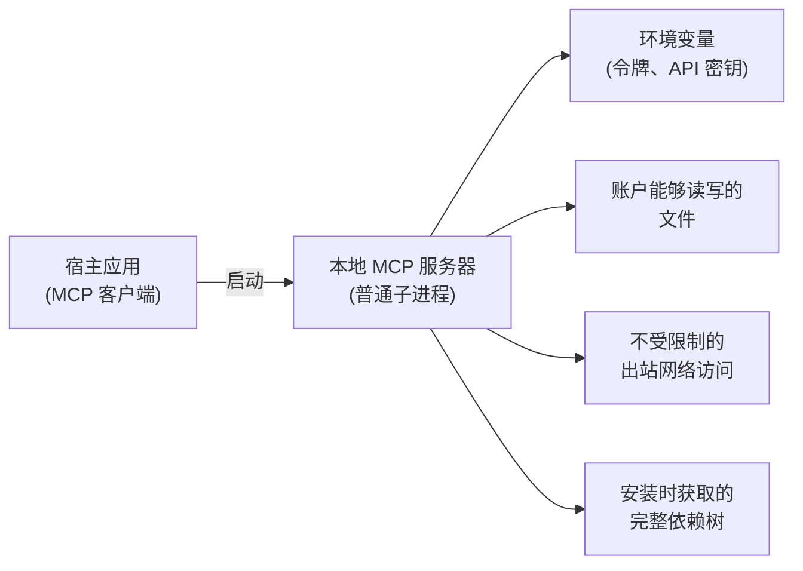

大多数 MCP 安全文档讨论协议威胁模型：OAuth 流程、令牌处理、会话劫持和混淆代理攻击。相关内容请参阅[授权](/docs/draft/tutorials/security/authorization)和[安全最佳实践](/docs/draft/tutorials/security/security_best_practices)。

本指南讨论另一种威胁模型：**你的机器**。在本地运行 MCP 服务器时，你会从互联网下载代码，并以用户账户的子进程运行它。该进程会继承你的环境变量，可以读取账户能读取的任何内容（SSH 密钥、云凭据、浏览器配置、主目录），也可以向任意位置建立出站网络连接。这些行为不受协议约束，而取决于你如何运行进程。

<Note>
  **范围：**本指南讨论运行在你（或组织用户）控制的机器上的服务器，通常通过 stdio 启动。部署和加固远程或托管服务器是另一个主题，需要不同的控制措施。
</Note>

<Tip>
  **读完本指南后只做一件事：**打开客户端的 MCP 配置，移除不再使用的服务器，确认每个剩余服务器的来源，并固定其版本。本指南的其他内容都建立在你确切知道正在运行什么的基础上。
</Tip>

## 本地服务器可以触碰什么

本地 MCP 服务器不是协议提供沙箱中的插件，而是由宿主应用启动的普通操作系统进程，拥有该权限所带来的全部访问能力：

提供一键安装的客户端必须在执行前显示准确命令（[SEP-1024](/seps/1024-mcp-client-security-requirements-for-local-server-)），但只有在你知道该查看什么时，同意对话框才有帮助。本指南的其余部分就是为此而写。

### stdio 信任模型

大多数本地服务器使用 stdio 传输：客户端将服务器作为子进程启动，双方通过 stdin 和 stdout 通信。这带来一个重要假设：**客户端和 stdio 服务器属于同一个信任域。**它们以相同权限并排运行，协议和 SDK 都不会让一方防御另一方。服务器一旦被启动，就已经获得了在机器上执行代码的能力，传输无法在两个进程之间建立边界。这是有意设计的：SDK 假设 stdio 对等方之间完全信任，本地服务器周围的隔离和安全围栏由宿主应用及机器操作者负责。

实际有两个后果：

- 真正的安全决策发生在**启动之前**：安装什么（来源）以及如何运行（隔离）。stdio 传输不是沙箱。
- 如果你以较低权限运行服务器，该边界需要由你自己执行，可以使用下文的容器、沙箱或虚拟机。

信任域还会累积。你配置的每个服务器共享同一个模型上下文，因此恶意服务器可以影响代理如何使用其他服务器的工具。每次安装都会扩大其他服务器暴露在其中的攻击面。

### 本指南处理的威胁

1. **恶意服务器。** 拼写相近的包名、相似的仓库，或被新发布者接管的废弃项目。服务器表面上按预期工作，同时窃取环境变量或文件。
2. **过度收集的服务器。** 合法服务器收集了工作所需之外的环境变量、文件或网络流量。未受信任内容中的提示注入也可以将诚实服务器引向同样的越权行为，利用你授予它的访问权限。
3. **被入侵的依赖。** 服务器作者诚实，但依赖树中的某个包在供应链攻击中被入侵。
4. **被投毒的工具目录。** 工具名称和描述是模型读取的指令。服务器可以在其中隐藏引导代理的内容，包括如何使用其他服务器的工具，即使被投毒的工具从未被调用（通常称为工具投毒，针对其他服务器工具时也称为工具遮蔽）。定义在安装时也不是固定的：服务器可以在你批准后悄悄更改定义（rug pull），因此一次性同意对话框和包版本固定不能覆盖这部分攻击面。
5. **存在漏洞的服务器或桥接器。** 合法且未被修改的组件仍可能成为入口。连接到恶意端点就能触发本地桥接器的严重漏洞，而监听端口的本地开发工具也可能被网页直接利用。

本指南不讨论：能够物理访问机器的攻击者、针对性的国家级攻击，以及协议层攻击（见上面的链接文档）。

在讨论缓解措施前，有一个决定所有措施形态的事实：**没有任何检查可以证明服务器会做什么。**协议无法保证服务器就是它声称的服务器，也无法保证它只做承诺的事情。可读的仓库、签名、SBOM、精选目录等来源信号只能说明你在信任谁，并不能证明这种信任合理。除非审计并自行构建每个版本，否则无法预先验证行为。

因此，下文的缓解措施遵循一个原则：**将第三方本地服务器视为不受信任代码，只授予你明确交给它的权限，并尽量少交。**审查降低错误信任决策的概率，隔离决定错误决策的代价。每节都给出基线、可选的进一步措施，以及不确定时的默认选择。

## 先问它是否需要本地运行

缩小爆炸半径最便宜的方式，是不要先制造它。在将服务器作为本地进程安装前，先问它究竟需要机器上的什么。读取工作树、驱动本地工具或访问硬件，是本地运行的理由。包装远程 API 则不是：只与互联网服务通信的服务器在笔记本上运行没有收益，而你却要承担本指南列出的所有额外风险。

- **有远程版本时优先使用远程版本。**通过[可流式 HTTP](/specification/2026-07-28/basic/transports/streamable-http)提供的服务器不会在机器上运行代码，使用协议授权流程，而不是本地配置文件中的令牌，并且只需在一个位置打补丁。此时应适用协议威胁模型，而不是本指南的模型。
- **将不必要的本地安装视为信号。**第三方服务器没有本地访问需求，却只以 stdio 进程提供时，应询问原因。这可能只是作者选择了最省事的路径，但也正是恶意或过度收集服务器进入机器的方式。
- **保留真正需要本地运行的例外。**有些能力只能由本地进程提供。对于这些服务器，本指南其余部分全部适用。

**不确定时：**如果服务器不需要你的文件、本地工具或本地网络，请使用远程版本，完全跳过本地安装。

## 安装前检查来源

注册表中的条目不是背书。Docker Hub、ghcr.io、npm、PyPI 和 NuGet 几乎什么都会托管，包受欢迎或名称正确都不能保证安全或仍在维护。即使是精选 MCP 目录，也通常只承诺尽力审查：精选可以降低风险，但不会替你承担运行代码的责任。

安装服务器前：

- **确认发布者。**能否将包关联到源代码仓库以及真实维护者或组织？仓库是否有近期且合理的活动？
- **核对精确的包名。**拼写相似是最便宜的攻击方式。确认安装的是文档实际指向的包，而不是相似名称的包。
- **固定版本。**安装具体版本而不是 `latest`，避免被入侵的未来版本通过自动更新进入机器。同时要有明确的更新习惯：固定版本也意味着安全公告发布后你可能一直暴露在漏洞中。
- **了解固定覆盖范围。**使用 `npx` 或 `uvx` 这类启动器固定顶层包版本，并不固定安装时新解析的传递依赖；被入侵依赖正是通过这里进入。按摘要（`image@sha256:...`）固定容器镜像，才能冻结完整依赖树。
- **优先选择有来源元数据的产物。**签名产物、构建证明和 SBOM（软件物料清单）可以帮助核对谁构建了产物以及其中有什么，包括使用的 MCP SDK 及其版本；当某个版本出现漏洞时，这一点尤其重要。

**进一步：**不要只记录签名和证明存在，而要实际验证它们（例如使用 Sigstore 工具或注册表的证明验证），并从产物自行生成 SBOM（例如使用 Syft 或 Trivy），不要盲目信任发布的清单。有些注册表和运行时可以在启动时验证签名，将来源检查从一次性安装检查变成持续检查。

**不确定时：**只安装源代码可读、发布者可确认的服务器，并固定精确版本。

## 将工具定义视为不受信任输入

安装服务器并不是最后一次信任决策。运行时，服务器会向客户端发送工具名称和描述，模型会将它们当作指令读取，这构成安装审查无法覆盖的注入面。

- **依赖服务器前先阅读工具列表。**大多数客户端可以显示每个工具的描述，[MCP Inspector](/docs/draft/tools/inspector) 可以在模型不参与的情况下列出服务器暴露的每个工具。如果描述包含与工具职责无关的指令，请移除该服务器。
- **优先选择会固定工具定义的客户端。**有些客户端会在首次批准服务器时记录工具定义，定义改变时再次询问。协议并不要求这样做，因此这是选择客户端时值得考虑的属性。
- **保持服务器清单小。**所有配置的服务器共享模型上下文，每增加一个服务器，就扩大其他服务器暴露在其中的范围。

**不确定时：**安装少量服务器，逐一浏览工具描述，并优先选择工具定义改变时会重新询问的客户端。

## 在隔离环境中运行服务器

进程隔离是本指南中杠杆最大的缓解措施。它可以将“服务器能读取我的 SSH 密钥”变成“服务器只能读取空目录”，即使来源检查失败，也能同时防御上面列出的各种威胁。

- **基线：**在容器（如 Docker 或 Podman）中运行第三方服务器，除服务器真正需要的内容外不挂载其他卷。stdio 传输无需改变：客户端与容器 stdin、stdout 的通信方式和裸进程完全相同。
- **替代方案：**专用于开发工作的轻量虚拟机，或操作系统提供的进程沙箱。一些面向 MCP 的运行时和客户端集成会自动用容器包装服务器；重要的是模式，而不是具体工具。

容器不是不可穿透的边界，但它会移除对环境、文件和钥匙串的默认访问，而常见攻击正是依赖这些访问。

**进一步：**加固容器本身：seccomp 配置可以限制系统调用，AppArmor 或 SELinux 等 Linux 安全模块可以限制可访问内容，通常只需启用发行版默认配置。再进一步，可以在 microVM 或独立用户账户中运行服务器，并与下文网络控制结合，使沙箱既看不到多余内容，也无法外传少量可见内容。

**不确定时：**将每个第三方服务器放在容器中运行，只挂载它实际要处理的目录。

## 隔离凭据

本地启动的服务器可能继承启动它的环境。如果 shell profile 全局导出了云凭据和 API 令牌，每个服务器都有可能读取全部凭据。

- **按服务器传递密钥，不要全局传递。**使用客户端配置中的每服务器环境配置，而不是在 shell profile 中导出密钥，让每个服务器只看到自己的凭据。
- **严格限制令牌。**为每个服务器签发独立令牌，并使用可用的最小权限（例如只限一个仓库的细粒度访问令牌，而不是账户级令牌），这样泄露后容易限制和撤销。
- **不要把长期凭据放在明文配置中。**客户端配置文件是已知且可预测的磁盘位置。客户端支持引用时，优先使用操作系统机密信息存储（例如 macOS Keychain、Windows Credential Manager 或 Linux freedesktop Secret Service）。
- **文件也属于凭据。**`~/.ssh`、`~/.aws` 等目录同样是磁盘上的凭据。真正能阻止服务器访问它们的是上面的进程隔离。

**进一步：**使用启动时由密钥管理器或代理签发的短期凭据，而不是静态令牌；如果决定移除某个服务器，轮换它曾经持有的所有凭据。

**不确定时：**通过每服务器配置为每个服务器提供独立且范围狭窄的令牌，绝不在多个服务器之间复用个人的广泛权限令牌。

## 限制文件系统访问

许多有用的服务器确实需要访问文件，问题在于访问多少。

- **授予能工作的最小根目录。**为面向文件系统的服务器配置明确的项目目录，通过服务器配置或工具参数传入，绝不要传入主目录。
- **优先只读。**如果服务器的工作只是读取代码或文档，将目录以只读方式挂载或授权。
- **警惕范围过宽。**服务器只处理狭窄任务，却要求宽泛根目录，是越权信号。请授予更窄目录，或改用其他服务器。

<Warning>
  配置层的允许列表是**合作式边界**：行为良好的服务器会遵守它，但协议不会阻止恶意或被入侵服务器读取进程能够访问的其他内容。应将它们视为诚实服务器的护栏。真正的执行来自上面的隔离层，即沙箱或容器，在其中允许的目录是服务器唯一可见的文件系统。
</Warning>

**进一步：**将允许列表与隔离结合，使服务器实际能看到的文件系统只有你选择的挂载目录。

**不确定时：**只授予单个项目目录的只读访问。

## 控制网络出站

数据外泄需要出口。本地进程通常拥有不受限制的出站访问，这会将过度收集或入侵直接变成数据损失。

- **了解服务器应该访问哪里。**包装单个 API 的服务器应有短且可预测的目标集合，访问其他位置是值得调查的信号。
- **不需要网络时禁止网络。**只操作本地文件或工具的服务器不需要网络；使用容器时只需一个 `--network=none` 标志。
- **过滤剩余流量。**确实需要出站的服务器，应通过出站过滤防火墙或带域名允许列表的出站代理限制到预期目标，并记录超出范围的尝试。

<Note>
  出站不是唯一的网络问题。监听端口的本地 MCP 管道（连接远程服务器的桥接器、开发工具、本地托管的 HTTP 服务器）可被其他本地进程访问，也可能通过浏览器被网站访问。绑定 `127.0.0.1` 不是身份验证边界：这类组件需要真正的身份验证和来源校验，并应在出现公告时及时更新。
</Note>

**进一步：**通过代理为每个服务器设置独立出站允许列表，并对超出范围的目标报警；异常出站通常是本页所述问题已经发生的第一个可观察信号。

**不确定时：**除非服务器明确需要网络，否则禁用网络；对其余服务器，确认它们预期访问的目标。

## 在组织中管理本地服务器

如果你是 IT、安全或平台管理员，上面的章节是基础组件，但你的问题不同：机器多、用户多，服务器还可能在你不知情的情况下安装。两个事实决定了整体做法：

1. **本地 MCP 服务器是用户安装的普通软件。**协议无法清点、修补或隔离它不管理的机器上的进程。这属于端点和软件治理，是你原本就有的责任，只是新增了一类软件包。
2. **用户不会先来询问。**假设用户会像安装编辑器扩展一样安装服务器。

可行的起点：

- **定义批准来源。**发布一份经过审查且固定版本的服务器短允许列表，并说明新服务器加入所需的条件：可确认的发布者、可读源码、来源元数据和 SBOM。让批准路径比未批准路径更容易。
- **设定默认运行姿态。**决定并记录托管机器上的服务器运行方式，例如“第三方服务器在不挂载主目录的容器中运行”，不要将隔离责任留给每个用户临时决定。
- **本地访问不必要时集中部署。**本指南开头的问题适用于整个设备群：只包装 SaaS API 的服务器不必在每台笔记本上运行。集中托管可以只维护、审计和控制一个实例，而不是数百个实例。
- **持续清点。**每个平台上的客户端配置文件都位于已知位置。端点管理工具可以收集它们，持续回答“谁在运行什么版本、来自哪个来源”。
- **保留审计轨迹。**工具支持时，记录受管机器上的 MCP 活动（哪个服务器、哪个工具、何时使用），这样事件复盘可以重建被入侵或越权服务器实际做了什么，而不是只根据权限猜测。
- **为设备群事件做准备。**广泛使用的本地服务器（或其中的 SDK）出现漏洞时，需要查找所有实例，用代理或防火墙阻断其出站、轮换配置传给它的每个凭据，并通过批准渠道推送固定的修复版本。SBOM 可以让你在几分钟而非几天内回答“哪些机器运行了基于受影响 SDK 版本构建的内容”。
- **考虑监管背景。**软件供应链法规（例如欧盟网络韧性法案）越来越要求 SBOM、更新流程和漏洞处理，上述工作通常可以同时满足这些要求。

**不确定时：**先清点设备群中的客户端配置，再建立一份批准服务器短列表；列表之外的内容按未经批准的软件处理。

## 检查清单

针对自己的机器：

- 我知道客户端配置中的每个服务器，并移除了不再使用的服务器。
- 不需要机器上任何内容的服务器以远程方式运行，而不是本地进程。
- 每个服务器都来自可确认的发布者，并且版本已固定。
- 第三方服务器在容器、沙箱或虚拟机中隔离运行，而不是裸进程。
- 每个服务器只通过每服务器配置获得自己的最小权限凭据，不继承 shell 凭据，也不复用凭据。
- 文件系统访问限制到具体目录，可能时使用只读权限。
- 不需要网络的服务器已禁用出站；其他服务器有明确的目标列表。
- 我已浏览每个服务器的工具描述，客户端会在工具定义改变时重新询问。

针对设备群：

- 我们维护带有公开准入标准的批准服务器列表。
- 我们持续清点受管机器上的 MCP 客户端配置。
- 我们为本地服务器记录了默认隔离姿态。
- 我们保留受管机器上的 MCP 活动审计日志。
- 我们能够阻断某个服务器的出站访问，并在设备群内轮换其凭据。

## 后续步骤

<CardGroup cols={2}>
  <Card
    title="安全最佳实践"
    icon="shield"
    href="/docs/draft/tutorials/security/security_best_practices"
  >
    协议威胁模型：混淆代理、令牌传递和会话劫持
  </Card>
  <Card
    title="授权"
    icon="key"
    href="/docs/draft/tutorials/security/authorization"
  >
    远程 MCP 服务器的 OAuth 授权机制
  </Card>
  <Card
    title="SEP-1024"
    icon="file-shield"
    href="/seps/1024-mcp-client-security-requirements-for-local-server-"
  >
    本地服务器安装同意流程的客户端安全要求
  </Card>
  <Card
    title="连接本地服务器"
    icon="plug"
    href="/docs/draft/develop/connect-local-servers"
  >
    在客户端中设置本地服务器，即本指南保护的工作流
  </Card>
</CardGroup>
