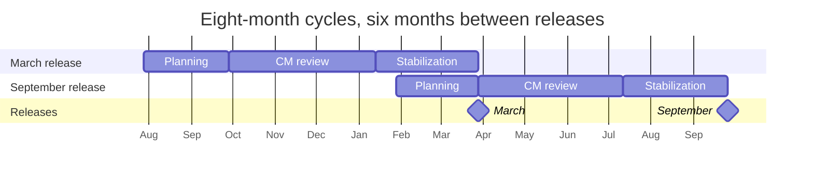

  <Badge color="blue" shape="pill">
    已接受
  </Badge>
  <Badge color="gray" shape="pill">
    流程
  </Badge>

| 字段         | 值                                                                              |
| ------------ | ------------------------------------------------------------------------------- |
| **SEP**      | 3398                                                                            |
| **标题**     | 发布周期更新                                                                    |
| **状态**     | 已接受                                                                          |
| **类型**     | 流程                                                                            |
| **创建日期** | 2026-09-17                                                                      |
| **接受日期** | 2026-10-14                                                                      |
| **作者**     | Kurtis Van Gent ([@kurtisvg](https://github.com/kurtisvg))                      |
| **赞助人**   | Kurtis Van Gent ([@kurtisvg](https://github.com/kurtisvg))，代表核心维护者团队  |
| **PR**       | [#3398](https://github.com/modelcontextprotocol/modelcontextprotocol/pull/3398) |

---

## 摘要

本提案为 Model Context Protocol（MCP）建立可预期的发布周期。规范通常在每年 3 月和 9 月的最后一个星期二发布，每六个月发布一次。每个版本周期为八个月，包括两个月规划、明确的核心维护者审查窗口，以及发布前的稳定阶段。相邻周期重叠两个月。

每份 SEP 由一个工作组或核心维护者团队赞助。提案全年都可持续推进，所有类型的 SEP 都使用排定的核心维护者审查窗口。计划纳入某次发布的提案必须在软冻结前达到 Final 并完成合并。接受提案后即可开始 SDK 实现。尚未完成的提案顺延至后续周期，不改变发布日期。

每个周期由一名主要发布经理和一名副发布经理协调，副发布经理将在下一周期担任主要发布经理。本提案建议将原定于 2026 年 12 月的发布目标移至 2027 年 3 月下旬，之后遵循固定节奏。

<a id="motivation" />

## 动机

贡献者需要知道何时确定优先事项、何时审议提案，以及实现必须何时准备就绪。核心维护者的审查能力有限，而工作组和 SDK 维护者需要足够时间来完善提案、测试实现，并在规范发布前消除歧义。

当前的 [SEP 指南](https://modelcontextprotocol.io/community/sep-guidelines)定义了赞助、审查、接受和定稿流程，但没有将这些阶段与固定发布日历关联。[SDK 分级政策](https://modelcontextprotocol.io/community/sdk-tiers)要求 Tier 1 SDK 在规范发布前提供支持，但每次发布的时间表另行商定。明确的里程碑可以让各方更好地协调。

核心维护者在 MCPCon Europe 最近一次 Core Maintainer Day 上共同制定了这项流程。本 SEP 将该提案正式化。未完成的提案顺延至下一次发布。

<a id="specification" />

## 规范

<a id="release-cadence-overview" />

### 发布节奏概览

MCP 通常在每年 3 月和 9 月的最后一个星期二发布规范。发布经理会在每个周期公布的日历中确认具体日期。每个周期从目标发布日期前八个日历月开始。前两个月专用于规划，最后两个月与下一版本的规划重叠。

所有发布里程碑都以发布前的日历月表示，包括半个月间隔。这些间隔用于设定规划目标；具体日期和截止时间以公开发布日历为准。

| 里程碑       | 发布前时间 | 结果                                              |
| ------------ | ---------- | ------------------------------------------------- |
| 开始规划     | 8 个月     | 拟定路线图并收集维护者和工作组的反馈。            |
| 开启 CM 审查 | 6 个月     | 公布优先事项并开始按计划审查 SEP。                |
| 软冻结       | 2.5 个月   | 结束审查，将范围冻结为已达 Final 且已合并的 SEP。 |
| 下一周期规划 | 2 个月     | 开始规划下一次发布。                              |
| SDK测试版    | 1.5 个月   | 发布 Tier 1 SDK Beta 版本，供生态系统测试。       |
| 硬冻结       | 1 个月     | 仅允许紧急情况下更改规范。                        |
| 发布         | 0 个月     | 发布规范、发布说明和就绪情况指南。                |

下图中的两个周期共享同一条月份时间轴。**1 月下旬至 3 月下旬为两个月的重叠期**：3 月版本处于稳定阶段，同时开始规划 9 月版本。图示展示的是常规节奏，日期仅为示意；具体截止日期以公开发布日历为准。

当前版本发布当天，下一周期的规划结束，CM 审查窗口开启。对于 9 月发布，类似的重叠期为 7 月下旬至 9 月下旬，同时开始规划下一年 3 月的版本。SDK Beta 和冻结时间见上表。

<a id="release-management" />

### 发布管理

每次发布由一名主要发布经理和一名副发布经理负责。发布经理由主动提名的维护者担任，并由超过半数符合资格的核心维护者（CM）投赞成票选出。投票资格遵循[投票与记录结果](#voting-and-recorded-outcomes)中的规定。

核心维护者为两名发布经理提供履职所需的权限，包括访问仓库、发布工具、审查队列和沟通频道，并邀请他们参加所有 CM 会议。

发布经理先担任一个周期的副发布经理，随后在下一个周期担任主要发布经理。核心维护者会在下一次发布的规划开始前选出新任副发布经理。

主要发布经理负责发布日历、审查安排、范围跟踪、冻结协调、SDK 就绪情况、发布和沟通。副发布经理参与这些工作，与主要发布经理共同维护队列和交接记录，并熟悉发布流程。发布经理负责协调和升级决策；SEP 接受与例外批准权仍由本 SEP 规定的相应角色掌握。

如果发布经理无法继续履职，核心维护者会通过相同的提名和投票流程选出继任者，并记录新的人员安排。

按照本流程完成首次发布后，发布经理会发布回顾，涵盖队列等待时间、软冻结时的就绪情况、SDK Beta 可用性、紧急变更，以及周期重叠期间的工作负荷。对本流程的实质性变更遵循 SEP 流程。

<a id="planning" />

<a id="planning-—-8-months-before-release" />
### 规划：发布前 8 个月

规划在发布前 8 个月开始，持续至发布前 6 个月的 CM 审查窗口开启。规划一开始，发布经理就会公布本周期各项里程碑的具体日期和截止时间。

规划期间，核心维护者会提出路线图、收集维护者和工作组（WG）的反馈，并公布覆盖未来六到十二个月的优先事项。规划也会确定工作组和 SDK 之间的依赖关系。纳入路线图表示优先安排审查，但不保证提案会被接受或纳入某个特定版本。

<a id="cm-sep-review" />

<a id="cm-sep-review-—-6-to-25-months-before-release" />
### CM SEP 审查：发布前 6 至 2.5 个月

CM 审查窗口在发布前六个月开启，在软冻结时结束。该窗口适用于 Standards Track、Extensions Track、Process 和 Informational 类型的 SEP。预审和正式审查均安排在此窗口内。全年都可以向队列提交提案。

工作组在整个周期中持续起草提案、制作原型、收集社区反馈并进行内部审查。面向后续发布的规范变更则继续留在提案分支或 PR 中，直至当前版本发布。

Process 和 Informational SEP 在接受并完成其实现要求后即可生效。扩展沿用各自的发布生命周期。它们的 CM 审查时间安排遵循本 SEP；规范冻结则适用于正在准备的规范发布范围。

<a id="sponsorship-and-submission" />

#### 赞助与提交

正式审查前，每份 SEP 都需要由工作组或核心维护者团队赞助，并指定一名代表代其行事。赞助表示支持将提案提交审查；是否正式接受仍须另行决定。

- **工作组赞助：**在工作组指定且可公开阅读的仓库或分支中开发提案，并通过现有的[工作组决策流程](https://modelcontextprotocol.io/community/working-interest-groups#making-decisions)取得批准。工作组负责人记录决定及未解决的问题，然后将准备就绪的 SEP 提交至 [SEP 审查队列](https://voting.modelcontextprotocol.io/p/seps)。
- **核心维护者团队赞助：**核心维护者同意赞助提案，并指定一名 CM 代表团队。该代表记录赞助决定，征询相关工作组意见，然后将准备就绪的 SEP 提交至同一队列。无需另行取得工作组批准。

正式提交至队列前，两种方式都要求在 MCP 主仓库创建正式的 SEP PR。依照 [SEP-1850](https://modelcontextprotocol.io/seps/1850-pr-based-sep-workflow)，PR 确定 SEP 编号前先使用占位编号。工作组赞助的 PR 链接至工作组的审查与批准记录；由核心维护者团队赞助的提案可以直接在主仓库中开始。在 PR 中记录赞助团队的决定，以及与受影响工作组的协商情况。

SEP 的 Sponsor 字段填写代表赞助团队的维护者或核心维护者，并由其负责状态、标签和实现跟踪。符合资格的工作组负责人可以担任这一角色；由核心维护者团队赞助时，则由指定的 CM 担任。

两种方式均遵循相同的队列、审查日程和接受要求。某份 SEP 被选中讨论时，发布经理会邀请相关工作组负责人或指定的 CM，以及所有 SEP 作者参加 CM 会议。

<a id="review-queue-and-scheduling" />

#### 审查队列与日程安排

发布经理负责维护公开的 [SEP 审查队列](https://voting.modelcontextprotocol.io/p/seps)。每个队列项目记录提案链接、赞助团队及其代表、已指定的维护者赞助人、请求的审查类型、就绪日期、与路线图的关联，以及目标审查周期。正式审查项目链接至规范的上游 SEP PR。预审项目可以链接至尚无上游 SEP 编号或尚未完成团队批准的初始提案。

工作组负责人或指定的 CM 可以申请可选预审，以便在投入撰写完整提案前讨论方向、依赖关系和主要问题。预审提供指导，但不代表提案已被接受，也不预留发布范围。

发布经理为每次议程安排项目时，优先安排准备就绪的正式审查，其次是预审。在每类审查中，先安排与路线图一致的提案，再按就绪日期从早到晚排序。任何日程例外的原因都要记录在队列中。因实质性修改而退回的提案重新提交时会获得新的就绪日期；仅因议程时间不足而延期的就绪提案则保留原日期。

正式审查在窗口期间定期举行的核心维护者会议上进行。每次正式审查：

1. **会议前两周：**发布经理与核心维护者选出准备就绪的提案，并公布议程及提案链接。
2. **会议前一周：**审查者异步提交评论。作者和赞助人回应评论，并指出需要讨论的问题。
3. **会议期间：**作者、工作组负责人或指定的 CM 介绍提案、未解决的问题，以及已有的实现反馈。
4. **介绍结束后：**启动下文所述的有记录投票，然后在 SEP PR 和队列中公布结果及后续事项。

排定的投票必须在适用的软冻结或硬冻结前结束并通过。计划纳入发布的 SEP 必须在软冻结前达到 Final 并完成合并；后续修正必须在硬冻结前合并。合并前必须满足所有适用要求，包括一致性测试。硬冻结后的变更需要紧急批准。排入队列不保证获得审查时间，也不保证纳入发布。

<a id="voting-and-recorded-outcomes" />

#### 投票与记录结果

提案介绍结束后，指定的维护者赞助人会在维护者 Discord 服务器中发起为期七个日历日的有记录投票，并从 SEP PR 链接到投票记录。记录须注明所投票的提案修订版、截止时间和符合资格的投票者：投票开始时在册的核心维护者团队成员，包括主要维护者，但不包括荣誉维护者。

提案获接受需要获得超过半数符合资格投票者的赞成票。弃权和缺席均不计为赞成票，仅在会议出席者中取得多数也不足以通过。若多数投票者反对，则提案被拒绝；否则，未达到接受门槛的提案将退回修改或安排以后再审。赞助人会在 SEP PR 中记录票数、决定、理由和后续事项，并根据现有指南更新提案状态。

投票期须完整开放七天，但[硬冻结](#hard-freeze-—-1-month-before-release)期间缩短的紧急投票除外。若投票期间提案发生实质性变更，须退回审查，不能依据针对早期修订版投出的票接受。投票未能在审查窗口结束前完成时，顺延至下一窗口，未完成的投票不能视为接受。

投票结束时生效的规则适用于该次投票，即使投票在冻结前开始也一样。软冻结后只允许在冻结范围内进行修正；硬冻结后，变更必须符合紧急标准并满足核心维护者全体投票要求。批准本身不能使变更免受合并时有效的冻结规则约束。

现有[主要维护者权限](https://modelcontextprotocol.io/community/governance#roles)继续适用。提案涉及治理修订时，还须遵守 [SEP-2085](https://modelcontextprotocol.io/seps/2085-governance-succession-and-amendment) 中更严格的提案、评论期限和批准要求。

<a id="implementation-after-acceptance" />

#### 接受后的实现

SDK 维护者应在 SEP 被接受后立即开始实现。尽早开展实现和发布预览版本，有助于及时将歧义和互操作性发现反馈给作者、赞助人、相关工作组和核心维护者，以便仍有机会修改。

SDK 实现并非 SEP 达到 Final 的必要条件。

<a id="soft-freeze-—-2-5-months-before-release" />

<a id="soft-freeze-—-25-months-before-release" />
### 软冻结：发布前 2.5 个月

软冻结时，计划纳入规范发布的每份 SEP 都必须达到 Final 并完成合并。这包括规范文本、适用的架构变更、变更日志条目、完成的参考实现，以及 [SEP-2484](https://modelcontextprotocol.io/seps/2484-conformance-tests-required-for-final-seps) 要求的一致性测试。仅仅接受提案并不足以满足截止要求。

发布经理会公布冻结范围和延期提案。从软冻结到硬冻结期间，变更仅限于该范围内的缺陷修复、润色和澄清。新功能和重大重新设计顺延到后续周期。修正仍须遵循正常审查流程及适用的测试要求。

未能按时定稿的已接受提案仍保持 Accepted 状态，并跟踪至后续发布。仍在等待决定的提案保留现有状态并返回队列。单纯延期无需重新进行接受投票，但实质性重新设计需要重新审查。被拒绝的提案遵循现有拒绝和重新提交流程。

能否纳入后续周期的发布，仍取决于准备情况和该周期的范围。不会为未完成的提案推迟发布日期。

<a id="next-cycle-planning-—-2-months-before-release" />

### 下一周期规划：发布前 2 个月

当前版本仍处于稳定阶段时，下一次发布的规划会提前 2 个月开始，即下一版本发布前 8 个月。下一周期遵循上述规划流程，在当前版本发布当天结束规划并开启 CM 审查窗口。

在这两个月的重叠期中，当前周期的副发布经理还会担任下一周期的主要发布经理。他们在协助当前版本进入稳定阶段的同时，与新任副发布经理共同领导下一周期的规划。即将离任的主要发布经理仍负责当前版本，直至发布完成。

<a id="sdk-beta-—-1-5-months-before-release" />

<a id="sdk-beta-—-15-months-before-release" />
### SDK Beta：发布前 1.5 个月

Tier 1 SDK 会在发布前 1.5 个月提供支持冻结规范范围的 Beta 版本，让客户端和服务器开发者在硬冻结前有半个月报告问题。Beta 发布说明会列出目标规范版本、可用功能、已知差距和反馈渠道。SDK 维护者会向发布经理提供一致性测试结果和未解决的阻塞问题。

此里程碑涵盖 SDK 分级政策要求的功能；实验性功能或扩展并非 Tier 1 必须支持的内容。我们鼓励其他 SDK 也参与 Beta 里程碑，并继续履行现有级别承诺。

发布经理会维护公开的就绪情况摘要，记录 SDK 版本、一致性结果、差距、负责人及预计解决日期。错过 Beta 或稳定版本里程碑的问题会升级给核心维护者和 SDK 工作组，并在发布指南中披露。单个 SDK 延误不会推迟规范发布，也不会自动更改该 SDK 的级别；级别决定仍遵循现有分级政策。

<a id="hard-freeze-—-1-month-before-release" />

### 硬冻结：发布前 1 个月

硬冻结从发布前 1 个月开始。冻结规范的每项变更都须经核心维护者全体投票批准。只有针对严重安全漏洞，或阻碍发布的正确性或互操作性缺陷的变更可以提交投票。新增功能和可自行决定的重新设计均不符合条件。

主要发布经理通过常规 PR 流程协调每项例外：

1. 确认拟议变更符合上述紧急标准。记录符合条件的缺陷、不能等待的原因、最小修正方案及其对 SDK 和发布产物的影响。不符合标准的变更不得提交投票。
2. 主要发布经理为修正 PR 向全体核心维护者发起有记录投票。无需单独提交 SEP、指定 SEP 赞助人或在会议上进行提案介绍。
3. 合并前取得受影响实现维护者的审查，并运行相关回归测试和一致性检查。如果可观察的协议行为发生变化，还须更新适用的一致性测试覆盖。
4. 记录投票、决定、验证结果和任何实现指南变更。通知受影响的 SDK 维护者，并更新就绪情况摘要和发布说明。

紧急投票可以在 CM 审查窗口之外进行并结束。必要时，主要发布经理可以缩短七天投票期，但必须通知所有符合资格的 CM 截止时间及其原因。批准仍需超过半数符合资格的 CM 投赞成票。投票资格和主要维护者权限遵循[投票与记录结果](#voting-and-recorded-outcomes)中的规定。

必须在合并前完成批准和验证。如果缺陷无法及时安全修复，则移除受影响的新功能及其依赖变更也须符合紧急条件，并经相同的核心维护者全体投票批准。其余规范按计划发布。

涉及安全的信息遵循现有的[安全报告与披露流程](https://modelcontextprotocol.io/community/security)。保密期内，将决定和验证记录保存在受限频道中；允许披露时再公开。

<a id="release-—-0-months-before-release" />

### 发布：发布前 0 个月

Tier 1 SDK 会在规范发布前提供稳定支持，以符合其现有功能支持承诺。

发布日依照现有流程发布带日期的规范、发布说明、实现和迁移指南，以及 SDK 就绪情况摘要。协议版本继续使用日期格式。交接说明中记录未解决问题和后续负责人。即将接任的主要发布经理继续领导下一周期，并在此时开启审查窗口。

<a id="transition-and-adoption" />

### 过渡与采用

本 SEP 提议将原定于 2026 年 12 月的发布改至 2027 年 3 月 30 日（3 月的最后一个星期二），具体以过渡日历确认为准。上一版规范于 2026 年 7 月 28 日发布。首个周期采用 2026 年 8 月已完成的规划。

采纳本 SEP 后两周内，核心维护者通过上述提名和投票流程选出首任主要发布经理和副发布经理；两人随后公布过渡日历、审查会议，以及冻结、Beta 和发布的具体截止日期。首任主要发布经理不必先担任过一个周期的副发布经理。流程正式运行时，过渡日历会开启首个审查窗口，并在根据 3 月版本计算的软冻结日结束。会议安排必须留出完整的议程准备时间和投票期。

2027 年 9 月版本的规划于 2027 年 1 月下旬开始。2028 年 3 月版本的规划于 2027 年 7 月下旬开始。之后的周期遵循完整的固定日历。

现有上游 SEP PR 继续有效，并保留其编号、讨论和已完成的决定。在下一次正式审查前，提案须获得工作组或核心维护者团队赞助并加入队列；作者无需关闭现有 PR，也无需在工作组仓库重新创建 PR。已接受的提案继续保持接受状态，但必须满足发布就绪要求。本 SEP 本身按照其采纳前有效的流程处理。

<a id="rationale" />

## 理由

<a id="predictable-dates-with-flexible-scope" />

### 日期可预期，范围保持灵活

每六个月发布一次，能为实现者提供固定的规划周期。八个月的周期让路线图规划与稳定阶段重叠，因此可以在准备下一版本优先事项的同时完成当前版本。以月为单位表示所有里程碑，便于比较时间线；公开日历则提供具体截止日期。

若为等待未完成的提案而推迟发布，会让下一次发布更难规划。调整范围、将未完成的工作顺延，则既为其提供新的机会，也不代表提案因错过期限而被拒绝。

<a id="review-capacity-and-sponsorship" />

### 审查能力与赞助

工作组审查能让领域反馈和原型在提案占用 CM 议程时间前进入讨论。公开队列使优先事项和延期情况一目了然。所有类型的 SEP 使用相同的 CM 窗口可以简化日程安排，但可能会延后窗口外准备就绪的流程或扩展提案。工作组全年持续开发以及可选预审，可帮助贡献者为下一次审查机会做好准备。

核心维护者团队赞助为流程变更、涉及多个小组的提案以及尚无对应工作组的议题提供直接途径。征询相关工作组意见可以保留领域反馈，两种途径适用相同的审查和接受要求。指定赞助人则继续负责状态跟踪和实现职责。

<a id="readiness-before-stabilization" />

### 稳定阶段前确保准备就绪

要求 SEP 在软冻结时达到 Final 并完成合并，可让 SDK 维护者获得明确的规范以供实现和测试。如果只要求提案已被接受就进入稳定阶段，规范文本或一致性测试工作就会与缺陷修复争夺时间。尽早开展 SDK 实现可以降低此风险，但不要求所有 SDK 都实现才能让 SEP 定稿。

<a id="recorded-votes-and-emergency-review" />

### 有记录投票与紧急审查

七天投票让不同时区的参与者都能投票，也为未出席会议的人提供明确的投票机会。要求取得符合资格成员的多数票，能避免因会议人数较少而接受提案，但也意味着每个截止日期前需要足够的参与度。

核心维护者全体投票，让冻结发布范围的变更由整个团队负责决策。

<a id="rotation-and-transition" />

### 轮换与过渡

先担任副发布经理，能让发布经理为领导下一周期做好准备。明确每个重叠周期的职责归属，可以避免交接时责任不清。将近期目标调整至 2027 年 3 月下旬，为引入日历和就绪里程碑留出时间，同时承认已完成的规划工作。

<a id="backward-compatibility" />

## 向后兼容性

本 SEP 更改贡献和发布流程，不引入协议消息、架构变更、版本协商变更，也不增加已部署客户端和服务器的新要求。现有基于日期的规范版本仍然有效。

由工作组赞助的提案新增团队批准环节；由核心维护者团队赞助的提案则可以直接提交上游。两种方式都使用季节性 CM 审查窗口。既有提案历史和接受决定按照过渡流程保留。本 SEP 更新 SEP-1850 中的赞助和日程安排部分，同时保留规范的上游 PR、基于 PR 的编号、由赞助人管理状态，以及现有定稿要求。

SDK Beta 和稳定版本里程碑明确了发布预期，同时保留现有分级流程，并继续将实验性功能和扩展排除在 Tier 1 的强制覆盖范围之外。Final SEP 仍作为历史记录保留；流程采纳会更新当前贡献指南，而不会重写历史记录。

<a id="security-implications" />

## 安全影响

本 SEP 不会引入新的协议攻击面、身份验证行为或用户数据处理方式。固定日历仍须允许冻结期间修复严重安全问题。紧急流程要求核心维护者全体投票、实现审查和相关验证，同时保留协调披露机制。公开队列和发布说明不得过早披露受保密期约束的漏洞细节。

<a id="reference-implementation" />

## 参考实现

对于本流程 SEP，实现工作包括贡献者文档和运行安排。达到 Final 状态前需要完成以下工作：

1. 更新当前 SEP 指南和工作组指南，说明赞助、上游提交、审查安排、投票和过渡处理方式。
2. 发布发布周期文档和第一版日历，包括 UTC 具体截止时间和审查会议。
3. 建立公开的 [SEP 审查队列](https://voting.modelcontextprotocol.io/p/seps)，发布 SDK 就绪情况摘要，指定其维护者，并记录首任发布经理的任命。
4. 发布清单，涵盖冻结范围、紧急批准、SDK 里程碑、发布和交接。

相关文档变更、日历、队列和人员安排确定后，在此处添加链接。流程类 SEP 不需要满足协议一致性测试要求；现有发布工具可以继续用于发布。
