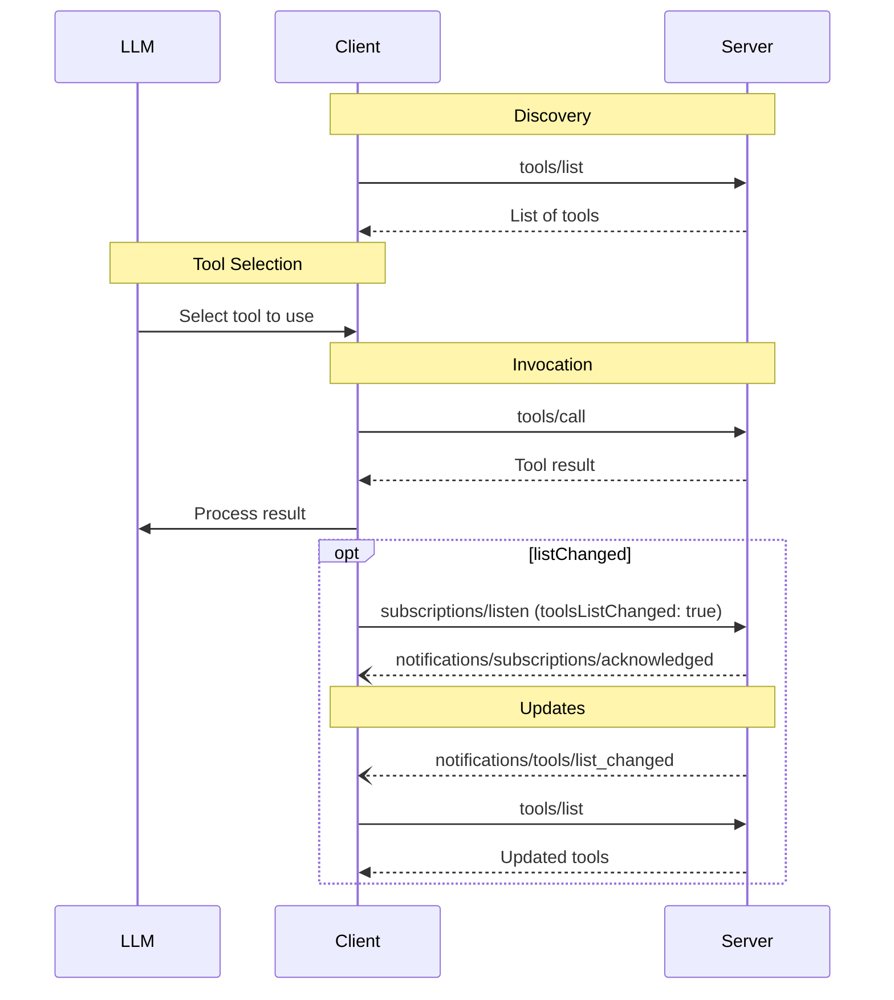

<div id="enable-section-numbers" />

模型上下文协议 (MCP) 允许服务器公开可被调用的工具
语言模型。工具使模型能够与外部系统交互，例如查询
数据库、调用 API 或执行计算。每个工具都由唯一标识
名称并包含描述其模式的元数据。
<Note>
  为简洁起见，本页的请求示例省略了 `_meta` 请求
  元数据（`io.modelcontextprotocol/protocolVersion`，
  `io.modelcontextprotocol/clientInfo`，和
  `io.modelcontextprotocol/clientCapabilities`）。每个请求**必须**包括
  必填的 `_meta` 字段；看到
  [`_meta`](/specification/2026-07-28/basic/index#meta)。
</Note>

<a id="user-interaction-model" />
## 用户交互模型

MCP 中的工具被设计为**模型控制**，这意味着语言模型可以
根据上下文理解自动发现和调用工具
用户的提示。

然而，实现可以通过任何接口模式自由地公开工具
满足他们的需求——协议本身不强制任何特定用户
交互模型。
<Warning>

为了信任和安全，**应该**始终
成为具有拒绝工具调用能力的循环中的人。

应用程序**应该**：
- 提供 UI，明确哪些工具正在向 AI 模型公开
- 调用工具时插入清晰的视觉指示器
- 向用户提供操作确认提示，以确保有人在操作中
  循环
</Warning>

<a id="capabilities" />
## 能力

支持工具的服务器**必须**声明 `tools` 功能：

```json
{
  "capabilities": {
    "tools": {
      "listChanged": true
    }
  }
}
```

`listChanged` 表示当列表出现时服务器是否发出通知
可用工具发生变化。

声明 `tools` 功能的服务器**必须**响应 `tools/list` 请求
以及当前可供请求客户使用的一组工具。这套**可能**是
空并且 **可能** 随着时间的推移而改变（参见
[列表更改通知](#list-changed-notification))，但**不得**有所不同
每个连接或作为连接上其他请求的副作用。套装
**可能**因请求中提供的授权而异 - 例如，返回
仅调用者授予范围允许的工具 - 因为凭据是
每个请求输入，而不是连接状态。

服务器 **应该** 以确定的顺序返回工具（即，跨
当底层工具集未更改时请求）。确定性排序使
客户端可靠地缓存工具列表并提高LLM提示缓存命中率
包含在模型上下文中。

<a id="protocol-messages" />
## 协议消息

<a id="listing-tools" />
### 列出工具

要发现可用的工具，客户端会发送 `tools/list` 请求。该操作支持
[分页](/specification/2026-07-28/server/utilities/pagination) 和[缓存](/specification/2026-07-28/server/utilities/caching)。

**Request:**

```json
{
  "jsonrpc": "2.0",
  "id": 1,
  "method": "tools/list",
  "params": {
    "cursor": "optional-cursor-value"
  }
}
```

**Response:**

```json
{
  "jsonrpc": "2.0",
  "id": 1,
  "result": {
    "resultType": "complete",
    "tools": [
      {
        "name": "get_weather",
        "title": "Weather Information Provider",
        "description": "Get current weather information for a location",
        "inputSchema": {
          "type": "object",
          "properties": {
            "location": {
              "type": "string",
              "description": "City name or zip code"
            }
          },
          "required": ["location"]
        },
        "icons": [
          {
            "src": "https://example.com/weather-icon.png",
            "mimeType": "image/png",
            "sizes": ["48x48"]
          }
        ]
      }
    ],
    "nextCursor": "next-page-cursor",
    "ttlMs": 300000,
    "cacheScope": "public"
  }
}
```

<a id="calling-tools" />
### 调用工具

要调用工具，客户端发送 `tools/call` 请求：

**Request:**

```json
{
  "jsonrpc": "2.0",
  "id": 2,
  "method": "tools/call",
  "params": {
    "name": "get_weather",
    "arguments": {
      "location": "New York"
    }
  }
}
```

**Response:**

```json
{
  "jsonrpc": "2.0",
  "id": 2,
  "result": {
    "resultType": "complete",
    "content": [
      {
        "type": "text",
        "text": "Current weather in New York:\nTemperature: 72°F\nConditions: Partly cloudy"
      }
    ],
    "isError": false
  }
}
```

<a id="input-required-tool-results" />
### 输入所需的工具结果

服务器 **可以** 使用 [`InputRequiredResult`](/specification/2026-07-28/basic/patterns/mrtr#inputrequiredresult) 响应 `tools/call`，以指示在完成工具调用之前需要额外的输入。这遵循[多次往返请求](/specification/2026-07-28/basic/patterns/mrtr#multi-round-trip-requests) 机制。

当使用输入响应重试请求时，客户端在请求参数中包含 `inputResponses` 和 `requestState`（如果服务器提供）：

**输入所需回复：**
```json
{
  "jsonrpc": "2.0",
  "id": 2,
  "result": {
    "resultType": "input_required",
    "inputRequests": {
      "github_login": {
        "method": "elicitation/create",
        "params": {
          "mode": "form",
          "message": "Please provide your GitHub username",
          "requestedSchema": {
            "type": "object",
            "properties": {
              "name": { "type": "string" }
            },
            "required": ["name"]
          }
        }
      }
    },
    "requestState": "eyJsb2NhdGlvbiI6Ik5ldyBZb3JrIn0..."
  }
}
```

**使用输入响应重试：**
```json
{
  "jsonrpc": "2.0",
  "id": 3,
  "method": "tools/call",
  "params": {
    "name": "get_weather",
    "arguments": {
      "location": "New York"
    },
    "inputResponses": {
      "github_login": {
        "action": "accept",
        "content": {
          "name": "octocat"
        }
      }
    },
    "requestState": "eyJsb2NhdGlvbiI6Ik5ldyBZb3JrIn0..."
  }
}
```

请注意，初始请求和重试之间的 JSON-RPC `id` **必须** 不同。

<a id="list-changed-notification" />
### 列表更改通知

当可用工具列表发生变化时，声明 `listChanged` 的服务器
功能 **应该** 向已打开的客户端发送通知
[`subscriptions/listen`](/specification/2026-07-28/basic/patterns/subscriptions) 流
`toolsListChanged: true`：

```json
{
  "jsonrpc": "2.0",
  "method": "notifications/tools/list_changed"
}
```

<a id="message-flow" />
## 消息流



<a id="data-types" />
## 数据类型

<a id="tool" />
### 工具

工具定义包括：
- `name`：工具的唯一标识符
- `title`：用于显示目的的可选人类可读工具名称。
- `description`：人类可读的功能描述
- `icons`：用于在用户界面中显示的可选图标数组
- `inputSchema`：定义预期参数的 JSON 模式
  - 遵循[JSON Schema使用指南](/specification/2026-07-28/basic#json-schema-usage)
  - 如果不存在 `$schema` 字段，则默认为 2020-12
  - **必须**是有效的 JSON Schema 对象（不是 `null`）
  - 对于没有参数的工具，请使用以下有效方法之一：
    - `{ "type": "object", "additionalProperties": false }` - **推荐**：明确仅接受空对象
    - `{ "type": "object" }` - 接受任何对象（包括属性）
  - 属性**可以**包含要公开的 [`x-mcp-header`](#x-mcp-header) 注释
    作为 HTTP 标头的参数值
- `outputSchema`：可选的 JSON 模式定义预期的输出结构
  - 遵循[JSON Schema使用指南](/specification/2026-07-28/basic#json-schema-usage)
  - 如果不存在 `$schema` 字段，则默认为 2020-12
- `annotations`：描述工具行为的可选属性
<Warning>
  为了信任和安全，客户**必须**考虑工具注释
  除非它们来自受信任的服务器，否则不受信任。
</Warning>

<a id="tool-names" />
#### 工具名称

- 工具名称**应该**长度在 1 到 128 个字符之间（含）。
- 工具名称**应该**区分大小写。
- 以下**应该**是唯一允许的字符：大写和小写 ASCII 字母（A-Z、a-z）、数字
  (0-9)、下划线 (\_)、连字符 (-) 和点 (.)
- 工具名称**不应**包含空格、逗号或其他特殊字符。
- 工具名称**应该**在服务器内是唯一的。
- 有效工具名称示例：
  - `getUser`
  - `DATA_EXPORT_v2`
  - `admin.tools.list`
<Note>

工具名称唯一性仅限于单个服务器。客户或代理
来自多个服务器的聚合工具**可能**会遇到命名冲突（例如
例如，两台服务器各自公开一个 `search` 工具）并且**应该**实现
消歧策略，例如在工具名称前添加服务器标识符前缀。

服务器 `name`（来自 `serverInfo`）不保证在整个服务器中是唯一的
服务器并且**不应该**依赖于消除歧义。
</Note>

<a id="x-mcp-header" />
#### x-mcp-标头

`x-mcp-header` 扩展属性允许服务器指定特定工具
使用时要镜像到 HTTP 标头的参数
[流式 HTTP 传输](/specification/2026-07-28/basic/transports/streamable-http#custom-headers-from-tool-parameters)。

这使得网络中介（负载均衡器、代理、WAF）能够路由和处理
基于参数值的请求，而不解析请求体。

`x-mcp-header` 属性直接放置在属性的 JSON 架构中
被镜像。其值指定生成的 `Mcp-Param-{name}` 的名称部分
HTTP 标头。

**`x-mcp-header` 值的约束：**
- **不能**为空
- **必须**匹配 HTTP 字段名称令牌语法（`1*tchar`，[RFC 9110 第 5.1 节](https://datatracker.ietf.org/doc/html/rfc9110#section-5.1)）
- **不得**包含控制字符，包括回车符（CR、`\r`）或
  换行（LF、`\n`）
- **必须**在所有 `x-mcp-header` 值中不区分大小写是唯一的
  `inputSchema`
- **必须**仅适用于具有原始类型（整数、字符串、布尔值）的参数。
  不允许使用 `number` 类型的参数。整数值**必须**在范围内
  使用 IEEE754 双精度浮点数表示的整数的安全范围（−2<sup>53</sup>+1 到 2<sup>53</sup>−1）
- **必须**仅适用于从模式_静态可达_的属性
  根，定义于
  [工具参数的自定义标头](/specification/2026-07-28/basic/transports/streamable-http#custom-headers-from-tool-parameters),
  它还定义了如何从调用参数中提取标头值
使用 Streamable HTTP 传输的客户端**必须**拒绝任何工具定义
`x-mcp-header` 值违反了这些约束。拒绝意味着客户**必须**
从 `tools/list` 的结果中排除无效工具。客户端 **应该** 记录
拒绝工具定义时发出警告，包括工具名称和原因
拒绝。这确保了单个格式错误的工具定义不会阻止其他工具定义
避免使用有效的工具。使用其他传输（例如 stdio）的客户端**可以**忽略
`x-mcp-header` 完全注释。

**使用 `x-mcp-header` 的工具定义示例：**
```json
{
  "name": "execute_sql",
  "description": "Execute SQL on Google Cloud Spanner",
  "inputSchema": {
    "type": "object",
    "properties": {
      "region": {
        "type": "string",
        "description": "The region to execute the query in",
        "x-mcp-header": "Region"
      },
      "query": {
        "type": "string",
        "description": "The SQL query to execute"
      }
    },
    "required": ["region", "query"]
  }
}
```

在此示例中，当使用 `"region": "us-west1"` 调用该工具时，客户端添加
HTTP 请求的标头 `Mcp-Param-Region: us-west1`。
<Warning>

服务器开发人员**不应该**标记敏感参数（密码、API 密钥、令牌、
PII）与 `x-mcp-header`，因为标头值对网络中介可见。
</Warning>

<a id="tool-result" />
### 工具结果

工具结果可能包含[**结构化**](#structured-content) 或**非结构化**内容。

**非结构化**内容在结果的 `content` 字段中返回，并且可以包含多个不同类型的内容项：
<Note>
  所有内容类型（文本、图像、音频、资源链接和嵌入资源）
  支持可选
  [注释](/specification/2026-07-28/server/resources#annotations)
  提供有关受众、优先级和修改时间的元数据。这是
  资源和提示使用相同的注释格式。
</Note>

<a id="text-content" />
#### 文字内容

```json
{
  "type": "text",
  "text": "Tool result text"
}
```

<a id="image-content" />
#### 图片内容

```json
{
  "type": "image",
  "data": "base64-encoded-data",
  "mimeType": "image/png",
  "annotations": {
    "audience": ["user"],
    "priority": 0.9
  }
}
```

<a id="audio-content" />
#### 音频内容

```json
{
  "type": "audio",
  "data": "base64-encoded-audio-data",
  "mimeType": "audio/wav"
}
```

<a id="resource-links" />
#### 资源链接

工具**可以**返回[资源](/specification/2026-07-28/server/resources)的链接，以提供额外的上下文
或数据。在这种情况下，该工具将返回一个可由客户端订阅或获取的 URI：

```json
{
  "type": "resource_link",
  "uri": "file:///project/src/main.rs",
  "name": "main.rs",
  "description": "Primary application entry point",
  "mimeType": "text/x-rust"
}
```

资源链接支持与常规资源相同的[资源注释](/specification/2026-07-28/server/resources#annotations)，以帮助客户了解如何使用它们。
<Info>
  工具返回的资源链接不保证出现在结果中
  `resources/list` 请求。
</Info>

<a id="embedded-resources" />
#### 嵌入式资源

[资源](/specification/2026-07-28/server/resources) **可以** 嵌入以提供额外的上下文
或使用合适的[URI方案](./resources#common-uri-schemes)的数据。使用嵌入式资源的服务器**应该**实现 `resources` 功能：

```json
{
  "type": "resource",
  "resource": {
    "uri": "file:///project/src/main.rs",
    "mimeType": "text/x-rust",
    "text": "fn main() {\n    println!(\"Hello world!\");\n}"
  },
  "annotations": {
    "audience": ["user", "assistant"],
    "priority": 0.7,
    "lastModified": "2025-05-03T14:30:00Z"
  }
}
```

嵌入式资源支持与常规资源相同的[资源注释](/specification/2026-07-28/server/resources#annotations)，以帮助客户了解如何使用它们。

<a id="structured-content" />
#### 结构化内容

**结构化**内容作为结果的 `structuredContent` 字段中的 JSON 值返回。这可以是符合工具的 `outputSchema`（如果已定义）的任何 JSON 值（对象、数组、字符串、数字、布尔值或 null）。

为了向后兼容，返回结构化内容的工具还应该返回 TextContent 块中的序列化 JSON。
<Note>

`structuredContent`是服务器产生的结果数据，与LLM无关
“结构化输出”（架构约束模型生成）。
</Note>

<a id="output-schema" />
#### 输出模式

工具还可以提供用于验证结构化结果的输出模式。

如果提供了输出模式：
- 服务器**必须**提供符合此模式的结构化结果。
- 客户端**应该**根据此模式验证结构化结果。
具有输出架构的示例工具：

```json
{
  "name": "get_weather_data",
  "title": "Weather Data Retriever",
  "description": "Get current weather data for a location",
  "inputSchema": {
    "type": "object",
    "properties": {
      "location": {
        "type": "string",
        "description": "City name or zip code"
      }
    },
    "required": ["location"]
  },
  "outputSchema": {
    "type": "object",
    "properties": {
      "temperature": {
        "type": "number",
        "description": "Temperature in celsius"
      },
      "conditions": {
        "type": "string",
        "description": "Weather conditions description"
      },
      "humidity": {
        "type": "number",
        "description": "Humidity percentage"
      }
    },
    "required": ["temperature", "conditions", "humidity"]
  }
}
```

此工具的有效响应示例：

```json
{
  "jsonrpc": "2.0",
  "id": 5,
  "result": {
    "resultType": "complete",
    "content": [
      {
        "type": "text",
        "text": "{\"temperature\": 22.5, \"conditions\": \"Partly cloudy\", \"humidity\": 65}"
      }
    ],
    "structuredContent": {
      "temperature": 22.5,
      "conditions": "Partly cloudy",
      "humidity": 65
    }
  }
}
```

具有数组输出模式的示例工具：

```json
{
  "name": "list_users",
  "title": "User List",
  "description": "Returns a list of all users",
  "inputSchema": {
    "type": "object",
    "properties": {}
  },
  "outputSchema": {
    "type": "array",
    "items": {
      "type": "object",
      "properties": {
        "id": { "type": "string" },
        "name": { "type": "string" },
        "email": { "type": "string" }
      },
      "required": ["id", "name", "email"]
    }
  }
}
```

具有数组输出的工具的有效响应示例：

```json
{
  "jsonrpc": "2.0",
  "id": 6,
  "result": {
    "resultType": "complete",
    "content": [
      {
        "type": "text",
        "text": "Found 2 users: Alice (alice@example.com) and Bob (bob@example.com)."
      }
    ],
    "structuredContent": [
      { "id": "1", "name": "Alice", "email": "alice@example.com" },
      { "id": "2", "name": "Bob", "email": "bob@example.com" }
    ]
  }
}
```

提供输出模式可帮助客户和法学硕士通过以下方式理解并正确处理结构化工具输出：
- 启用响应的严格模式验证
- 提供类型信息以更好地与编程语言集成
- 指导客户和法学硕士正确解析和利用返回的数据
- 支持更好的文档和开发人员体验

<a id="schema-examples" />
### 架构示例

<a id="tool-with-default-2020-12-schema" />
#### 具有默认 2020-12 架构的工具：

```json
{
  "name": "calculate_sum",
  "description": "Add two numbers",
  "inputSchema": {
    "type": "object",
    "properties": {
      "a": { "type": "number" },
      "b": { "type": "number" }
    },
    "required": ["a", "b"]
  }
}
```

<a id="tool-with-explicit-draft-07-schema" />
#### 具有明确的 Draft-07 架构的工具：

```json
{
  "name": "calculate_sum",
  "description": "Add two numbers",
  "inputSchema": {
    "$schema": "http://json-schema.org/draft-07/schema#",
    "type": "object",
    "properties": {
      "a": { "type": "number" },
      "b": { "type": "number" }
    },
    "required": ["a", "b"]
  }
}
```

<a id="tool-with-no-parameters" />
#### 不带参数的工具：

```json
{
  "name": "get_current_time",
  "description": "Returns the current server time",
  "inputSchema": {
    "type": "object",
    "additionalProperties": false
  }
}
```

<a id="stateful-tools" />
## 有状态工具

<Note>

本节是工具设计的非规范指南。该协议没有
状态句柄的概念；从电线的角度来看，手柄是一个普通的
工具结果中的字符串和后续工具调用的普通参数。
</Note>

MCP 没有协议级会话，因此服务器不能依赖隐式会话
将一个工具调用与下一个工具调用相关联的每个连接状态。需要的服务器
跨调用维护状态——购物车、打开的浏览器上下文、
数据库事务 — 应该通过从 a 返回显式句柄来实现
创建工具并接受该句柄作为后续调用的参数。

例如，管理购物车的服务器可能会公开：

```jsonc
// → tools/call
{ "name": "create_basket", "arguments": {} }

// ← result
{
  "content": [{ "type": "text", "text": "Created basket bsk_a1b2c3" }],
  "structuredContent": { "basket_id": "bsk_a1b2c3" }
}

// → tools/call
{
  "name": "add_item",
  "arguments": { "basket_id": "bsk_a1b2c3", "sku": "..." }
}
```

该模型负责承载`basket_id`前进；服务器存储
该键下的购物车内容并在每次调用时查找它们。

在设计句柄时，服务器应考虑：
- **授权。** 对于经过身份验证的服务器，句柄是名称，而不是
  能力。服务器应该验证调用者的授权
  处理每个电话。对于未经身份验证的服务器，句柄是
  必然是不记名令牌，它应该以足够的熵生成
  （例如，UUIDv4）并给出有限的生命周期。
- **不透明度。** 编码内部结构的句柄邀请解析或
  猜测；不透明标识符则不然。
- **生命周期。** 因为句柄比任何单个连接都存活，所以服务器的
  保留策略应在创建工具的描述中说明（例如，
  “篮子在 24 小时不活动后就会过期”），因此模型可以在以下情况下看到它：
  决定创建国家。
- **过期错误。** 针对过期或未知句柄的调用应返回
  工具执行错误如此说明，因此模型可以通过创建
  新的。

<a id="error-handling" />
## 错误处理

工具使用两种错误报告机制：
1. **协议错误**表示请求结构本身存在模型不太可能修复的问题：
   - 未知工具
   - 格式错误的请求（无法满足 [CallToolRequest schema](/specification/2026-07-28/schema#calltoolrequest) 的请求）
   - 服务器错误
它们作为标准 JSON-RPC 错误返回：
   ```json
   {
     "jsonrpc": "2.0",
     "id": 3,
     "error": {
       "code": -32602,
       "message": "Unknown tool: invalid_tool_name"
     }
   }
   ```

2. **工具执行错误**包含可操作的反馈，语言模型可以使用这些反馈进行自我纠正并使用调整后的参数重试：
   - API 失败
   - 输入验证错误（例如，日期格式错误、值超出范围）
   - 业务逻辑错误
它们在工具结果中报告为 `isError: true`：
   ```json
   {
     "jsonrpc": "2.0",
     "id": 4,
     "result": {
       "resultType": "complete",
       "content": [
         {
           "type": "text",
           "text": "Invalid departure date: must be in the future. Current date is 08/08/2025."
         }
       ],
       "isError": true
     }
   }
   ```

客户端**可以**向语言模型提供协议错误，尽管这些错误不太可能导致成功恢复。

客户端**应该**向语言模型提供工具执行错误以实现自我纠正。

<a id="security-considerations" />
## 安全考虑

1. 服务器**必须**：
   - 验证所有工具输入
   - 实施适当的访问控制
   - 速率限制工具调用
   - 清理工具输出
2. 客户**应该**：
   - 敏感操作提示用户确认
   - 在调用服务器之前向用户显示工具输入，以避免恶意或
     意外数据泄露
   - 在传递给法学硕士之前验证工具结果
   - 遵循[`$ref`分辨率要求](/specification/2026-07-28/basic/index#ref-resolution)
     根据 `inputSchema` 和 `outputSchema` 验证工具输入和输出时
   - 为工具调用实现超时
   - 出于审计目的记录工具的使用情况