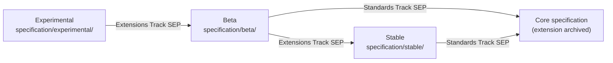

<a id="sep-3392-extension-lifecycle" />
# SEP-3392：扩展生命周期

- **状态**：最终版
- **类型**：流程
- **创建日期**：2026-09-25
- **作者**：Peter Alexander (@pja-ant)
- **赞助人**：@pja-ant
- **PR**：https://github.com/modelcontextprotocol/modelcontextprotocol/pull/3392

<a id="abstract" />

## 摘要

本 SEP 为 MCP 扩展定义成熟度生命周期。扩展从 Experimental 阶段开始，可以晋升至 Beta，随后要么作为扩展达到 Stable 阶段，要么纳入核心规范。存放扩展规范的目录用于表示其所处阶段（`specification/experimental/`、`specification/beta/`、`specification/stable/`）。因此，一个 `ext-<area>` 仓库可以包含处于不同阶段的扩展，阶段变化时也无需重命名仓库。所处阶段决定允许进行哪些协议变更、由谁批准，以及实现者可以期待怎样的稳定性。

Experimental 和 Beta 扩展只需扩展维护者批准即可迭代，并且可以进行破坏性变更。进入 Beta 和 Stable 阶段都需要 Extensions Track SEP。Stable 扩展仅在发布新的核心协议版本时变更。将扩展纳入核心规范则需要 Standards Track SEP。

本 SEP 更新 [SEP-2133](./2133-extensions.md) 定义的扩展生命周期，但不改变扩展的协商方式。

<a id="motivation" />

## 动机

SEP-2133 定义了两类扩展：一类位于 `experimental-ext-` 仓库且不承诺稳定性的实验性扩展；另一类位于 `ext-` 仓库，并通过 Extensions Track SEP 毕业成为正式扩展。该 SEP 没有定义成熟度，因此带来两个问题。

**正式扩展没有稳定性信号。** Extensions Track SEP 是唯一的准入门槛；扩展成为正式扩展后，SEP-2133 允许维护者随时修改它，无需核心维护者审查。实现者无法判断一个正式扩展已趋于稳定，还是仍在调整。各扩展用不同且未定义的术语表示成熟度：`ext-auth` 使用 `specification/stable/` 和 `specification/draft/`，`ext-tasks` 将架构快照标记为“Stable”和“Development”，`ext-skills` 则发布 `specification/stable/`。

**正式扩展的变更时点没有定义。** SEP-2133 允许扩展维护者随时修改正式扩展，并要求每次破坏性变更都使用新标识符。实现者需要可预期的行为变更时点。协议已经提供了这样的机制，因为每个请求都会声明协议版本，而 [SEP-2663](./2663-tasks-extension.md) 已按协议版本定义扩展行为。

[SEP-2596](./2596-spec-feature-lifecycle-and-deprecation.md) 将“功能成熟度层级”留作待解决问题，并指出 Kubernetes 的 alpha/beta/GA 模型。本 SEP 为扩展回答这个问题。

<a id="specification" />

## 规范

<a id="stages" />

### 阶段

| 阶段 | 位置 | 协议变更 | 批准方 | 进入阶段的方式 | 实现者可以期待 |
| --- | --- | --- | --- | --- | --- |
| **Experimental** | `specification/experimental/<name>`，或 `experimental-ext-<name>` 仓库 | 可随时进行任何变更，无需通知 | 扩展维护者 | 扩展维护者添加，或任意维护者创建 `experimental-ext-` 仓库 | 无。设计可能改变或被移除。 |
| **Beta** | `specification/beta/<name>` | 可进行任何变更，破坏性变更预计较少 | 扩展维护者 | 扩展轨道 SEP | 欢迎实际使用。破坏性变更会记录在案。 |
| **Stable** | `specification/stable/<name>` | 仅随新的核心协议版本变更 | 扩展维护者 | 第二份 Extensions Track SEP | 在同一协议版本内，行为保持固定。 |
| **核心规范** | `specification/archived/<name>` | 与核心规范相同 | 核心维护者 | 标准轨道 SEP | 与核心规范相同。 |

位置是 `ext-<area>` 仓库中的路径。请参阅[仓库与目录](#repositories-and-directories)。



除非核心维护者通过有记录的投票豁免此要求，否则扩展 **MUST NOT** 跳过 Beta 阶段。本 SEP 定稿时已成为正式扩展的项目按[过渡安排](#transition)分类。

<a id="roles" />

### 角色

**扩展维护者**是扩展仓库的维护者之一，其姓名列在该仓库的 `MAINTAINERS.md` 中，`ext-tasks` 已采用这种方式。根据 SEP-2133 对仓库维护者的规定，核心维护者任命扩展维护者；被任命者通常是相关工作组的负责人或兴趣组的召集人。每个扩展 **MUST** 至少有一名扩展维护者。

“扩展维护者批准”是指至少一名非 PR 作者的扩展维护者批准了该拉取请求。扩展维护者 **SHOULD** 通过相关工作组或兴趣组协调变更，并遵循其[决策流程](https://modelcontextprotocol.io/community/working-interest-groups#making-decisions)。

核心维护者保留 SEP-2133 授予他们对所有扩展的权限，包括修改、弃用、归档或移除扩展。根据[治理角色](https://modelcontextprotocol.io/community/governance#roles)，主要维护者对本 SEP 中核心维护者的各项决定保留否决权。

<a id="repositories-and-directories" />

### 仓库与目录

正式扩展位于 `ext-<area>` 仓库中，该仓库 **MAY** 按 SEP-2133 的规定归纳相关扩展。同一仓库中的扩展 **MAY** 处于不同阶段。仓库名称不表示阶段，阶段变更时也不需要更改仓库名称。

仓库中存放扩展规范的目录表示其阶段。例如（扩展名称仅作说明）：

```
ext-tasks/
  specification/
    experimental/
      partial-results.md
    beta/
      steering.md
    stable/
      tasks/
        2026-07-28/
        draft/
    archived/
```

- 每个扩展的规范 **MUST** 位于 `specification/<stage>/<name>`，其中 `<stage>` 为 `experimental`、`beta` 或 `stable`，而 `<name>` 可以是文件或目录。一个扩展 **MUST NOT** 同时出现在多个阶段目录中。
- 阶段目录 **MUST** 与扩展阶段一致，且这是唯一必需的阶段标记。`<name>` 下的目录结构由扩展维护者决定，但[Stable 阶段](#stable)对版本管理另有要求。
- 阶段变更是指从一个阶段目录移动到另一个目录，或移动到 `specification/archived/`。扩展维护者提交拉取请求执行迁移，并链接相关要求的 SEP（如有）；核心维护者负责批准。这是扩展仓库中唯一需要核心维护者批准的变更。
- 扩展维护者 **MAY** 仅凭扩展维护者批准，在 `specification/experimental/` 下添加新扩展。
- GitHub 不会将已移动的路径重定向到新路径。扩展维护者负责更新因迁移而失效的链接。
- 架构、SDK 包、示例和其他支持文件 **MAY** 放在仓库的其他位置。如果它们属于某个扩展，则 **SHOULD** 注明所属扩展。
- `specification/archived/` 用于存放已纳入核心规范或已结束的扩展。请参阅[核心规范](#core)和[结束扩展](#ending-an-extension)。

**实验性仓库。** SEP-2133 定义的 `experimental-ext-<name>` 仓库继续保留。任何维护者 **MAY** 创建此类仓库。仓库中的所有内容均处于 Experimental 阶段，因此无需再设置阶段目录。实验性仓库中的扩展进入 Beta 阶段时，须移动到 `ext-<area>` 仓库中的 `specification/beta/`。目标仓库可以是该领域已有的仓库，也可以是核心维护者创建的新仓库。核心维护者 **MAY** 将实验性仓库重命名为正式仓库，`ext-tasks` 和 `ext-skills` 即采用了这种方式。

以下要求适用于所有阶段：

- 根据 SEP-2133 的要求，每个扩展 **MUST** 始终关联一个工作组或兴趣组。
- SEP-2133 中有关许可、贡献者许可授权、商标和反垄断的条款均适用。
- MCP 网站的扩展页面 **MUST** 列出每个扩展的当前阶段；对于 Beta 扩展，还须列出其预期目标阶段。

SDK 保留 SEP-2133 授予它们的自主权。所有阶段的扩展默认均为禁用状态，并且都需要明确选择启用。

<a id="experimental" />

### Experimental

Experimental 扩展是原型。扩展维护者 **MAY** 在现有 `ext-<area>` 仓库的 `specification/experimental/` 下添加扩展；任意维护者 **MAY** 创建 `experimental-ext-<name>` 仓库。两种做法都可以在 SEP 起草前或起草后进行。

- 扩展维护者 **MAY** 合并任何变更（包括破坏性变更），无需通知、弃用流程或核心维护者审查。
- 实现者 **MUST NOT** 假设该扩展的两个版本互相兼容。实现者 **SHOULD** 固定到某个标签或提交。

核心维护者仍可随时归档 Experimental 扩展或实验性仓库。

<a id="beta" />

### Beta

Beta 扩展是核心维护者愿意交由实现者试用的扩展。目标是投入实际使用，让实现者发现需要改进之处，并持续迭代设计。

**进入阶段。** 扩展维护者或工作组根据 SEP-2133 和 [SEP 指南](https://modelcontextprotocol.io/community/sep-guidelines)提交 Extensions Track SEP。该 SEP 按照 Standards Track SEP 的方式审查；SEP-2133 已要求其中标明工作组和扩展维护者，并提供官方 SDK 中的参考实现。SEP 获得接受后，扩展移入 `specification/beta/<name>`，如[仓库与目录](#repositories-and-directories)所述。

**预期目标阶段。** Beta SEP **SHOULD** 说明扩展预期达到 Stable 阶段还是纳入核心规范。目标阶段用于向实现者提供信号，并非承诺。扩展维护者 **MAY** 在 Beta 阶段改变目标；最终由让扩展离开 Beta 阶段的 SEP 决定目标。目标阶段变更 **SHOULD** 像破坏性变更一样公告。

**迭代。** 进入 Beta 阶段后，变更由扩展维护者批准，无需核心维护者进一步审查。

- 扩展 **SHOULD** 优先采用新增可选字段或能力标志等增量式变更，而非破坏性变更。
- 允许破坏性变更，但此类变更 **SHOULD** 较少发生，并 **SHOULD** 集中批量进行。
- 每项破坏性变更 **MUST** 记入变更日志，并注明引入该变更的版本。
- 扩展维护者在合并破坏性变更前，**SHOULD** 在相关工作组或兴趣组频道中公告。
- 扩展维护者 **SHOULD** 维护已知实现及其反馈的公开列表。该列表将作为扩展进入下一阶段的证据。

**离开阶段。** Beta 扩展可晋升至 Stable 或核心规范，也可以归档。

<a id="stable" />

### Stable

Stable 扩展是 MCP 生态中已发布并受维护的组成部分，但仍位于核心规范之外。

**进入阶段。** 扩展维护者或工作组提交第二份 Extensions Track SEP。审查和接受流程与 Standards Track SEP 相同。该 SEP **MUST**：

- 链接 Beta SEP 和扩展的位置，并通过已知实现列表说明扩展已投入实际使用。
- 展示两个互相独立且能够互操作的实现，其中至少一个为客户端实现，另一个为服务器实现。
- 对于具有可观察协议行为的扩展，附带满足 [SEP-2484](./2484-conformance-tests-required-for-final-seps.md) 中 Standards Track SEP 要求的一致性测试场景。本 SEP 将 SEP-2484 的要求扩展至晋升为 Stable 的 Extensions Track SEP。

SEP 达到 Final 后，扩展移至 `specification/stable/<name>`，扩展维护者发布第一个 Stable 版本。

**版本修订。** Stable 扩展按核心协议版本发布修订版，例如在 `specification/stable/<name>/draft/` 旁发布 `specification/stable/<name>/2026-07-28/` 快照。

- 已发布的修订版不可变。
- 只有在新的核心协议版本作为 Current 发布时或之后，扩展 **MAY** 发布新修订版。拟议变更会累积在 `draft/` 中，并在生效前向实现者公开。
- 新修订版只需扩展维护者批准，核心维护者不进行审查。
- 不改变任何实现要求的编辑性修正 **MAY** 随时对已发布修订版进行。

**兼容性。** 请参阅[标识符与兼容性](#identifiers-and-compatibility)。

**离开阶段。** Stable 扩展可以纳入核心规范或被弃用。

<a id="core" />

### 核心规范

通过 Standards Track SEP，将适合纳入核心协议的扩展升级为核心协议组成部分，并按其他 Standards Track SEP 的方式审查。提案 **MAY** 来自 Beta 或 Stable 扩展。SEP **MUST** 引用扩展仓库及其位置。

功能会在某个特定核心协议版本 R 中纳入核心协议，例如 `2027-01-01`。R 发布后适用以下规则：

- **R 或更新版本。** 对于声明 R 或更新版本的请求，该功能属于核心行为。无论是否公布扩展标识符都适用，因此服务器以 R 或更新版本响应时，无需公布或再响应此扩展。
- **早于 R。** 对于声明更早版本的请求，扩展按其最终修订版定义的方式适用。仍支持早期版本的客户端 **SHOULD** 继续公布扩展标识符，以便尚不支持 R 的服务器回退到扩展行为。
- **停止公布的时机。** 对端不再支持任何早于 R 的版本时，即停止公布该扩展。不设单独的淘汰期。
- **差异。** 核心行为 **MAY** 与扩展行为不同。SEP **MUST** 定义这些差异，使每个协议版本都对应唯一且明确的行为。

SEP 达到 Final 后，规范文本进入核心草案。在 R 作为 Current 发布前，扩展仍保持当前阶段。随后，扩展移至 `specification/archived/<name>`，并在文件顶部添加通知，指向核心规范章节和相应 SEP。归档副本保留扩展的最终修订版，继续作为早期协议版本的定义。从此以后，所有变更均属于核心规范变更。同一仓库中的其他扩展不受影响。

<a id="ending-an-extension" />

### 结束扩展

- **撤回或不活跃。** 扩展维护者 **MAY** 撤回 Experimental 或 Beta 扩展，之后该扩展移至 `specification/archived/`。如果 Experimental 或 Beta 扩展连续六个月没有合并任何变更，也没有工作组或兴趣组活动，核心维护者 **MAY** 将其归档。
- **弃用。** Stable 扩展通过 Extensions Track SEP 弃用，并遵守 SEP-2596 对核心功能规定的要求、最短期限和 Tier 1 SDK 义务。弃用期间仍保留在 `specification/stable/` 下；移除时再移至 `specification/archived/`。

归档的扩展保留其名称、标识符和历史记录，并在顶部添加说明归档原因的通知。某仓库中的所有扩展都已归档后，核心维护者会归档该仓库；`experimental-ext-<name>` 仓库则作为整体归档。

<a id="identifiers-and-compatibility" />

### 标识符与兼容性

本节取代 SEP-2133 中“每次破坏性变更 **MUST** 使用新标识符”的规定。

- 扩展创建时即固定其标识符，阶段变化时不更改。
- **Experimental 和 Beta。** 扩展 **SHOULD** 优先采用增量式变更，例如在设置对象中添加可选字段或能力标志，而不是进行破坏性变更。破坏性变更继续使用相同标识符，但该标识符不再保证不同修订版之间的兼容性。进行破坏性变更的扩展 **SHOULD** 在其设置对象中添加或递增 `revision` 字符串，让对端能够检测版本不匹配。省略 `revision` 表示初始修订版。对端收到未知的 `revision` 时 **SHOULD NOT** 启用该扩展。
- **Stable。** 破坏性变更只能出现在与核心协议版本关联的新修订版中。两个对端使用的扩展行为由它们协商的协议版本决定。某个修订版 **MUST NOT** 改变早期协议版本已定义的行为，因此无需新标识符。只有当新旧行为必须在同一协议版本下共存时，才使用新标识符。
- 扩展规范 **MUST** 说明每个修订版适用的协议版本。
- 根据 SEP-2133 的要求，所有阶段的实现者 **SHOULD** 将从对端收到的扩展数据视为不可信数据。

<a id="transition" />

### 过渡安排

本 SEP 达到 Final 后：

- 更新 `docs/extensions/overview.mdx` 和 `docs/community/sep-guidelines.mdx` 中的 Extensions Track 说明，使其符合本 SEP。
- 扩展页面列出各扩展及其阶段。
- 现有仓库中的扩展按下表分类。不重命名仓库。各 `ext-` 仓库的扩展维护者将规范移至表中所示的阶段目录，并由核心维护者批准迁移。

| 仓库 | 定稿时的阶段 | 规范移至 |
| --- | --- | --- |
| `ext-apps`、`ext-auth` | Stable | `specification/stable/` |
| `ext-skills`、`ext-tasks` | Beta | `specification/beta/` |
| `ext-server-card` | Beta | `specification/beta/` |
| `experimental-ext-interceptors`、`experimental-ext-variants`、`experimental-ext-triggers-events`、`experimental-ext-tool-annotations` | Experimental | 不变 |

- 分类后的扩展无需新增 SEP。现有 SEP（包括 `ext-server-card` 的 SEP-2127）视作对应阶段所需的 SEP；扩展保留现有标识符和线上行为。由于现有 SEP 未说明预期目标阶段，各 Beta 扩展的维护者需要在扩展页面记录这一信息。
- 被归类为 Stable 的扩展从 Final 起遵循修订版规则。下一修订版与下一核心协议版本关联，现有已发布规范内容保持不变。
- 当前直接位于 `specification/` 下的带日期快照和 `draft/` 目录（例如 `ext-apps` 和 `ext-tasks`）移至扩展自己的目录下，例如 `specification/beta/tasks/2026-07-28/`。
- `ext-auth` 继续托管多个扩展，且这些扩展均归类为 Stable。其 `specification/stable/` 和 `specification/draft/` 目录目前分别存放不同扩展；两项扩展都移至 `specification/stable/`，并各自获得一个 `draft/` 目录。
- `ext-skills` 目前发布在 `specification/stable/` 下，其中“stable”指已发布版本。其规范移至 `specification/beta/`。
- 托管多个 Experimental 扩展的 `experimental-ext-` 仓库（例如 `experimental-ext-tool-annotations`）保持不变。希望进入 Beta 的扩展移至 `ext-<area>` 仓库，其他扩展保留原位。

<a id="rationale" />

## 理由

**为什么将阶段放在目录中，而不是仓库名称中？** 本 SEP 的早期草案曾以仓库名称表示阶段（`experimental-ext-<name>`、`beta-ext-<name>`、`ext-<name>`）。这种方式使一个仓库只能对应一个阶段，但同一领域通常会有多个处于不同阶段的工作。Tasks 与 Events 工作组计划在稳定当前 Tasks 扩展的同时，让 steering 和中间结果继续孵化（[agents-wg#29](https://github.com/modelcontextprotocol/agents-wg/pull/29)）；而 `ext-auth` 已在 `specification/stable/` 和 `specification/draft/` 下分别维护一个扩展。若阶段放在仓库名称中，两种情形都需要额外仓库，以及各自的维护者文件、议题和软件包。放在目录中即可共用这些资源。也能避免仓库重命名，因为 GitHub 虽会重定向仓库地址，但每次阶段变更都会影响软件包名称和模块路径。

目录也会出现在规范的每个链接中，而 README 横幅或 frontmatter 标签无法做到这一点。这种方式有两个代价：GitHub 不会重定向已移动的路径，因此默认分支上的旧链接会失效；指向标签或提交的链接不会失效，而 MCP 网站的扩展页面是稳定的入口。此外，目录迁移只需要写入权限，重命名则需要管理员权限。因此，本 SEP 要求核心维护者批准迁移。

**为什么进入 Beta 需要 SEP，而 Beta 内的迭代不需要？** Beta 是项目首次为扩展背书的阶段，因此须经过 SEP-2133 对正式扩展所要求的完整审查。此后的迭代遵循 SEP-2133 的思路：每次变更都经核心维护者审查，会让扩展受制于一个本就需要数月的流程。

**为什么 Stable 需要第二份 SEP？** Stable 比 Beta 有更强的承诺：扩展在同一协议版本内保持固定行为。第二次审查让核心维护者能够根据 Beta 阶段的实际使用、独立实现和一致性测试，判断是否可以作出这一承诺。

**为什么 Stable 扩展只能随核心协议版本变更？** 实现者需要知道行为变更何时生效。每个请求都会声明协议版本，因此将扩展修订版与核心版本关联，就能让变更在明确时点生效，而不会影响仍使用早期版本的对端。这也符合现有做法：`ext-tasks` 根据核心版本创建架构快照，`ext-skills` 则将稳定规范固定在 `2026-07-28`。

**为什么必须先经过 Beta 才能进入 Stable？** Beta 的目标是在项目承诺某种设计前进行实际使用。Beta 阶段也更容易收集 Stable 所需的证据；如果证据表明存在问题，修改 Beta 扩展的成本较低。核心维护者仍可豁免此要求。

**为什么 Beta 扩展要说明预期目标阶段？** Beta 的两个出口代表不同预期。目标为核心规范的扩展之后会由核心协议版本定义，并停止公布其标识符；目标为 Stable 的扩展则继续作为扩展存在。决定是否深入采用 Beta 扩展的实现者需要了解预期方向。不过此目标不具约束力，因为 Beta 阶段正是用来收集决定目标所需证据的。

**为什么扩展纳入核心规范后仍需继续公布？** 协议版本是按请求协商的，因此客户端无法预先得知服务器是否支持 R。继续公布扩展，可让同一客户端兼容 R 两侧的服务器；双方都支持 R 后，核心行为无需再协商。

**考虑过的替代方案。**

- _将阶段放在仓库名称中（`experimental-ext-<name>`、`beta-ext-<name>`、`ext-<name>`）。_ 这样一个仓库只能处于一个阶段，因此同一领域存在多个阶段的工作时就需要多个仓库；每次阶段变化也都要重命名。请参阅上文第一个问题。
- _先写扩展名，再写阶段，例如 `tasks/beta/spec.md`。_ 这种方式可在不同阶段保持扩展路径前缀不变，但读者无法按阶段列出所有扩展，而且每个链接中的阶段标识更深。
- _通过核心维护者投票进入 Beta，而不是提交 SEP。_ 流程更轻量，但会为正式扩展创建第二种未成文的批准途径，也不会留下设计的书面记录。
- _为 Experimental 和 Beta 扩展使用不同标识符，例如 `io.modelcontextprotocol.experimental/<name>`。_ 这样线上即可识别阶段，但每次阶段变化都会迫使实现者修改代码和标识符。通过 `revision` 设置可以较低成本获得大部分好处。
- _每次 Stable 破坏性变更都要求新标识符（沿用 SEP-2133 原文）。_ 这会让新旧行为无限期共存，并迫使实现者同时实现两者。将行为与协商的协议版本关联，可以复用协议已有机制。

**先例。** Kubernetes 通过 [alpha、beta 和 GA 阶段](https://kubernetes.io/docs/reference/command-line-tools-reference/feature-gates/)为功能提供不同的稳定性承诺和[弃用期限](https://kubernetes.io/docs/reference/using-api/deprecation-policy/)，[SEP-2596](./2596-spec-feature-lifecycle-and-deprecation.md) 已引用此模型。OpenTelemetry Collector 组件设有[development、alpha、beta 和 stable 稳定性级别](https://github.com/open-telemetry/opentelemetry-collector/blob/main/docs/component-stability.md)。Node.js 的[稳定性指数](https://nodejs.org/api/documentation.html#stability-index)也会将 API 标记为 experimental 或 stable 等级。

<a id="backward-compatibility" />

## 向后兼容性

本 SEP 仅更改流程，不改变任何线上消息。

- 本 SEP 以以上规则取代 SEP-2133 中有关标识符以及创建、迭代和晋升流程的规定。
- 不重命名任何仓库，因此仓库 URL、软件包名称和模块路径均不变。
- 现有 Experimental 仓库保持不变。
- `ext-skills`、`ext-tasks` 和 `ext-server-card` 归类为 Beta。它们的标识符和线上行为不变，但规范会移至 `specification/beta/`，导致默认分支上的旧路径链接失效。
- `ext-apps` 和 `ext-auth` 归类为 Stable，规范会移至 `specification/stable/`。从 Final 起，它们已发布规范的变更要等到新的核心协议版本发布后才能生效。

<a id="security-implications" />

## 安全影响

Experimental 和 Beta 扩展无需核心维护者审查即可迭代，因此安全设计可能在安全专家阅读前就已实现。以下措施可降低风险：

- 所有阶段的扩展默认均为禁用状态，须由实现者主动选择启用。
- 进入 Beta 阶段需要提交 Extensions Track SEP（包括安全影响章节）；进入 Stable 阶段还须经过第二次完整 SEP 审查。
- 只有通过核心维护者批准的拉取请求才能将扩展移入 `specification/beta/` 或 `specification/stable/`，避免扩展标示未经 SEP 授权的阶段。
- Stable 变更仅随核心协议版本生效，并会预先在 `draft/` 中公开。
- 核心维护者保留在任何阶段归档扩展的权力，例如收到漏洞报告时。

Experimental 和 Beta 阶段允许在同一标识符下进行破坏性变更，因此基于不同修订版构建的两个实现可能会协商使用该扩展，却无法正确解析对方的数据。实现 **MUST** 验证扩展数据（SEP-2133）；如果存在 `revision` 设置，对端便可拒绝未知修订版。

<a id="reference-implementation" />

## 参考实现

本流程 SEP 不涉及协议实现。达到 Final 后，将实施[过渡安排](#transition)中列出的文档变更和目录迁移。
